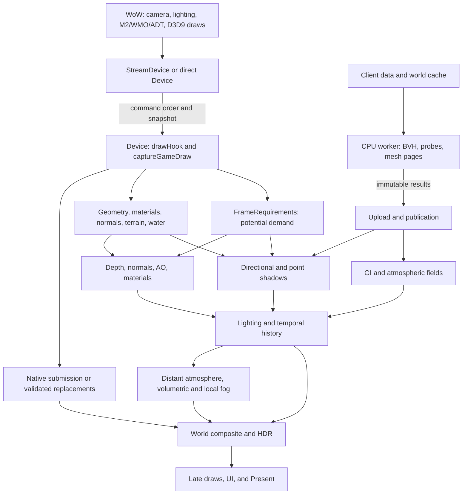

# Northlight architecture audit and refactoring plan

Snapshot from 19 November 2026 at `HEAD afa84414`. First establish a repeatable test with real frame data, then move state ownership out of `WorldRenderer` and `Device` and replace expensive paths one at a time. The latest game log points to material and capture preparation, the GPU normal pass at 2× MSAA, repeated draws in point shadows, and command queue waits. Each change needs evidence against its own baseline.

## 1. Existing implementation

Northlight is an x86 D3D9 proxy for WoW 3.3.5a. The game traverses the scene, selects visible objects, animates models, and submits native draws. With `CommandStream` enabled, the game thread records commands in order, mirrors some device state, and associates a context snapshot with each draw. The replay thread owns the device. The direct path runs without a queue. `Device` routes the four `Draw*` variants through `drawHook` and owns capture and the scene-to-UI boundary. CPU workers build the static scene, BVH, and probes from retained input versions. `WorldRenderer` receives their results, uploads resources, and runs effects. [Architecture](architecture.md) · [Draw adapters](../src/proxy/renderer.cpp#L4335) · [Command stream](../src/stream/stream_device.h) · [Workers and GPU passes](../src/world/world_renderer.h#L1530)

The diagram shows the relationships, and the exact order is set by the code `renderEffects` and `WorldRenderer::render`. Implementation already distinguishes between World, Menu and auxiliary objectives. `FrameRequirements` plans for a potential capture, and the readiness of specific entrances is checked before execution. This boundary allows for separate development of planning and resource contracts. [Need for frame](../src/core/frame_requirements.h) · [Entry into Effects](../src/proxy/renderer.cpp#L1464) · [WorldRenderer::render](../src/world/world_renderer.h#L5452)

| Problem | Actual status | What needs to be corrected |
| --- | --- | --- |
| Monoliths | `world_renderer.h` - 7 226 lines, `renderer.cpp` - 4 834, `world_effects.hlsl` - 2 129, `stream_proxies.h` - 1 781, `world_gi.cpp` - 1 583 The calculation excludes generated and outside sources and derivative tables. `WorldRenderer` already includes `.inl` for a number of effects and resources. | Remove dependence on overall privacy. Describe the point of entry, resource owner and check each module. |
| Communication map | Audit shows 230 entries in 11 Shader manifes, 228 unique heshes bytecode, 22 HLSL-file. 223 records have a lexical link from `src/`, 7 are marked for verification. | Link the Shader version to actual choice, register contract, object, resources, diagnostics and test. Allow search in both directions. |
| Recalculation and memory | There are already state mirrors, diluted shadows VB/IB, a total pool of images, runtime GPU-residence, pages and bags, static caster index, reuse of RT. The latest commies added re-use for AutoBump and point Shadows. | Measure the remaining CPU readings of constants and position checks, the number of GPU drow and the reasons for re-re-re-re-re-re-re-re-selections, separate from re-selection or downloading bytes. |
| Indirect integration | There is a world context and menu, an oral light with proven handoff, Shader specialization and M2 diagnostics 12340. A conventional opaque M2 can send the section's record to a specific queued draw on profiled frames. The references `NorthlightM2Draw::current` are published in the field of dispatch; there are no combat users of this recording. The existing handoff constant for standards is based on proof through a mirror, regardless of the M2 march. | Make a user-specific input from the tested native data: The benefits of the knowledge of the object and the benefits of removing the second GPU draw are checked separately. |
| Self-contained reception | There are strict runners, CPU contracts, hidden-development GPU-oracles, real MPQ-strings, and private chain trade + sidecar + stand DLL. GitHub Actions triggers `source`. A positive check of transport uses a specially written product. | Get the standard from this `Wow.exe`, check it on the stand and add a separate automatic run of the candidate inside an isolated client before publication. |

Sources of inventory and contracts. [Shader audit](../scripts/audit_shaders.py) · [Capture and buffers](pipeline-buffers-20261117.md) · [Recording M2](../src/stream/stream_device.h#L281) · [Dispatch generator](../scripts/generate_forwarders.py#L302) · [CI](../.github/workflows/validation.yml) · [Test stands](../tests/README.md)

## 2. Last game log

Used active `D:/Games/335_engb_mod/northlight-renderer.log` that was filled in during the audit. The cut contains 19 698 string, 3 896 240 byte, SHA-256 begins with `d3687cd9bc23`. Line 18 contains `source=11c309d23205…` which coincides with `source_identity()` the current tree and line in the set DLL. The set DLL corresponds to `renderer/frd9.dll` byte. `northlight-renderer.prev.log` refers to `75c4d4fe09b1…`. Comparison of assemblies requires the same load and settings. The current session used DXVK 3.1.1, 3840×2160, 2× MSAA and `RenderProfile=1`.

| Loga section | What you see? |
| --- | --- |
| Entry to Northrend, row 16923–17574 | From the first recording of the camera to the GI-atlas 3,141 s, to the readiness of static shadows 5,360 c. CPU Building 3,000 c. The mixed entrance window has p95 127,933 ms and maximum 609,066 ms. The response time and individual loading pauses shall be measured separately. |
| Effects included, lines 19101 and 19655 | Two consecutive windows of 120 personnel after switching on— 38,457 and 39,267 ms average, about 25,7 FPS on 240 frames. p95 through windows— 48,779 and 45,699 ms. Before turning off, there is a partial window on 93 frame with medium 37,620 ms. |
| Effects off, lines 18110–18559 | Full windows give 18,704–21,175 ms, about 47–53 FPS. In the off period there are limits to changes in settings. DLL, command flow, and HDR remain in process. The values are suitable for cost estimation and choice A/B without exact attribution of the difference. |
| CPU, personnel 19558 and 19685 | `captureNetMs` 7,48 and 8,10 (in thousands of ms. `MATERIAL_PROFILE.cpuExclusiveMs` 4,60 and 4,99 The clock is added to the area. 1,13 I'm looking for a profiler on these sampled frames. 875 Local position assessments, 1 210 `sharedBudgetSkips` and zero `reused` In the first frame, this job was not available, but it was not available. `captureNetMs` Whatever. 7,48 (in thousands of ms. |
| GPU, same footage | The entire GPU Interval 29,62 and 32,69 ms `GameScene` 17,38 and 17,32, `ModelNormals` 4,17 and 4,58, `Effects` 5,68 and 8,53, including `PointShadow` 1,56 and 3,60 ms `GameScene` active configuration interval, requires a separate launch for a net native base. |
| Normal, same footage. | 1 773/1 741 Packages, 1 210/1 208 draw after consolidation, zero nonomal `sourceReadBytes` and `upBytes`. 178 936/180 660 float4-registrations through bank path. Both attempts at a non-word MRT have been stopped from `target-msaa`. The material in these frames has read 53 016 and 0 byte of the source respectively. |
| Thin shadows, same footage. | 2 708/4 632 replay draw, 0/1 364 static draw, 0/72 rebuilt static lines. 1 336/1 338 replay boards are ready. The expensive sample has 54 moded and 18 facesWithoutCache. `POINT_COLD` CPU 1,24/2,99 ms. This argument measures refresh and the cost of shipping even after successful crowding. |
| M2, same frame | 3 143 out of 3 206 `ordinary` in two Samples, about 98%. 198 palette tests without difference. 18542 - 664 out of 984 early cold frame: the amount to be counted in draw classes and phases; 98% refers here to the conventional M2 selected. |
| Line, Game Frameworks 19614–19733 | 50 recorded `CSTREAM QUERYFRAME`: the median of 21,14 ms total expectation, 16,97 ms to replay and 4,13 ms inside replay. These lines measure the selected quary treep and the phases may overlap with other frame work. First determine which critical-path relationships delay replay and end EVENT. |

Medians and ranges CPU/GPU above describe two frames after the effects are activated. Frame time, CPU-spans, GPU timeamps and waiting quary refer to intersecting scales. The calculation of the winnings requires a total frame time in a pair run, and the explanation is that events are linked by producer framework, replay framework, performance epoch and sequence. In the windows turned off, time is already higher than 16,67 ms. The purpose 60 of the FPS in these settings requires separate and navigative measurement, and the overhead costs of the proxies. [Log of the current session](<D:/Games/335_engb_mod/northlight-renderer.log:16923>) · [GPU and CPU shots, 19685](<D:/Games/335_engb_mod/northlight-renderer.log:19591>) · [Meaning of budget controllers](architecture.md#remaining-architectural-work)]

## 3. Segregation of monoliths by owners

| Step | First Selection Point | Contract and acceptance |
| --- | --- | --- |
| M1. Boundary `Device` | To remove logic/diagnosis and load backend/resources into stand-alone units, then select draw preparation, capture and coordination of effects around existing `drawHook`, `captureGameDraw`, `renderEffects`. `Device` holds COM-interface, boundaries `BeginScene`/`EndScene`/`Present` and reset. | For each of the four adapters, save arguments, result, order of terrain ♪ material ♪ normals ♪ world water, life of uP memory, raw/wrapped challenges, fall fallsback, state after call and one perk submit. `test_draw_orchestration*`, `test_capture_handoff`, `test_saved_state`. |
| M2. Peace publication | With `WorldRenderer::work` select request/cancellation/publication, separate the stage of construction of existing `WorldMeshUploadPlan` and BVH/test. From `upload` take staging and committee resident mesh, keeping `mesh_buffer_store` and current plans. | Worker reads unchangeable entrances, D3D calls remain the owner of the device. The old result is held to safe replacement. Check a repeat attempt after failure of alllocation, map switch, cancellation, steel publication, separate readiness of the GI and static shadows. Compare digest pages and the result of x86 stend at pressure to address space. |
| M3. Passage owners | Start with `world_point_rendering.inl` and point Shadow resources, then directional/actor Shadows, lighting/temporal, fog, composite. Take into account existing `world_screen_resources.inl` and `world_geometry_resources.inl`. `WorldRenderer::render` becomes a plan of how to perform, enter, prepare and deliver. | Each owner obtains narrow parameters and resource representations, controls create/lost/reset/trim. to divide the common `releaseGPU` and state restore by owner, checking the partial creation. After each selection, compare draw orderer, bendings, tags, fallsback and images. |
| M4. HLSL and queue | Once the connections are registered, divide the family `world_effects.hlsl` into logical parts distance/normal helpers, lighting/GI, fog, temporal/composition and Shadow entry points. In `stream_proxies.h`, distinguish by the lifetime boundaries VB/IB, image locks, query/resource finalization when the relevant subsystem is modified. | Save entry points and number of options, compiler pin and relationships includes, profiles and registers; cross-check bytecode. If different, check ASM, numerical result and GPU Oracle. To check the command order, HRESULT, Reset epoch, release/retire, mutations, and present conclusion. |

Start with moving the logic and mechanical re-establishment of the test links. The addition of a new `.cpp` takes into account the clear list of TU in `build_renderer.py` and the hard fix. The individual composition introduces behavioural change or optimization. Decomposition criterion - the correction of one passage is located in its files and tests, and its entry and ownership of resources are visible without reading all fields `WorldRenderer`. The size of the reference frames and the number of common `friend`-accesss to be used as indicators. One holder `WorldRenderer&` in all new modules will move to the current model `.inl`. [Selection points](../src/world/world_renderer.h#L1530) · [A clear list of TU](../scripts/build_renderer.py#L195) · [Taking order](../src/proxy/renderer.cpp#L2052)

### M3. Purposes of point shadows

`NorthlightWorldPointTargets` has active cubes preserved by static edges, common R32F target, D24S8-buffer and neutral texture. It creates targets for heating and ordinary passage, releases them and lists them for memory. The personnel coordinator selects the lamps, selects the heating budget, records the cause of the malfunction and binds the surfaces in the same order.
[Point Shadow Target Owner](../src/world/world_point_targets.h) · [Order of accesses](../src/world/world_point_rendering.inl)

The initial warm-up takes prepared goals and sheaders, performs three closed draws and restores the original D3D9 including full constant banks. One `GetData` from `D3DGETDATA_FLUSH` sends preparatory work. Readiness of the cube publishes a regular passage. [Warming up when the device is created](../src/world/point_pipeline_warmup.h)

`FacePass` Provides static casting agents, cached terrain
It binds the materials and returns the filters after
He notes the use of static masks for live terrain
The index cut to the first draw and returns the static declaration
Coordinator continues to select lists and
Only the completed line is published. On DXVK before and after, depths were matched.
All six sides and the number draw in eight scenarios.
On 22 shots, the repeat recovered the reference depth.
The Dalaranas have retained the Grapes, Triangles, and Post Reset gifts.
[Fitting the geometry of the border](../src/shadows/point_shadow_face_pass.h)

`NorthlightWorldPointLighting` owns hard and soft sheaders
Point Shadows and Sends a screen correction.
constants and picks the published cube. The owner binds textures,
Apply the correction and remove the scissor.
The DXVK matches the 70 track of teams and 70 hashs.
Three entry failures verified
D3D9 Reset with
conservation and rebuilding of resources, including rejected Reset and
Two successful attempts in each mode.
[Screen correction of point shadows](../src/world/world_point_lighting.h)

### M3. Actors &apos; shadows

`NorthlightWorldActorShadows` Creates depth and time maps for each
The module fulfils the requirements of this standard.
Two-stage construction of the taylons and separate resolve. `WorldRenderer`
plans replay casters with a nearby cascade and chooses common or
When memory is reduced, textures are released and when memory is reduced.
The Shaders will be re-created as well as the Actors.
[Actors' shadow resources and passageways](../src/world/world_actor_shadows.h)

### M3. Cascades directed

`NorthlightWorldDirectionalTargets` Manage final maps, static
Cashem, a common time buffer and maps of the nearby cascade environment.
The module combines depth and identifies objectives through the overall budget
Geometry. `renderDirectional` Prepares static plans and caster lists,
Selects cascade goals and actor cards, publishes finished maps and completes
Background objectives `NorthlightDirectionalShadow::GpuPass` relate the objectives and
Time depth, send terrain draw and return the nearby cascade
The frame entry point uses the time of passage for the budget
Point shadows and receive profile counters.
[Resources of sent shadows](../src/world/world_directional_targets.h) · [Painting directed shadows](../src/shadows/directional_gpu_pass.h)

After the standard, the coordinator builds the actors' secrets and picks the general passageway.
or separate mask. `NorthlightWorldDirectionalVisibility`
screen target, Shader pairs, re-allocation and recovery
Once the general passage has failed, the coordinator restores
The light selects the sheader by resolve and fog
Reuses the secrets.
[Conspicuity holder](../src/world/world_directional_visibility.h) · [Order of accesses](../src/world/world_soft_shadows.inl)

### M3. Screen fog

`NorthlightFogScreen` Owns, creates and
A drop, a history resolution, and two rifts.
`renderAtmosphericFog` Checks both sources before entering volume
Atlas, re-uses the finished atlas or triggers a Raymarch screen.
`NorthlightAtmosphereCommands` Ties up the cast card and the noise,
Cloud painting, restores lighting after Raymarch and atlas.
Staff Coordinator allows history, adds lamp fog after
The blurry and transmits the compositions to the current image and flags of history.
In the DXVK tests at 0× and 2× MSAA, there was a match between 54 command records and 48 hashs
Atlas failure, raymarch transition and recovery check
After a draw error.
[Owner of screen fog](../src/world/world_fog_screen.h) · [GPU teams](../src/world/world_atmosphere_commands.h) · [Atmospheric passage](../src/world/world_atmospheric_fog.inl)

`NorthlightWorldForeverFogShaders` Owns 10 sheders imported
Raymarch. The basic version is loaded with fog screen resources.
Options for transition, shadows of actors and noise-free mode are created at the first
The owner checks the device's capabilities, chooses
The backup option for failure and releases the sheaders on discharge.
[Choosing a Shader](../src/world/world_forever_fog_shaders.h)

`NorthlightWorldMoonFloorFog` Prepare texture of heights and six options
The module chooses the base passage.
When it is not available, and returns the scenes after draw.
The personnel coordinator checks the relevance of the long cascade and transmits
Regional field published [Passage of moon fog](../src/world/world_moon_floor_fog.h)

### M3. Shader personnel constants

The personnel module prepares total constants, including the previous type,
Game mist and horizon smoke parameters.
Clouds before launching a mist of spells and loading c0–c67 once
With the basic textures. The light and fog passways use the same array.
for partial restoration of the constant.
[Staff constants](../src/world/world_frame_constants.inl)

### M3. Final composition

`NorthlightWorldComposite` controls SDR and HDR sheders, intermediate
with a color buffer and a stencil mask.
Combined passage of materials and separate passageways for
surface areas without lighting and with baked lighting. `WorldRenderer`
transmits the textures of the frame, orders the passage and stores the blocks.
Re-establishment of the device.
[♪ The song owner ♪](../src/world/world_composite.h)

### M3. Lighting history and distance

`NorthlightWorldLightHistory` Owns pairs of light images and distances,
Checks the compatibility of the previous frame and changes the entries after
The module performs smoothing and temporary accumulation.
`WorldRenderer` Sets the passage order and transfers the previous distance
In a reprospection of fog, the current light is in composition.
[Owner of History](../src/world/world_light_history.h)

`NorthlightWorldNormalsPass` Owns screen target and two options
He writes the current one for smoothing if necessary.
The distance to the target that the story of lighting transmits.
`NorthlightWorldScreenLighting` Draws direct light and GI. He owns sheders,
direct and basic light objectives and an additional target for baked
The personnel coordinator transmits the data to the temporary passage
before the direct light objective is re-used by local sources.
[Normal.](../src/world/world_normals_pass.h) · [Screen lighting](../src/world/world_screen_lighting.h)

Local lighting re-uses the direct light buffer after temporary
Screen lamps, point sources and flashes use a sample
The frame and retread the common straps in front of the fog.
The same sample of lamps accumulates light in the previous unit of light history,
and the luminance limit applies once to the sum.
`NorthlightWorldLocalLighting` Owns chader lamps, diagnostic target
The coordinator gives him the surfaces,
In the event of a discharge, the owner shall release
and removes the prohibition of reloading the optional sheader of one lamp.
[Lamp Passage Owner](../src/world/world_local_lighting.h) · [Order of accesses](../src/world/world_local_lighting.inl)

### M3. Discharge of passage resources

`releaseGPU` Coordinates stopping of background tasks and causes release
In the event of a failure to comply with the requirements of this Regulation, it shall be possible to obtain from the holder of the vehicle the light, standard, fog and shadows of the passers-by.
Geometry allotations operate as a separate target-dumping route, which
Saves screen images. A complete discharge also purifies the sheaders.
Shadows and history.
[Dumping procedure](../src/world/world_renderer.h) · [Geometric objectives](../src/world/world_geometry_resources.inl)

### M3. Condition of the device

The shadow module sets the target baseline and depth.
Prepares full-screen straps and neutral light to build the distance.
The fog binds the cast cards to its source.
Regional field in s13 after drawing or failing.
Refurbishes the active outer area on the same device, otherwise
The passage keeps the state on its own.
[Status area](../src/proxy/saved_state.h) · [Music](../src/world/world_composite.h)

`NorthlightWorldFlashShadows` Owns cascade slots, sheader of correction,
The cascade teams tie the material,
Geometry pages and live terrain buffers draw selected world ranges
and select a pixel necker for replay. `WorldRenderer`
Total depth, boundaries of the position and the range chosen.
Only a pair of fully shown maps is available.
The order of the links and draw, failure to create a second map and frame after Reset.
DXVK pair runs and D3D9 system runs kept the same order.
Commands, two indexed draw for a couple of maps and one draw correction
The Hash cards and the result of the correction match.
The Dalaranas were matched by ten raw boobs of color, depth, normality and HDR,
as well as the tested edges of point cubes.
[Owner of shadow flashes](../src/world/world_flash_shadows.h) · [GPU Fixture](../tests/test_flash_shadow_gpu.py)

`NorthlightWorldShadowTransition` Maintains maps of the previous static
Cascade, current dynamic castes and transition sheikers.
A copy of the old cascade and a reference to both epochs. `WorldRenderer` selects the moment
Crossover, compute the offset of the copy and check the available memory.
Four cascades and two eras coincided with the initial order of command,
Restriction and recording of allocation and records preserves normal
Cascades.
[Transition owner](../src/world/world_shadow_transition.h) · [Recording of Commands and Failures](../tests/test_shadow_transition_resources.py)

`NorthlightShadowPalettePass` owns a common in-house draw for
Point shadows, point shadows, and actor's shadows.
The block of copies and the time-frame for re-allocation.
And they drop their caches and the constant after an in-formed draw.
The GPU DXVK and D3D9 system fitters, behaviors
In the case of caster closures, 14 failures and post-dump recovery.
[Owner of the pill](../src/shadows/shadow_palette_pass.h) · [GPU Fixture](../tests/test_point_palette_gpu.py)

`NorthlightPointShadow::FacePass` Adhesives and cleans one
A series of cubes, caches of material and depth combinations.
`WorldRenderer` Select sources, draw up prepared lists
Caster and published the finished cube. The recording fissure checks order.
Commands, failure to select the static edge, switch between MRT, copy
and integration, and re-linking for new application.
[Passage holder](../src/shadows/point_shadow_face_pass.h) · [Command fixation](../tests/test_point_face_pass.py)

`NorthlightWorldFogField` Owns the loading of regional density and altitude
Fuzzy border, save reference to loaded publication and bind
textures to s13 and s12 in front of the atmospheric passage.
The textures of heights are preserved by the main raymarch.
Releases both textures and postpones a repeat for a second. `WorldRenderer`
Chooses a map publication and transmits the change of field to the moon pass.
[Field Owner](../src/world/world_fog_field.h) · [Command fixation](../tests/test_world_fog_field.py)

`NorthlightShadowReplay::Pass` Performed draw animated
Castors for cascades, maps of actors, flashes and point faces.
Caches of reference and projected constant, restores source index
The buffer when the combined failure occurs and drops caches after a palette draw.
The selection, consolidation and publication of maps shall remain at the appropriate passageways.
[Send Draw](../src/shadows/shadow_replay_submit.h) · [Command fixation](../tests/test_shadow_replay_submit.py)

Local area `GpuPass::CachePass` updates static
The cascade cache. It peels the selected rectangles before turning on the scissor,
Saves the chaining order and shuts down scissor at any exit.
All or part of the updating and publication of the key remain with the cascade.
[Cache Pass](../src/shadows/directional_gpu_pass.h) · [Command fixation](../tests/test_directional_gpu_pass.py)

### M4. Command line

From `stream_proxies.h` the lock and lease of buffers VB/IB, condition and
images sub-resource downloads, image adapters, queries and completion
Proxie's life. `StreamCore` Keeps total budgets and a line.
and release after callback stays in `replay_thread.h`.
[Limits of ownership](architecture.md#runtime-contracts)

### M4. Peace Shaders

`world_effects.hlsl` is divided into 11 modules by way of passage.
Transit dependences for World, Shadow Transport and Fog Volume. 91
The compiled version, their ASM and three headings coincided with the original assembly.
[The boundaries of modules](architecture.md#shader-and-resource-navigation)

## 4. Map of Shaders, Facilities and Resources

Broaden `scripts/audit_shaders.py` and its JSON. The compilation templates remain the source of enry, target, include hashes and bytecode hash. From the existing ASM to actually read registers and sampler slots. The location of the Shader entrie, the role of each resource, the conditions of performance and fallsback are attached to the owner module. For conditional and dynamically collected connections, use the declaration next to the relevant binder or factory, then cross-check it with sample observations from human resources. Current species `runtime-reference` shall be stored as a degree of evidence. [Audit script](../scripts/audit_shaders.py) · [World shader manifest](../shaders/world-shader-build.json)

| Recording | Minimum fields |
| --- | --- |
| Shader and option | Source and includes, entry/target/hash, generald symbol, ringime factory/caller, hard copy and chain patch/assemble, terms caps/quality/domain and fallsback. |
| Draw and object | M2 conventional/group, WMO, ADT, water, particles, scy, UI; chader family and verified capaciities; section/range, alpha/depth and deformation mode; World/Menu/aux; evidence by which an object can provide access. |
| Passage and Resource | Stage and owner, need/preparedness, read and recorded entrances, slots, constants, format and resolution, sample account, area of life and reset, history, aliases and recovery points. |
| Verification | Identifier CPU/GPU/trace oracle, negative scenario, diagnostic precursor or identifier, reference to definition. |

1. Start with vertical cut `M2/terrain → material + model normals + world depth → WorldNormals/WorldDistance → lighting/history → WorldComposite/HDR`. Second cut cover `M2/WMO/ADT → directional/point`, third cut cover: fog, water, weather and scy. Activate AO-only, fog-only, Menu and MSAA modes where the input manufacturer changes.
2. For the first cut, make two requests for a single report. `WorldCompositeHdr` Get upstream, options and tests. For M2 section or ADT, get customers, tolerances and fallsback. From the same report, generate Markdown/Mermaid to `fp.output_dir()`. B `docs/architecture.md`, if implemented, leave a level 1 map and navigation command.
3. In `source` check resolution entry/resource/test IDs, lack of complete links, coverage of selected families, Shader hashes match and compatibility of slots. in GPU/trace check actual related sampler/RT, performance report, MSAA, option and order. Observations mark the assembly version and dynamic options the reason why they are allowed.

The second cut connects M2, WMO and ADT with cascades, character map, and
Point cubes. For common entry, the map shows links in each
Audith can attach the results of Dalaran's replay with cascade hashs,
Local light and cubes on the selected Precents.
[Audit teams](architecture.md#shader-and-resource-navigation)

The third cut connects fog, water, weather and sky to the composition.
Particle options and UI are visible. AO-only, fog-only, Menu and 2× MSAA
The data show the selected resource producers.
for water, weather and the sky map
So far, it's based on C++ and ASM.
[Audit teams](architecture.md#shader-and-resource-navigation)

An example of the reason for a detailed map - `WorldDistance` in fog-only and `WorldNormals` in lighting can become producers of one R32F history pair. The change of the owner throws history away. After temporal resolve, `light` passes local light, and those familiar by different names texture and surface refer to the same allition. The name of the variable or match format does not define the right to reuse. [Resource contracts](architecture.md#runtime-contracts) · [Real aliases](compact-captures.md#pipeline-buffer-audit)

## 5. Reuse by type of work and time of life

| Order | Change | Condition under which the modification is adopted |
| --- | --- | --- |
| R1. Show repeated work | On one `device + epoch + frame + draw ordinal` for materials, standards, world replay and shadows, compare eligibility, source of geometry, range versions, requested bytes and float4, estimates of bows, number of individual draws. For CPU/GPU, store live bytes/high-water, pool expansion, performances, lege eg and expectations. | One report shows which work is repeated, which entrances were switched and which user was holding the resource. Heavy auditions are launched separately from performance. |
| R2. Share what has already been read | Extend existing `CaptureSource`/snapshot handoff to one draw. Reuse decalarization, checked span mirror, resident VB/IB, immutable section and results only with a matching key. Segregate the compact hot-head of the package from the demand-driven payload held up to the last consumer. | Less than `bankReads`/copyed registers, repeat classification/bounds and extracts at the same entrances. |
| R3. Reduce the shadows | Use the already published Static Caster Index and existing cache keys. Attribute `facesMoved`, `facesWithoutCache`, changes geometry/content and refresh rate. Separately check static and dynamic boundaries, continue accurate coalescing/instancing where positions, clipp, alpha and order of recording coincide. Measure `ShadowRefreshCpuMs` and compliance with permissible limitations. | Identical depth coverage of all six edges and current actors on fast motion, less replay/static draw or rebuilds at the same set of sources, projection, range, resolution and frequency of mandatory renewal. Measure separately many fixed lamps, moving light and cold change of zone. |
| R4. Make memory predictable | For `draw_snapshot`, `scene_native_store`, VB/IB the confirmed second CPU copy with known GPU ownership and absence of a CPU reader. Reuse stagging in compatible size/format and completion. Resource groups remain lazy. | `DISCARD`, `NOOVERWRITE`, `ProcessVertices`, GPU organisations, `Reset`, resissive, presure and re-use of addresses give a correct version. Compare x86 free span and resident/retired bytes and time cold recovery. Check that there are no new expectations on the warm path. |

The keys are semantic. The unchangeable geometry depends on the source, ranges, layout, generations VB/IB and section/LOD versions. This is a copy and position depending on the generations of model and frame, selected palette and appropriate strings, and view-space backgrounds also depend on camera and numerical mode. The history and resources of the GPU are determined by frame/device epoch, target parameters and completion of the last command. For unknown write, incomplete palette or missing entry, use the current proven path. Separately control CPU geometry for GI, weather and fallsback. [Photo pool](../src/world/draw_snapshot.h) · [Resident source](../src/replay/scene_native_store.h) · [Bounds](../src/water/material_skin_bounds.h) · [CPU/GPU owners](cpu-gpu-ownership-20261117.md)

The first audit of R1 is started on a saved track through
`replay --capture-work-frame 282` The report `capture-work.json` binds the bags,
Cash images and re-use for three customers each draw.
The report contains queries and a float4 standard.
Include entry into cache. Audit VB/IB records actual calls
`Lock` and ranges served by the CPU command flow.
The events are the consumer, the type of buffer, the displacement and the length.
The range on the same draw is considered separate. Diagnostics are linked to
The selected World Present is started separately from the measurements.
[Audit of captures](../scripts/northrend_capture_work.py)

On the warm set 282 Dalarian collected 2 354 draw. 1 014
The normals have received 879 geometry gears,
And the capture of shadows 1 143 The budget of the images was written down only in the seizure of shadows,
where there are 1 422 hits and 0 cash gaps on this frame.
On 175 drow, both material and normals recorded range verification
Equal access to these checks requires separate reconciliations.

In R2, ModelNormals uses the lines already read.
a bank of materials when the range is covered and the period of recording is consistent with
Locking the mirror of the device. The result of the boundary check remains with
On frame 282 Dalarian at 3840×2160, 2× MSAA and 12:00
On 35 draw, the same requirements for the mirror are replaced by reading 245 float4 from the bank.
Of the 278 test run readings, the remaining 33 came from three draws,
The number of times we're running is different.
The recorded bags of ModelNormals are equal to 927 in each run.
[Checking on the stand](northrend-baseline.md) ·
[Range check](../src/proxy/model_normal_range.h)

R2/R4 Shadow records select the float bank on first reading and hold
A common bank in a verified era or line.
On the 254 Dalaran track with 128 players at 4K and
2× MSAA has 1 434 packets left 788 separate float banks.
Data decreased from 5,60 up to 3,08 MIB. The counter takes account of the constant lines.
The limits of the free-recording pool include:
The banks left in it.

In the first pair, the final colour varied by 23 pixel in Present 290 and by
90 in Present 298. Repeated control DLL replayed in relation to the first
The same discrepancies and the same switchover of one blaster between the nearest
A cascade and a map of the actors that the candidate showed you.
Color, depth and proven edges of point shadows
The distribution of the caster between maps is reproducible
remains a separate task T2. [Owner of banks](../src/world/world_renderer.h) ·
[Checking Time of Life](../tests/test_model_replay_pool.py)

In R3 replay point shadows store a bank of vertebrate constants for the time of drawing
Change of border requires re-excuse the projection.
updates known c0–c3 values and instansing drops the cache after recording.
The meter `POINT_REPLAY_STATE.constantBytes` measures the amount of data,
Constance in challenge.
On frame 254 Dalaran with 128 players at 4K and 2× MSAA six edges and 259
Replay draw demanded 445 952 byte instead of 450 688.
The shadows were shut off in both runs.
They were beaten between the assemblies on frame 290 and 298.
[Comparison on replay](northrend-baseline.md)

In the test run N3 for 22 warmed-up Present, same point stage
The shadows were updated from 6 to 24 sides, midway 12.
266 to 877 replay draws, midway 449. Static, terrain and live drows,
And the re-assemblies of static lines gave zero for all 22 frames.
`POINT palette` Recorded 175–176 reference packages passed
Test of the palette, frame and zero in-line calls.
R3 compare physical drow by sides, GPU time and cover
with the same sources, geometry and update schedule.

The diagnostics after selection checked 234 updates to the edges on 22 frames.
Among the 15 859 non-transparent indexed handouts to the WMO by print
Source assigned 13 444 to skinned M2 132.
A complete match between GPU and index range was not met.
Even before the compatibility requirements of the palette.
Instansing of point shadows was left without groups.
measure the entrances before the draw association.

Standing experiment R3 checked the re-use of the already drawn
A pair on one DLL
cross-check 22 There's a six-step match on the eight frames.
Replay draw was 259 instead of 438 and the median of the GPU-time pair difference
`PointShadow` -0,172 ms. Total missing 1 432 Draw.
The mid-point of the pair difference was -0,002ms. This is the measurement of the passageway.
In a separate comparison of 4K, 2× MSAA on Present 290 and 298 beaten
The same color, depth, normalities and verified edges.
Checkpoints are collected in a separate profile.

In a repeat on the fixed Dalaran route, the straight line was zero.
Allowing boundaries with fixed static map and MIN
blinding allowed the use of 90 finished edges on 12 of 22 President.
Median replay draw was 408 ♪ 241, missed 2 493 across the window
On Radeon at 4K, MSAA 2× and SDR the median of the pair interval difference
`PointShadow` -0,645 ms, CPU input -0,043 ms. 22 The shots are gone.
Checking the number of edges, logical packages and triangles with account taken
On Present 244 and 270, the re-check was broken 36
The depths of R32F from the reference and optimized runs.
re-used 18 Once checked, the mode is on game option.
DLL `NORTHLIGHT_POINT_OPAQUE_REUSE=1` Flatboard flag
`NORTHLIGHT_RETRACE_POINT_OPAQUE_REUSE=1` saved.
[Verification of re-use of boundary](../src/shadows/point_opaque_face_cache.h)
The lines with cutout and skinned cassettes continue to be updated in this mode.
It's just the usual way.

On the next run, Dalaran with 128 NPC is a fixed, non-transparent part.
it's a match to 162 It's just a little bit more of an update on mixed lines. 11 859 Basic packages
For 22 frames, before draw groupings.
This is the part in R32F, and it puts on the remaining casters with MIN blending.
On 19 comparable shots A/B per DLL at fixed noon,
4K, 2× MSAA and SDR mid-point of actual replay draw taking into account filling
cache reduced with 408 up to 184I've been shot for this footage. 4 465 Sent.
The two-way difference was -0,673 ms GPU and -0,030 ms CPU pump.
Present 244 and 270 were hit by all 36 depth maps.
are excluded from the time measure due to readback. 254 different
It's a single source package of ModelNormals, so this frame is also excluded.
Operating mode `NORTHLIGHT_POINT_MIXED_REUSE=1` limited to the boundaries with
a static map where the normal passageway already uses MIN blending.
The straight-taped boundary retains the same D24 permit procedure.
The owner keeps up to 32 R32F textures, takes them into account in the memory of shadows.
and releases at Reset and Trimming.
Recording remains a normal card, and if copy failed,
The line is updated by a full list of casters.
The DXVK GPU stored the depth when alling failed, copying failed
from cash, copying to cache and drow after recording.
Release and refill the cache.

Couple running the track through `--point-mixed-reuse` on Radeon
cross-checked the load of all 22 human resources.
Two images of maps being unloaded on the remaining 20 median physical draw
with a cash count of 408 ~ 184, all removed 4 689
The Median of the parity difference `PointShadow` was -0,581 ms GPU
and -0,065 ms CPU-supplied. The depth of all 36 discharged edges coincided
hit. [Cash owner](../src/shadows/point_mixed_face_cache.h)

On the same 22 frames, the bench measured the surface of the forward-looking AABB edges
When comparing 210 updates on WMO geometry, current
and the previous rectangles of the remaining casters covered all 256 tiles
Partial updating with such boundaries does not cut off WMO.
The surface model will open the rectangle to the full edge at
at the threshold of positive `w`The result relates to AABB,
and does not measure the coating of
The handout counters, after the transfer of the palette owner, were matched.
With a control track on all 22 frames.

On the same lists, they estimated an increase in the capacity of the index range package.
The transition from four to four is constant and fully compatible
The range was reduced by eight by 71 per 22 frame.
The evaluation allows ideal accommodation and does not take into account the download budget.
The bound cache still holds a four-band limit.

Prototype allowed to copy discrete ranges from different groups
Capture in one index buffer when reading lines match rigid position.
On 22 Dalaran pairs at 4K, 2× MSAA and SDR he did not add any
One association. Median point replay draw remains 408, median
The GPU pair difference was +0,021 ms. Edit was removed from the working tree.

The other R3 route combines adjacent untranslutable rigid ranges
They may belong to different buffers and sheader.
Groupings if the whole bank matches lines that read
The top sheader after the cube projection has been set up.
One DLL combined 624 ranges on 22 pairs.
dispatches decreased from 438 to 408, the pair difference of GPU-time
`PointShadow` was -0,067 ms. Working implementation calculates
A mask for registration of a finished top chader.
and the logical load counters are stored.
On Present 290 and 298 the prototype combined the pairs of 18 pairs.
Normals, linear HDRs and tested boundaries were beaten.
Implementation of 15 personnel has coincided with the timetable and composition of the lines.
396 shipments with the same median 438 . 408.
The result of this run is used.
for metering, and clear measurement and reconciliation of the working DLLs are waiting
Free device.
[String mask](../src/shadows/point_rigid_pose_rows.h) · [Checking constant](../tests/test_replay_capture_constants.py)

On Radeon in SDR, separate A/B on one DLL until static cache transport
Checked 22 warmed President Dalarian at 4K and 2× MSAA. Number of edges,
Basic packages and triangles
The Median of Sending Point Shadows was 449 416, all removed
774 draw. the association counter on the lines read gave 708. He only thinks
Transitions between different banks of the constant.
`PointShadow` was -0,035 ms. This is the result of SDR on Radeon.
requires an adapter with a scrGB operating chain.

In R3 directed cascades and card of actors combine up to four
They use index ranges without rearranging triangles.
Same packing plan and index cache limit as point shadows.
On Present 254 Dalaran with 128 cascade players reduced 332 draw to
327 and the map of actors 531 up to 530. The composition 1 201 of the package and 586 494 triangles
The five combined calls covered 19 ranges.
The buffers have grown from 41 478 to 160 314 byte, on this frame all the buffers are taken.
from cash. [Replay counters](northrend-baseline.md)

In the re-profile, there was a convergence of directional shadows on 10 of 21
The candidate took out 5–8 draw on a match.
The GPU pair difference mediaian is timed.
This passageway was set at -0,38 and -0,87 ms. CPU delivery time in the series
The evaluation was varied, so the evaluation relates to the work and GPU time of the bench.

Early Checking the Position Borders at ModelNormals checks the declaration through the mirror
A picture of the material holds a reference to the declaration.
If the mirror does not know the current reference, the check uses a normal getter.
The stand considers both tracks separately and maintains the standard buffers for A/B.
[Comparison procedure](northrend-baseline.md)

Capture of shadows M2 uses four lines of projection from the same bank
The tolerance shall check the coating of lines and the relevant age under
Locking the mirror of the device. On Present 282 with static GI both
The run was run at 2 354 draw and accepted on 1 256 packages
Out of 1 419 getter calls for projection, there are 345.
The reference colour and the standard boobs match on both frames.
The final HDR color remains open. [Mode A/B](northrend-baseline.md)

In R4 the tolerance of full CPU copies VB/IB for partial readings of large
On the Dalaran route, both orders A/B gave the same
The counters on each of the 21 measured frames.
The number of shots dropped from 15,17 to 12,57 MB. to frame 290 total size
The blocked ranges decreased from 38,00 to 36,19 MB with an increase in number
successful `Lock` from 1 790 to 1 851. On heated frames 274–290 meter
The reading remained constant in both modes.
I've changed between repeats in both directions.
[Comparison Commands](northrend-baseline.md) ·
[Copy Owner](../src/proxy/replay_copies.h)

In the game log of 20 November 2026 year, 35 completed series `alpha-target` are recorded on 2 459 frames after the target space protection has been activated. The longest was 13,2 s. When entering pressure mode, the Render released the working surfaces for the native accuracy of the alpha test, after which the growth tolerance could have refused to recover them. Now the surface that has already been identified stays at the shadow passageway to Reset. If a new allion is refused, the guided maps are suspended and screen lighting, GI, local light and fog continue to be displayed. Uncompleted card is not published. Fully recorded static caches remain available on the next try.

In R4 smoothing buffer and sheader `RemovalSmooth` shall be removed at tolerance
The fog can separate the same buffer for its history.
And blurry, no matter the shadows.
This takes away one RGBA16F target size
1920×1080 When drawing 4K, or 15,82 MIB of nominal texture data.
[Allocation of screen resources](../src/world/world_screen_resources.inl)

In 18 full windows of the same log, the median window p50 is 26,52 ms, p95 36,04 ms. After the first failure, 20 samples give the median of GPU `GameScene` 16,76 ms from 19,33 ms and CPU capture 4,36 ms. World passage in these samples is often missing due to failure. In 44 separately recorded slow launches, the median effects of the CPU sections are 3,03 ms for point shadows, 2,77 ms for loading and 2,28 ms for a long-range cascade. `GameScene` includes the delivery of the reference stage and built-in passage, so the range does not in itself attribute the entire GPU-cost of the sheikers.

## 6. Engine integration and GPU reduction

1. **N1. Bring normal M2 from diagnostics to consumer.**Start with one function - selection of previously proven immutable section/range for AutoBump or model normals. Tie the result to a specific command and generation device/model/skin. Use the relevant set Gx/D3D bendings and exact range; take the lines of the palette from the confirmed orderd state. Through the sequence, transmit values and hold references. First the mode of comparison with the current way, then the choice of the result for the supported subset. Count eligible/matched/consumed/fallback and reasons on the menu, warm world and cold download, separately measure the producer and replay. Check the range matches, palettes, material/coverage and images before and after the re-use of objects.
2. **N2. Increase the proof by actual load ratio.**First measure how much costs are incurred on grouped goods, Alpha test, skinned/rigid M2, WMO and terrain. For grouped M2, prove multi-instance palettes, sections and order. For WMO/ADT take the identity of a trained batch and bows by the right owners. Visual list cameras are useful for the receiver pass; casters behind the screen remain in a specialized selection of the volume of light. The client's options, unconfirmed Shaders, dynamic/UP, projected, ribbons and parties, pass through the previous D3D9 path before adding their evidence. Each contract requires a negative signature, ring, state or generation test.
3. **N3. Reduce the GPU replay standard.**Existing native MRT first check on AA0 and determine the proportion of the norm that it maintains with the same alpha/depth control. Then play 2× MSAA separately. The experience of previous MSA experiments provides benchmarks for boundaries and value. Compare the existing delayed replay with the proven acronym packet/draw and, only if the backend is compatible, to the capture during the native draw and correct per-sample reolve. For fast path, you need the same silhouettes, materials, depth range, occluder order, correct stencil/UI and fallback. Net savings are accounted for by the additional MRT bandwidth, resolve and state changes. GPU wins are also possible without expanding semantic adapter, so experiments can be measured separately.
4. **N4. To select the critical path line.**To mark the producer record/publish, wait barrier, replay projection, backend `GetData` and wakeupps. On the same draws, compare the times of publication with the depth of the line and p95 delay with baseline. Check one parameter at a time — the moment of publish to the known synchronisation, the amount of preparatory work, the footage in line, and the restriction of spin. For confirmation, save these EVENT/OCCLUSION results and order device-loss/reset; acceleration shall not be obtained by false willingness or omission of mandatory draws. Discouraging both active `QUERYFRAME` and separate empty turns. Measure the cell and load the CPU along with p95 frame.

B N3 checked the packaging of separated index ranges of neighbouring countries
ModelNormals packages left single after the regular association,
when the VB coincides with the state of capture. 22
President Dalarana with 128 players at 4K and 2× MSAA candidate counter and
The number of new associations was zero at 2 870 packages per frame
Control sent 2 235 draw, experiment 2 252. Medians of intervals
The GPU was 4,93 and 5,36 ms. The comparison shows that this method
The difference between the regular association's counters does not reduce work on the track.
does not allow the difference to be attributed to the new package GPU time.
The experiment stayed on the stand.

A separate audit of ModelNormals on the same 22 Present found in each frame
609 Combinations of adjacent packages with identical resident VB, IB and index
Of these, 537 connections in 44 series have passed through
Comparison of the outside position of vertebrate constants c31+ and absence check
Samples of texture in pixel chader.
There was zero. Only two connections were in recognized class `Single`.
For the rest of the 535 you have to prove the exact range of the Bytecode palette.
Actual reduction draw and retention of surface
are checked by a separate instancing run.

In the laboratory prototype N3, all five recorded top programs
The bag keeps a range of bones,
Computed before CPU was released. 254 579 Packages
are placed in 51 established draw. After two Resets on President 290 and 298
M2, screen normals, allowed depth, HDR
and the marked edges of point shadows.

On 22 warmed-up Present laboratory instancing on the same
DLL reduced the number draw ModelNormals from 2 252 to 1 724.
reduced with 1,63 up to 1,34 ms, and the median GPU interval grew up with 3,38 up to
3,64 ms. The re-measured reconnected with the other WoW process and deleted.
The next lab version moves the palette to its source.
Multiplying after checking the time of life of a temporary register.
number of arithmetical instructions for all five programmes and the same
On 21 pair with the same point shadow counters.
The number drow ModelNormals decreased from 2 210 to 1 682, the mid-point of CPU supply -
From 2,06 to 1,77 ms and the mid-point of GPU interval from 5,26 to 4,55 ms.
===GPU===GPU pair difference media was -0,72ms.
In order, the same 528 draw gave -1,18 ms on 21 pair with the same job
The measurements refer to the passageway on the stand.

The working path analyzes the actual VS3 and stores only the range of bones
When CPU is released, it combines neighbouring resident packages with:
The same index range and status.
The GPU test checks the hit result at three draws and
Two draw, failure to release the buffer and partial failure of the flow-linking.
After Reset, new instansing resources are used with the same result.
The test went through DXVK and D3D9 system. If the backend rejects `mad` s
Two entry registers, the program uses a separate `add`.
The string restriction shall be checked for the actual size of the batch palette.
Two pairs of work-asses gave the opposite order
2 252 1 724 draw and 0,23–0,25 ms savings on the mid-point of CPU supply.
On 21 frame with the same work on point shadows, the median of the pair difference
GPU was +0,71 and -0,14 ms. In the normal DLL, instansing is activated.
the variable `NORTHLIGHT_NORMAL_PALETTE=1` before starting the client.
The bar includes it by default and accepts
`NORTHLIGHT_RETRACE_NO_NORMAL_PALETTE=1` for a test run.
[Bytecode Check](../src/proxy/model_normal_palette_shader.h) · [Delivery of copies](../src/proxy/model_normal_instancing.inl) · [GPU Test](../tests/test_model_normal_palette_gpu.py)

On the same SDR profile, Radeon 22 ModelNormals pairs kept the same
Induction packages and number of models dropped across borders.
2 192 1 662 all removed 11 650 draw.
-0,650 ms, and GPU-time grew by 0,259 ms. This is a measurement.
Supports maintaining the regime as an option.

Neighborly fixed drow ModelNormals maintain matching links
On 22 frames
Dalarana 37 frame-batches inherited ties that removed 159 teams
Settings. The DXVK test saved pixels, including when switching to normal
draw after the second batch error. In repeat checks A/A on Radeon at
of which 30 sent ModelNormals and three
Sending point shadows per frame. Both A/B excluded all 22 frames by load.
The effect on passage time remains open until reproducible A/A.

In mode `--profile-fixed-work`, both runs of the second assembly coincided with all
22 Present on ModelNormals in-box, fixed draw,
It's just a little bit of a problem with point shadows and the number of their triangles.
They are divided by 77 per frame. On Present 238 one assembly in two identical assemblies
The launch had 30 and 49 GPU-buffer groups for casteers.
Allowed 1 097 and 1 086 skinned packages of equal 3 998 candidates.
The race is rejected to measure the GPU time.
Allowing and placing buffers in front of the profile window.

After linking the load of geometry to the recorded Present 142 control A/A
It is similar by the load of ModelNormals and point shadows on all 22 frames.
In A/B the re-use of the straps removed the set-up commands by 159.
The number of shipments and triangles coincided.
All 22 shots from the time measure.
The range has increased by three, and the boundary cutter has increased by three.
The position has been reduced by three.
I'm sure the final set of bags is consistent.

The counter checked the orderly fingerprints of the original draw. 21 from 22 Human Resources
matched the composition and order of the bags supplied by ModelNormals and metering
Point shadows. 254 excluded from measurement due to four additional
Logic packages and two draws.
I've taken out 159 setup teams per frame.
At 4K, 2× MSAA and SDR were -0,274 ms CPU and +0,200 ms GPU.
Two controls coincide with the composition of packages and the weight of shadows on all 22
The mid-point of the difference was -0,645 ms CPU and
+1,337 ms GPU. Sustainable time gains in this series are not confirmed.

Among the remaining single draw ModelNormals, the median was 69
adjacent pairs per frame with the same geometry and different vertebrates
On the stand, they checked for transport.
Up to three of these lines in this copy. 21 Coupling Primer
Dalarana at 4K, 2× MSAA and SDR the median draw decreased from 1 702 to 1 699.
Present 254 is excluded because of the different order and composition of the packages.
The two-way difference was +0,035 ms CPU and -0,190 ms GPU.
After Reset, the M2, screen normals and buffers matched.
The total color was divided into 0,60%
And 4,96% pixels with a difference of up to two levels per canal.
The experiment is still on the stand.

Audit with page limit 21 showed why the three-line option
In 350 of 503 tested pairs, there was a change of 14–16 line.
All differences were c10–c12, c17–c24 and c236–c243, already supported
GameScene. The options with a separate mask for each pair were not given
Total savings. 21 The mid-point has grown with the same frame 1 702 up to
1 711 draw, no suitable option for 212 attempts.
The test used one scheme to transfer GameScene to the original program.
For 22 matching Present at 4K, 2× MSAA and fixed visual time
The median has been reduced with 1 702 up to 1 643 Draw. Total excluded 1 286 draw.
The two-way difference was -0,098 ms CPU and -0,381 ms GPU.
Standard M2, screen normals, distance and final color on two frames
After Reset, it was hit. In the game DLL, this mode is activated.
`NORTHLIGHT_NORMAL_PALETTE=2`, on the stand `NORTHLIGHT_RETRACE_NORMAL_INSTANCE_ROWS=1`.
Both regimes maintain a scalar feed when the package is not set.

After the Shadow Shader factories were taken out, they repeated A/B ModelNormals on one.
DLL, with overuse of the edges of point shadows in both runs.
reduced with 1 702 up to 1 643 Draw. The first pair was expelled by the President. 254
The other 19 personnel without GPU-readback.
The median of the GPU pair time difference was +0,182 ms, all eight
The buffers that were exported coincided with a beating.
All staff 22 and the median for 20 staff without readback was -0,114 ms.
Two final-coloured buffers in repeat were different on 7 and 10 pixels per
The same difference was repeated between two runs.
With the instansing on.

In the series with fixed time of all human resources, two launches were disabled.
The package was broken. When the mode is activated on the same DLL
There were 28 and 35 pixels of the total SDR colour on one level of the channel.
M2 and peace standard, distance, 12 final and 12 retained edges
Point Shadows matched on 20 pair frames without GPU-readback median
draw fell again from 1 702 to 1 643 and the change of GPU-time
ModelNormals was +0,142 and -1,827 ms versus two controls.
Extended package remains option until intermediate inspection
and a reproducible time gain.

In the next A/B, all 28 taken screen images coincided, including:
Source frame, color of fog, map of lighting, coating of effects and entrances
The GPU constants varied `c64.z`.
I was able to change a sample of fog in one run.
`--profile-fixed-work` Runner now captures adaptive GPU and CPU budgets
in a private profile and check their values for the DLL box before taking it.

Joint run of new modes on Dalaran with 128 NPC checked
22 President at 4K, SDR and 2× MSAA.
All the footage of the series of standard sets and the volume of operation of the dot shadows coincided.
Two GPU-readback shots are off the clock. 20 remaining
== sync, corrected by elderman == 1 702 → 1 643and draw replay
Point shadows with regard to the filling of a cache - 241 17.
The GPU differences were +0,258 ms and -0,628 ms respectively.
The difference between the two GPUs was -0,396ms.
Eight buffers of the screen and 12 sides of R32F were hit.
The time for the extended mode M2 depends on the measurement.

In a separate A/B on one DLL, the enhanced Mode ModelNormals remained
In both runs, shutting down the over-use of the edges was a good idea.
241 repeated drow on frame, inclusion - 17 with the filling of the cash.
On 20 pairs of re-time A/B midway time change point Shadow
-0,626 ms. Twelve lines checked, normal, distance and
The final SDR color was hit. A/B The final color's gone.
at 28 and 35 pixels of 8 294 400 when rejected to the same level of RGB.
The same differences were repeated between two runs with the cache off.
The mode shall be activated clearly through `NORTHLIGHT_POINT_MIXED_REUSE=1`.

The main `GameScene` supports instansing through `NORTHLIGHT_GAME_PALETTE=1`.
Isolated living A/B on one DLL used 128 NPC, 4K, MSAA 2× and
`NORTHLIGHT_NORMAL_PALETTE=1` in both launches. Mode removed 892–894
Indexed calls per frame. In pairs with comparable background load
Forever FPS grew from 18,91 to 19,71, p95 frame time decreased from 59,77 to
57,58 ms and GPU time `GameScene` from 32,36 to 31,61 ms.
Forever was 47,4% and 47,2%. The report is stored in
`.local/out/crowd128-gamescene-ab-20261122/performance.json`.

After re-factoring, the reception begins with `GameScene=1` on a fresh DLL.
Particle batching and adaptive EVENT shall be tested as additions to the best
It's compared to a heavy scene of QA.
`NORTHLIGHT_GAME_PALETTE=2` reduced another 368 shipment per frame, winning
Time frame not yet confirmed. `ModelNormals` has its own
Switch and separate A/B to replay.
[Instanting GameScene](../src/proxy/game_indexed_pair.h)

In N2 on the Present 282 Dalarian track with 128 players, the audit was distributed
5 848 draw for registered sheader classes.
Yes. 2 742 Standard package from 2 870All 7 622 float4 read via
getter in the capture of the shadows of the world, came to WMO. 1 380
In this window, all users were able to use the package for the projection and 6 242.
without reading requests VB/IB through `ReplayCopies::Reader`.

For confirmed indexed WMO, the projection verification is borrowed
Ah, well-known lines directly under the mirror lockdown.
rows from the same source to a bank belonging to the package.
The strings, UP and independent reconciliation use the source getter.
On Present 282 the number float4 read over getter decreased from 7 622
Up to 321 with the same 345 WMO packages. On President 290 and 298 colour, depth
and the selected map of the dot shadows were hit.
[Audit of captures](northrend-baseline.md) · [mirror owner](../src/proxy/device_mirror.h)

In a live Dalaran with 128 players on four warm samples of branch
Grouped goods performed on 60 commands with 246 copies and 33 112
There were several copies in 54 of these 60 teams.
The fixed Alpha test has been set to 24 commands. For all 240 commands
matched the ranges with the shifts in the pools and all matrix lines in the order of dispatch.
Run `--native-m2-require-grouped` requires this verification in addition
for verification of normal M2. [Audit in client](native-m2-capture-20261118.md)

Audit WMO/ADT links the current prepared index range with
D3D9 command via client signature, call chain and Gx offset.
For WMO, he checks that the tape belongs to the transmitting group, and
Reads the local AABB group. The two-way branch WMO uses a common
output function with a different temporary recording location on the wall.
For ADT, the same owner connects the range to one or two source
In 145 MCVT heights of each cup, the audit calculates the minimum.
And tops Z, and checks that AABB's client is covering for them.
Dalarian native upper limit of one cup beyond the MCVT range
About 2,66 food.
Only the combined AABB values and frame number.
That this AABB includes all the entries that command indices refer to.
The exact limits of geometry for shadows and materials are still taken from
Photo of D3D9 buffers.
[On stage test](northrend-baseline.md) · [Audit owner](../src/stream/world_batch_12340.h)

In R2 camera verification for ADT reads known rows of species and projection
from the mirror of the device under lockdown.
The relevant lines in filling out your bank. `CAPTURE_WORK`
getter and borrowed float4 separately for World and ModelNormals.
On Present 282 of 48 ADT World's teams took 384 flat4 from the mirror.
ModelNormals 8 float4 has been replaced by a single mirror reading via getter
to an unchangeable bank that used everything. 48 On Present 290
and 298 matched color, depth, both normal buffers and the boundaries tested.
Point shadows. Caster selection uses the limits of the image and the amount of light.

In the profile, the bench `MODEL_PREPARE` links the publication of records, awakening, working a thief and completing the tail in the rendezvous stream with a specific `Present`. The same frame contains `CSTREAM QUERYFRAME` and `CSTREAM EVENT_QUEUE` when actually waiting for EVENT. The wake-up check records the status of the turn and the result of stopping at timeout. [Measurements on the bench](northrend-baseline.md)

On Dalaran, with 128 players, the replacement of the EVENT recheck was checked
The number `Issue(END)` is the same in A/B bit.
Color, depth and selected maps of point shadows. 246–280 With the same
===P95 sheders===P95 sheders performed up to `END` changed from 0,233 to 0,209 ms in
order A/B and from 0,235 to 0,276 ms in order B/A. p95 fully waiting EVENT
Changed from 18,80 to 38,06 ms and from 47,06 to 36,05 ms respectively.
is determined by the expectation of the driver &apos; s result.
The winnings were returned to the previous test. After EVENT's reception, the bench performed until
`END` median 458 commands, and there were about 18 thousand live windows in already measured windows.
[Diagnosis of turn](northrend-baseline.md)

Deepening is done on the existing D3D9 backend and tested client adapter. For each new semantic possibility, compatibility shall be checked separately on a client image that causes the side and the current D3D arguments. The support of other binaries and the new graphical backend makes sense in a separate measurement of the achievable gain and the distinct cost of migration. [M2 study](native-m2-capture-20261118.md) · [Code M2 12340](../src/stream/m2_draw_12340.h) · [MSAA experiment](msaa-worldnormals-fusion-20261114.md) · [Dependence of the turn](../src/stream/replay_thread.h)

## 7. Self-checking prior to DLL publication

Two complementary branches are needed. The stand reproduces selected images with fixed entrances to compare candidates. Isolated `Wow.exe` confirms that the candidate is operating in a real application with a true order of download, camera, memory, line and driver. Northlight is already being downloaded into the game process as D3D9 proxie. Automating a sufficient level of proxies when launching a private copy of the client and managing an authorized test script. It is not necessary to launch a ready-made game release for each development step.

| Level | What's being implemented | Which confirms |
| --- | --- | --- |
| Source and Architecture | Existing `source`, `architecture` affected by contact tests, Shader manifests, ordering, boardership, innovation. | The contract and the control branches on the exact tree. |
| Hidden-development GPU and MPQ | Existing `gpu`, image/state oracles, x86 entry/pressure, world/terrain features. | Status, images, raw buffers, memory and time of the component at controlled entrances. |
| Captured replay | The same complete upper D3D9 trade and snapshot-sidecar for baseline and candidate. | The exact association and visual regressions of the selected real frames. |
| Live client | A private client downloads a production candidate or baseline. One runner puts the scene, checks readiness, runs the route, completes and collects the result. | Real images, downloads, lotancy, compatibility, FPS, and long-delayed footage. |
| Release | Gather DLL, verify the package and secure the exact DLL/assets/profile/backend/cache hashes from Live Gate. | The identity of the candidate issued to the tested Payload and the efficiency of the installation contract. |

### T1. Record baseline and single scenario

1. Record the heshes client PE, baseline and candidate DLL/assets, backend and driver, quality profile, map data chunks/cache, resolution, MSAA, VSync/limites, script, expected camera checkpoints and available x86 memory span. Report to maintain a repository fingerprint and `source_identity` separate fields. User settings are read only as baseline data for baseline.
2. The first scenario is a fixed Northrend at the coordinates of the current log and a short turn at the same point. A single cold launch calculates `first world camera → GI ready → static shadows ready`. For stable perf, record the phase and Focus, warm the region to specified readiness, record the route, camera, NPC/postal position if possible, and cut sessions with a profile change. For an exact image, the entrances are recorded in trade.
3. The first comparative run has three modes: a full-time backend without Northlight extensions, an ongoing production collection with disabled effects, a complete fixed profile. Check the path and capability flags in the log. The next A/B compares the two production assemblies with the same settings, rotates order A/B and B/A and repeats the range before estimating. Diagnostics trace/image/readback and normal performance runes are run separately. Save raw frames, p50/p95/p99, worst frames, CPU/GPU pass spopes, expectations, warm/cold accounts, and share slow frames. The current 120- personnel aggregates are useful for the initial review, and reference intervals are needed for p99 and comparison.

### T2. Play the actual frame on the existing bench

1. In a separate folder, run a controlled screen with a wrapping over Northlight's entrance. Bring the existing chain `native_snapshot_capture` . `prepare_native_scene.py` . `compile_native_replay_plan.py` . `--stand-replay` + `northlight-native-retrace.exe`. For the first World Script, prepare a short closed path with sufficient creation/fillability, draw ordinal/device/thread/epoch images and a list of actual cache inputs used. Big private data and client content to keep artifacts in local storage; in Git to store scripts, diagrams, small independent facts, and verifications.
2. Check the consistency of the source PE with the code data actually observed, the association of the reference draw with the package, timed resource aliases by generation, the status/load prefix, the President and the full life cycle. Prove WorldRender's activation on the playback and match of the selected route options. The first is to close the simple AA0 route without Reset to localize binding. Then close 2× MSAA with native dept and test Reset/resize after it. Separately maintain the original six-person Reset/image oracle; its known discrepancy to investigate HWND, cooperative status, operating order, real `GetData` and image after recovery.
3. Enter independent positive evidence of completeness. Compare the original Live Capture and replay by color, raw dept, cover/value of MSAA, standard, atlas/cube face and final HDR in selected frames. Check the key bags and the access points from the lairs. Negative runs are required to detect missing package, cut prefix, stale alias, incorrect Reset epoch, different pose and empty scene. The current flags `full_scene_ready=0`, `aliases_complete=0`, `fps_eligible=0` in transport reflect the area of the audited contract. The readiness status of the scene should be based on a new audited report on a particular stage.
4. For local iteration, add one command to start a saved scenario on top of existing tools. Exits in `fp.output_dir()`, hash before/after, stdout/stderr, draw jeans log and comparison artifacts. If you increase trace beyond limits, first cut the script or prepare a verified prefix. Loss of command, resource or image makes the result incomplete.

On the protected track, the crowd in Dalarana (3840×2160, 2× MSAA, 12:00) were compared by two replays of one assembly. On Present 282/290, the normal timer gave 1 221 016 / 905 086 different pixels in the local light buffer. The diagnostic step 60 Hz coincided with both buffers, all 64 local source entrances on each frame, depth and published edges of point shadows. The final scRGB leaves 1 430 / 1 385 different pixels. Disparities are also found in the long-range map of shadows and light history. A strict comparison with a client requires seizure with the same step 60 Hz. Details of the launch and verification of markers are described in [Northren scenarios](northrend-baseline.md).

Supplementary A/A-pair with `--light-history-audit` Showed the discrepancy before history was accumulated. 282/290 different 1 613 / 1 598 Pixels of shielding visibility of directional shadows and 1 172 / 1 146 Pixels of raw light. 1 566 / 1 612 Pixels, the previous distance is the same. In the magazines, partial updates to the static long-range map occur on different frames.

The projection log in the next pair confirmed that there was a match between matrices and screen visibility of shadows on both frames. On Present 290, the long-range map was re-used in one run and updated in another. 115 texels of the long-range map and 205 / 206 pixels of raw light on two frames. The final color check remains open. Audit now separates the raw light before and after the GI and records versions of the published atlas sample.

In pairs with hours of activation and mixing, the reference point samples were divided into 0,0076 game yards. In both sample matrices, only the depth shift was changed. In Present 282/290 y 196 / 429 of modified pixels after GI, the corresponding pixels of light up to GI and the visibility of shadows coincided. The atlas number is equal to 42 in both runs. For further verification, the reference point observations and the contents of the sample entrances are required.

The actual WorldGI texture images showed the same keys and residence in the atlas 42. The current and previous SH coefficients and time tags were different, while the moments of visibility coincided. In the component GPU run at the same entrances, the replacement of the coefficients changes 406 / 392 pixel to Present 282/290. The replacement of only time tags or constant bank does not change pixels. The component check isolates the input of the GI entrances. A number of sample releases, entry points and live capture tests remain to be re-established to coincide with the full frame.

In an isolated A/A dynamic sample, linking the shadow schedule to the Present was combined with the updating of the long-range map on frame 282. On the frame 290, the moment of renewal and the content of the static cache were again separated. Individual monitoring of the live capture log synchronised the first use of world geometry in both replay on Present 240 (a call for track 2363520). The depths coincided. In the final SCRGB there was a difference between 28 / 14 pixels on Present 282/290 against 1 879 / 3 514 at the reference pair.

Mode `--match-geometry-start` has been moved to the regular booth. With dynamic GI samples, he reduced the discrepancy between repeats from 1 410 / 2 947 to 112 / 92 pixels of total scRGB. In the extended audit, the current light and the screen view of the shadows coincided with the original 274–290. The previous light varied by one pixel on the first three frames and coincided with Precent 277. Two test frames gave an exact match between the color and depth of the extended pair and another pair with readback only on these shots. The differences in the signatures of the static maps and part of the sample input remained. It's a rerun of the same track. [Verification mode](northrend-baseline.md)

The new crowd route from the same connected fixed-hour customer 60 Hz is replicated before the final Releasé. The host performed 794 493 draw, 226 human resources and one Reset. Typeled `GetRenderTarget` and `GetDepthStencilSurface` after the release of the address, a new reference is established and old aliass are still rejected. On Present 210 and 218, the authorized depth was hit. The final scRGB differs 253 260 / 253 128 pixels from 8 294 400. The visual clocks and the readiness for geometry on Present 153 were matched. A comparison of intermediate buffers showed the difference between accumulated lighting in a confluence with a side colour, geometric standards and current local light.

The couple `--light-history-audit` recorded the entrances directly in the game and tied them to the same calls by the President on the stand. On the new Reset route came to the beginning of President 224, the images 335 and 343 were checked. The depths, the hard colours, the geometric normalities, the fog and the display were hit. In all 65 entries in the list of local sources, the light parameters coincided. In the current local light buffer there are 27 333 / 41 087 pixels. In linear HDR 78 868 of 79 062 and 118 856 of 118 961 modified pixels, they enter the area of a sample of changed local light. The difference in the directional light input is visible up to GI in 762 / 759 pixels, each of which masks the difference in visibility of the directed shadows. It's the results of a run with natural readiness for geometry.

For the same track, the readiness control for geometry has been checked in the Reset era. The bar has completed loading of the remaining 2 342 912 byte on Present 277 via a call from the 4443120 track. On the Present 335 and 343, there have been overlaps between directional visibility buffers, raw light before and after GI and depth. In the previous light history, there are still 4 / 2 different pixels. The final SCRGB remains 74 442 / 112 519 different pixels. For the next pair control, it is necessary to select point shadow cubes and the contents of the graves that read local light.

The next pair of one sample of the originals checked Dalaran with 128 players at 3840×2160 and 2× MSAA. The row processed 1 966 244 draw, 313 President and two Resets. On Present 301 and 309, the face color and the authorized depth were broken. In the final scRGB there was a difference of 216 760 / 82 209 pixels. A further map of shadows coincided, in the vicinity there was a difference of 3 219 / 1 138 texels. All pixels of raw light divergences fell into the mask of dissension of directional visibility prior to GI.

The boundary journal has a similar number of packages at all 217 common priority. The first discrepancy started at the readiness control point for geometry, Present 128. From 922 packages were ready 922 boundaries in the customer and 29 on the stand. Prior to this point, the bench blocked the CPU training with the same test that kept the shadows on. GPU geometry controls loading and printing.

The short history table of actor shadows checks up to four cells and replaces the oldest in filling. On three cross-sectional records, one entry was saved in the old version and all three in the new version. The dual capture of Dalarian with 128 players and a stand from the same source image coincided with the close and long-range maps of shadows on President 323 and 331. The final scRGB differed in 3 571 / 4 414 pixels, deep 2 100 / 3 023, in a native colour 1 073 / 1 077. All the depth differences lie in the central area of the frame. The first discrepancy of the Caster Log appeared on Present 171: the stand accepted 1 409 packages at 1 413 clients, and the projection, the number of cards of actors and the retention counters coincided. [The Shadow of Actors](../src/shadows/actor_side_hold.h)

On the same Present, the normal `d3dretrace` with the same DXVK reproduced the face color of the stand in 1 055 out of 1 073 and 1 061 out of 1 077 pixels that were different from a living customer. On the Present 323 differences are concentrated on the head and the bones of the nearest character. The difference is expressed before the composition in both ways of replicating the track.

In Present 323, the control pixels change to `DrawIndexedPrimitive` 8513907 and the head pixels affect calls 8513899, 8515185 and 8515187. These calls use one top sheader with skinning, but different arrays of indices and constant sets. The full screen call 8538024 then changes color when depth is disabled. The result links areas to specific entrances for the next verification of living geometry and replay. [Pixel sample of track](northrend-baseline.md#compare-resolved-color-and-depth-at-2-msaa)

For the identified calls, the track shows one full entry into each VB and IB of `D3DPOOL_MANAGED`. The only Reset follows after the test frames. The upper sheader `vs_3_0` mixes four impacts on the top and reads a palette with c31. A repetition of the pure DXVK with effective settings from the live client log gave the previous RGB values on all seven control frames 323 and the same distribution of matches on both Present.

In repeat A/A on another track with 128 players, distribution of one caster
There was a difference between the actor card and the nearby cascade from the frame 159.
selected a limited search range to the address of the photograph and the declaration.
Now the range depends on the number of primitives and the tops of the image.
The records are checked against the same owner. The negative test checks the rebound.
Same cell at different addresses and separate storage of owner history
even when overfilling. [The Shadow of Actors](../src/shadows/actor_side_hold.h) ·
[Intact test](../tests/test_actor_shadow_map.cpp)

The mixing of the constant atmosphere reproduced the drift of the minor bits of lighting in the native test. After this incident was eliminated and the atmospheric transitions were linked to check-hours, the three Dalaran runs provided the same global entrances to the receiver, SH coefficients, light before and after GI, visibility and depth. The first pair gave an exact final color on both control frames. The independent pair has 60 / 36 final colour pixels and 38 / 31 pixels of the previous lighting history. There are also differences in the shadow map. The live capture with the previous visual timer has yet to pass an accurate colour check.

The extended A/A- audith `--light-history-predecessors 8` tied the Present 274–290 to the challenges of the same track. All 17 frames of masks of light difference before and after the GI coincided, and each changed pixel of light entered the mask of visibility of the directed shadows. The cascade links were separated by 0,0145 game yards to the first frame of the window. On the Present 282/290 there was a difference between 1 585 / 2 989 pixels of final scRGB, depth and 132 sides of point shadow cubes. [Expanded audit](northrend-baseline.md)

In the experiment, a direct correction of the character's position levelled all 17 Present points. The long-range cascade upgrades continued to differ and the difference in total color increased to 168 265 / 170 723 pixels on two control frames.

For changes in geometry and M2 materials, compare the images with DXVK without Northlight, Northlight's game and linear buffers, and the final composition. In the same position, the chamber and the MSAA check the silhouette and coating of the dyes, the details of the textures and the detectability of the luminous elements. On two shots of Dalaran, the selected pre-fight site in the game buffer coincided with DXVK without Northlight. On the metal of the adjacent bead, a striped ripple is already visible in the linear buffer. At `AutoBumpModels=0` it disappeared, and the depth of the area coincided. At `AutoBumpModels=1`, the linear colour of the section was beaten to coincide with 3. This localizes a defect in the path common to two active model material modes. [Verification of model details](northrend-baseline.md)

The M2 standard generator evaluates the slope at the adjacent texels, maintaining the previous radius for height and occulus. On a smooth section of the Précent 282 and 290 the average of the discrete pavilion laplasian of the discoded material has fallen by 38–39%. The allowed depth and geometrical standards have coincided with both full frames. The cover of the material and the play color have coincided in the tested area. The GPU test checks the neutral norm on the smooth gradient, the preservation of the current seam and the absence of a remote copy of it.

The initial six-person check `Reset` on DXVK 3.1.1 was performed for AA0 and 2× MSAA in all three chains. All 36 RGB frames were matched. The test uses a common parser aptrace and selects images of the calls of the `Present` device or swap chain. To verify the SDR configuration, the configuration indicates in advance the HDR version of the settings expected by migration.

In a separate change-of-window test, the new backbuffer after `Reset` received an address of the released reading surface. The host now registers a new link from a typed `GetBackBuffer`, while preserving the invalidity of old alias. Repeating the same track at 2× MSAA completed 24 draw, one `Reset` real `GetData` and gave six accurate RGBs. [Verification teams](northrend-baseline.md#check-reset-and-resize) · [Story of the stand](../renderer/docs/native-replay-host-20261024.md)

On the present Dalaran route with 128 players after Reset at 3840×2160 and 2× MSAA, the depth was hit on Present 290 and 298. In both frames there was one scrGB pixel with a difference of the junior bat first visible in the standard material. The replacement of the sole sheifer `BumpNormalNative` bytecode from the seized assembly gave a broken match between the normal material buffer, linear HDR and the final colour on both frames. This option is accepted as the source. [Color and depth comparison](northrend-baseline.md#compare-resolved-color-and-depth-at-2-msaa)

### T3. Start a candidate inside an isolated client

1. Add runner to `scripts/` and test entry point `tests/`. Runner prepares a private customer catalogue with its own DLL/assets, backkend, qualiity, WTF/Cache logs and exits. Read-only data can be separated after checking that a particular path is used only for reading. For the first smoke, a character/man screen is sufficient with `Menu`. For the World, you need a local or test world and a test account. The way to stage the scene is a deterministic script of a route or the fixture of a server on this environment. The ability to enter the World automatically depends on the availability of this environment.
2. Exchanges with the game script go through confirmed control points. Runner waits for the window and the identity of the assembly, `Menu/World ready` known camera, `GI ready` and `static ready` where they are needed. Then triggers a limited time frame of Capture or time, checks the end, removes the artifacts and closes the generated process. In case of malfunction, saves crash/log the last point of readiness and result. Check timeout, someone else's DLL, no World, crash, non-compliance with the requested focus mode and a non-width profile. These cases do not give rise to `PASS`. C `--background` Runner starts a private window without activation and keeps the actual interval mode and `maxfpsbk` for comparison.
3. Broaden the hull after first smoke + World. Mandatory different loads are the cold appearance and rotation of Northrend, a crowd with current animations, a room with multiple lamps and repeated refrez, terrain/grass with displacement and WMO with alpha/prelit, menu \ the world with menu, water/wet and `Reset`/resise with 2× MSAA. For each scene, define the expected user, heckpoint, oracle and conditions of termination. A scenario with errors on stock/unknown pass is needed for a virtual fallback. Direct D3D9 and supported DXVK options are checked according to their actual caps and declared support.
4. Use existing `run_tests.py` for results. After the re-emerging World is a separate live gate for a trusted Windows GPU runner with private relationships and consistent GPU access. The short smoke is for candidates and changes in this route. The long image/perf runes are for releasing and specialized profiles. `PASS` requires scenario coverage and a match of identities. With an inaccessible client/wall, the report remains `INCOMPLETE`. The fast source CI continues to serve all PRs. The release report includes both `verify_packages.py` and Live validation exactly the stepd payload.

### Background 22 November

In a photograph of `c84cad31bc89` the name `release-live` confirmed the menu and Dalaran with 128 equipped NPC on DXVK 3.1.1 and 2.7.1. At 3840×2160, HDR, 2× MSAA and `maxfpsbk=0` p50/p95 were 49,6/55,7 and 56,2/62,7 ms respectively. The regular WOW worked simultaneously, so these absolute values should be compared separately with isolated measurements. On the same adapter, system D3D9 reported `INTZ=true`, `RESZ=false`. The depth resolution path at 2× MSAA has the status `UNSUPPORTED`. The background ABBA heavy landscape gave +1,0 and -3,0 ms p95. The acceleration of the full frame is not confirmed.

Four background routes have been seized and connected to replay. After a cold turn, the input color, depth, normality, and light were matched to the GI. The sample atlas was different with the same sheader and constants. On a rainy bank, the entrance colour and depth coincided, and the first measured gap is already visible in the illumination up to the GI. The track confirmed the variations and connections of water, RainScrub, sky, and weather particles. In the room, the input colour and the final HDR are separated at the same depth, local source parameters and edges of the compared cubes. In Dalaran, two size changes returned 4K and 2× MSAA, but the difference arose both in depth and in the input color. All four results remain open in strict comparison to the image. Heshi and the lines to the reports are kept in local log `.local/out/refactor-integration-20261122/corpus-coverage.json`.

The picture `df3c3dae97b9` translated the weather update in comparison mode into fixed hours by the Present. On the shore, the rain phase, intensity and mixing coefficients coincided with Present 411 and 419. The depth, input color, normalized and buffers of the heights and OCs of the materials coincided. The final HDR differs between 6 906 828 and 6 881 940 pixels. The registers `c17` and `c76` with the colour of the direct light and `c15.w` with its maximum component are different for both frames. The samples &apos; Atlass also differed. The difference in depth in Dalaran after resize is isolated. The mask on a scale of 1:1 shows areas around the head, brushes, and feet of the neighbouring character.

In the image of `7a2f80f7992f` the transition of the palette and the smoothing of celestial sources are also used by the Present clock in comparison mode. On the new route of the shore, all the checked GI constants and the image of light up to GI at Present 264 and 272. The colours at the entrance and depth are again consistent. The final HDR differs 3 937 206 and 3 971 643 pixel. The GI Atlass continue to come from different publications.

In the picture. `a2f45ee7d5bc` all of them. 17 At the first World Primer, a live client loaded an atlas with 8 With the samples processed, replay already had a full atlas. 266 and 274 different. 242 255 and 37 610 The final pixels scRGB. The depth, the input color, and the light to GI match. `release-live` Checked this Windows ZIP on the menu and Dalarane with DXVK. 3 and DXVK 2In each case, the log confirmed the creation of the NVIDIA GeForce RTX device. 4090.

On the same ZIP background ABBA in Dalaran with 128 characters and `ModelNormals=1` confirmed savings 892–893 draw calles in `GameScene`. In both pair comparisons p95 increased (+39,5 and +18,5 ms) with a variance between controls 39,0 ms. The acceleration of the full frame is not confirmed. `GameScene` remains optional.

The next two ABBAs used the same ZIP and off scene `GameScene`. Particle texture procession saved 298–308 draw calls and increased p50 by 10,3 and 3,4 ms. Adaptive `EVENT` reduced the mid-point of CPU waiting cycles from 9,8 to 4,3 million in the first pair and from 10,8 to 1,5 million in the second pair. Two pairs gave different directions for changing p95 (+29,1 and -149,2ms). Median loading 3D-engine RTX 4090 from open WW varied by 5 and 23 percentage points respectively. The recommended profile leaves both modes optional. The omissions of the compositions in these series are related to the loading of the scene, and the measured windows passed with active GI, shadows and fog.

The diagnostic picture `31a950611a80` published 27 complete GI atlases on the same client and replay. The requests to update the actors were matched by the content of the comparative GI texture and depth. On the present 307 the final color was broken, on 315 the remaining 6 964 different pixel. The logs show that the GPS controller has reduced the quality to the selected human resources. To isolate this factor, the bench is able to secure the full quality through `--fixed-gpu-budget` and confirm the settings for both processes.

With the full capacity secured, Present 272 was hit on the shore. On Present 280, the first replay was different from the living frame on 78 631 pixel, the second replay on the same track and DLL on 5 758. Both replays gave the same entrances to the GI, depth, normal and input color on the selected frames. In the cold Northrend, after the turn of the Present 171, there was a full match for the Present 179 between 1 147 colour pixels and 573 pixel of incoming lighting history. In order to search for the first separated passage `--light-history-between`, the entrances and the result of temporary accumulation on intermediate frames shall be retained.

On RTX 4090, a separate x86-strand confirmed the recovery after several Resets at 740 and 457 MIB of free virtual address space. The threshold for testing resources was 273 MIB. In both cases, seven sample textures were retained, 113 pages were matched and 257 MIB remained after restoration. Recovery took 921 and 797 ms. This verification of cold load and address space on 4 K/8 x MSAAA. A live test 2× MSAA remains a separate test.

In the picture of `03b052937419` the new live route of the shore and replay were hit by a match between the color and depth on Present 278 and 286 at 4 K/2 x MSAA on RTX 4090. On the second President, HDR coincided with the effects of the world and HDR before conversion. All nine frames matched measured entrances and the result of temporary light accumulation. Repeating the same track with the same DLL and resources gave the same comparisons and hash images. The report is saved in `.local/out/refactor-integration-20261122/integration-v13-hdr/shoreline-repeat-exact.json`.

The same picture gave a beat match to the heavy landscape scene on Present. 199 and 207In Dalaran with 128 The characters confirm two Resets and return to 4K/2× MASA. On the President 456 and 464 We're separated. 2 803 and 2 363 The pixel of depth and the color of entry were different before the composition. 497 There are thousands of pixels of input color on each of the two Present.

The first cold-turn path gave 868 different pixels of color on Present 170 and an exact match on Present 178. On the new track with a fixed budget of static shadows after confirmed rotation, both colours and depths coincided simultaneously on Present 246 and 254. On the second frame, both sides missed cascade maps equally. Verification fallsback requires a match between state and exact colour and depth of the final frame. The report is saved in `.local/out/refactor-integration-20261122/integration-v13-hdr/cold-turn-fallback-exact.json`.

In the room 495 552 coordinates are separated by a navigative RGB on both Present. The average absolute deviation on modified pixels is 5,6/3,8/0,8 from 255 to RGB. The depth corresponds to the entire frame area. The repeat area and the colours are stored in `.local/out/refactor-integration-20261122/integration-v13-hdr/interior-upstream.json`. A clean DXVK sample uses a device from a live capture log and keeps the name of the device created in both processes.

The clean DXVK on the same RTX 4090 coincided with the native buffer of the bench in all four of Dalaran &apos; s tested coordinates. In each of them, a live client gave another RGB. In the room, the clean DXVK gave the third RGB on both Précent at two selected coordinates. These results refer to the selected coordinates and help to select the early point of capture. The report is saved at `.local/out/refactor-integration-20261122/integration-v13-hdr/stock-native-probe-comparison.json`.

In Dalaran, the absolute deviation of the permitted depth has a median of `1,19×10⁻⁷` on both frames, with 158 and 167 pixels differing by more than 16 steps D24. In 781 and 590 coordinates, together with depth, the nominal RGB changes. The strict criterion preserves all differences. The distribution and boundaries are retained in `.local/out/refactor-integration-20261122/integration-v13-hdr/dalaran-pixel-diff/depth-profile.json`.

The separate background A/A and A/B on the same map of Dalarian compared stable `0.3.218.14` and `1cb276642df6` at 4 K HDR, 2× MSAA and the same DXVK. In this series `GameScene=0` and `ModelNormals=0`, the Forever remained open, with 225–226 background reports on each QA launch. One stable DLL p95 varied from 290 to 479 ms. In two pairs, the candidate reduced p95 from 380 to 209 ms and from 229 to 113 ms. On the profiled frame of the old production, the unit shadows provided 47–54 thousands of repeats and occupied 52–106 ms. The candidate &apos; s equipment lighting continued without these cube cards. The report with the identities, intervals and downloads of Forever is stored in `.local/out/crowd128-release-regression-20261122/performance.json`.

The test ZIP `5b1f62641879` was verified by the package and the name background `release-live` on RTX 4090. The menu and the Dalaran with 128 NPC were launched on DXVK 3 and 2 with tested DLL and resources. The system D3D9 returned `INTZ=true` and `RESZ=false`, so both live cases on 2× MSAA have the status `UNSUPPORTED`. Heshi ZIP, four successful scenarios and tested backsliding `a2f45ee7d5bc` are stored in `.local/out/refactor-integration-20261122/integration-v14-combined/candidate-manifest.json`. The image is stored as a control until the coloring and correction of the material has been completed.

The background smoke in the picture `03b052937419` confirmed the active menu, Northren's readiness and the return to character selection at 4K/2 x MSAA. The server log confirms logout and a new list of characters. This is a client life cycle check. A view of `620a8764c15e` reading the retained fog and updating it is used for one hour. A fresh cold Northren pair with this correction was hit at the Present 229 and 237. The heshes of both checks are stored in the cover log.

On the starting line of the space, the new stand `fa5667d1605b` restored the vertical path of the extended light to the confirmed lounge of capture. The GPU replicates the recorded constants in the same versions of top sheaders. Present 391 and 399 source RGB, the song's entry, depth, and normal were hit. The resulting discrepancies decreased from 1 872 809/1 874 721 to 29 572/1 679 pixels. The differences remain in the atlases of the GI sample and the history of the light. In one of the first differing requests, the update of the celestial light came on a replay at seven Present earlier. The report on the same track is stored at `.local/out/refactor-integration-20261122/integration-v17-native-lights/interior-before-after.json`.

The picture `3776fa6a0423` includes the directed crown clearance and has been tested by ZIP and background `release-live` at DXVK 3 and 2. Tested rebound leads to `e2276e34c24b`. On the saved transition path of the menu ♪ world ♪ menu, the stand now reaches the readiness of the mix on the recorded Present 280 and returns to the menu. The color and depth of the world's frame coincided with Present 388 and 396. On the fresh pair of one assembly, the cycle, depth, and normality also coincided. The final RGB differed on 847/814 pixels, with the input colour, raw light and atlases of GI coincide. In the previous history of light, there were 264/238 pixels scattered, and the long-range cascade had different versions of the cache. Heshi's bag, rebound and both checks are stored in the coating log.

All 847/814 modified pixels are in the area of a biline sample of passing light history 1920×1080. Following the introduction of a fixed budget for static shadows, a new background with the same DLL and resources went through the menu cycle ♪ world ♪ menu and strict color and depth test on President 275 and 283. The testing of the extended lighting sheaders was carried out on RTX 4090. In Dalaran, from 128 NPC, the play-up of the new track to `3776fa6a0423` continues to vary in a native color and depth. In comparison, two earlier accurate tracks are maintained with 128 NPC and two Resets on the same RTX 4090 and DXVK.

## 8. Procedure and criteria for completion

| Phase | The first result | Dependency and transition condition |
| --- | --- | --- |
| 0. Repeated measurements | T1, parser `FRAME`/CPU/GPU/query and reference reports for the current client profile, one cold and one warm script. | The report shall distinguish between phases, conditions, diagnostics and normal frametime. Before acceleration is evaluated, the variance A/A. shall be measured. |
| 1. Minimum Autonomous Adoption | ===Smoke===Smoke inside a private client, accessible to the World Checkpoint, the first closed real trade and one tested replay site, while expanding the Shader Map for the first cut and registration of core resources. | There's a real World with proven entry and verification, or clearly `INCOMPLETE` with a specific unprepared link; the components can run with their full local oracle. |
| 2. Allocation of Owners | M1-M3 for individual PRs. First, low-connected diagnostic parts and staging, then draw/capture and point/directional/lighting. M4 as coated shader/resource map. | Each transport is mechanically comparable to the baseline. `source`, `architecture`, `gpu` and affected on the current tree. |
| 3. Elimination of proven duplication | R1/R2 and N1 for one conventional M2 consumer. Separately R3 on point shadows and N3 on GPU normals, starting with two diagnostic log profiles. | Each PR has an independent matching regime and metrics of the work performed. Separately accepted is a short life time, current position and identical converage. A comparison in a living client shows the preservation of quality and proven benefit. |
| 4. Critical route and expansion | N4 for waiting and starting, R4 for measured x86 pressure, N2 for the next class of objects. Move AA2/Reset and extend the map/matrix. | Priorities are specified after A/B. pass reset/location/pressure, fallback is diagnosed, reports are comparable and belong to actual Payload. |
| 5. Translation of the reception into a regular issue | One documented start-up to test the package, candidate position, replay set and live smoke/perf. Identify which complete scenarios are mandatory for releasing and for specific groups of changes. | The receiver can be reproduced from a clean checkout and a private set of entrances. The option is published and checked. The backset takes the previous verification pair DLL/assets and its parameters. |

For pure refactoring, require the same command order, measurable work counters and state. For changes to the declared equivalence, require exact comparison where one backend and determinated formats support this. For permissible numerical differences to run, fix format, mask and threshold with separate checks at the limits of geometry, transparency and time. Compare current positions, resolution, range, quality and frequency of updating. The drape of shadows or effects due to the rejected entry requires a counter and correct fallsback.

Performance PR is accepted by its metric of work and by repeated pair measurements. The threshold of significant gain is drawn from A/A in each scenario. Lowering the average pass price with deterioration p95/p99, cold recovery, lateny or x86 memory span requires review and a separate solution. GPU and CPU-saving are included in their scales. The overall goal in milliseconds is to record after the regular and proxi-only baseline. If the purpose is 2–3 ms overhead, the criterion applies to the full living frame on the agreed route and quality, including capture and synchronizing.

The first three tasks for production are **(1)**baseline-passer and passport Northrend, **(2)**private launch `Wow.exe` with smoke and the first true camera, **(3)**map normals/material/composite and contract one handoff, which will provide a choice between the reduction of ModelNormals GPU replay, CPU-training M2 and point-shadow submit with a real dimension. Changes in line and redistribution of memory will be obtained on a separate basis CL/PR so that each can be rolled and compared with the previous configuration.

Commands when implemented - `python scripts/run_tests.py --suite source --strict`, `--suite architecture --strict --jobs 1`, `--suite gpu --strict --jobs 1` and `scripts/affected_tests.py --run`. The new tests take `--update-discovery` and are included in the relevant suite. `--verify-report` checks the stored `PASS` on the current tree. Windows compilation, native/GPU runners and batch verification follow `AGENTS.md`. Production DLL is collected in `scripts/build_renderer.py`, with the current Zig, Shader freshness and final package verification. [Development](development.md#validation-harness) · [Repository rules](../AGENTS.md)
