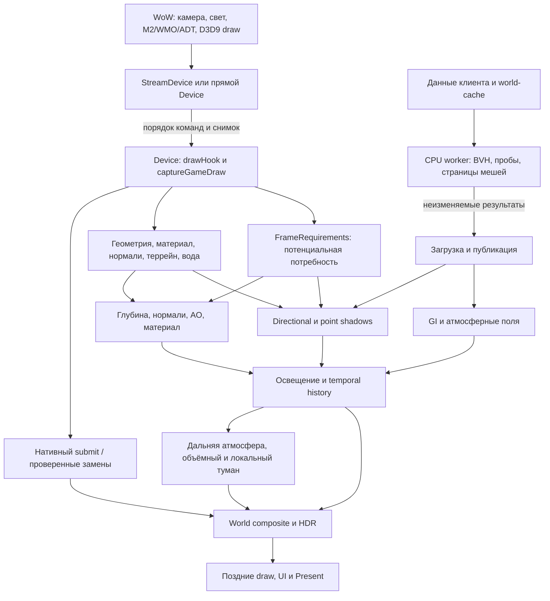

# Архитектурный аудит и план рефакторинга Northlight

Срез от 19 ноября 2026 года, `HEAD afa84414`. Первый этап — получить повторяемую проверку на данных настоящего кадра, затем вынести владельцев состояния из `WorldRenderer` и `Device` и по одному заменять дорогие участки. Приоритеты по последнему игровому логу — подготовка материала и захвата, GPU-проход нормалей при 2× MSAA, повторные draw в точечных тенях и ожидания вокруг командной очереди. У каждого направления свой способ доказать улучшение.

## 1. Что уже реализовано

Northlight — x86-прокси D3D9 внутри WoW 3.3.5a. У игры остаются обход сцены, выбор видимости, анимация и нативные draw. При включённом `CommandStream` игровой поток записывает упорядоченные команды, зеркалирует часть состояния и привязывает снимок контекста к конкретному draw. Поток replay владеет устройством. Существует и прямой путь без очереди. `Device` разводит четыре варианта `Draw*` через общий `drawHook`, управляет захватом и границей между сценой и UI. CPU-воркеры собирают статическую сцену, BVH и пробы из удерживаемых версий входов. `WorldRenderer` принимает результаты, ведёт загрузку ресурсов и исполняет эффекты. [Архитектура](architecture.md) · [Draw-адаптеры](../src/proxy/renderer.cpp#L4335) · [Очередь](../src/stream/stream_device.h) · [Воркеры и GPU-проходы](../src/world/world_renderer.h#L1530)

Схема показывает зависимости, а точный порядок задают код `renderEffects` и `WorldRenderer::render`. Реализация уже различает World, Menu и вспомогательные цели. `FrameRequirements` планирует потенциальный захват, а готовность конкретных входов проверяется перед исполнением. Эта граница позволяет отдельно развивать планирование и ресурсные контракты. [Потребность кадра](../src/core/frame_requirements.h) · [Вход в эффекты](../src/proxy/renderer.cpp#L1464) · [WorldRenderer::render](../src/world/world_renderer.h#L5452)

| Проблема | Фактическое состояние | Что нужно исправить |
| --- | --- | --- |
| Монолиты | `world_renderer.h` — 7 226 строк, `renderer.cpp` — 4 834, `world_effects.hlsl` — 2 129, `stream_proxies.h` — 1 781, `world_gi.cpp` — 1 583. Из подсчёта исключены сгенерированные и сторонние исходники и производные таблицы. `WorldRenderer` уже включает `.inl` для ряда эффектов и ресурсов. | Убрать зависимость от общего приватного состояния. Описать точку входа, владельца ресурсов и проверку каждого модуля. |
| Карта связей | Аудит показывает 230 записей в 11 shader-манифестах, 228 уникальных хешей байткода, 22 HLSL-файла. 223 записи имеют лексическую ссылку из `src/`, 7 помечены на проверку. Есть отдельные схемы проходов и расследования. | Связать вариант шейдера с фактическим выбором, регистровым контрактом, объектом, ресурсами, диагностикой и тестом. Разрешать поиск в обе стороны. |
| Повторное вычисление и память | Уже есть зеркала состояния, разреженные тени VB/IB, общий пул снимков, runtime GPU-residency, пулы страниц и пакетов, индекс статических кастеров, повторное использование RT. Последние коммиты добавили повторное использование для AutoBump и point shadows. | Измерить оставшиеся CPU-чтения констант и проверки позы, число GPU draw и причины повторного рендера граней, отдельно от повторного выделения или загрузки байтов. |
| Нативная интеграция | Есть съём контекста мира и меню, нативный свет с доказанным handoff, специализации шейдеров и диагностика M2 12340. Обычный opaque M2 может отправить запись секции в конкретный queued draw на профилируемых кадрах. По исходникам `NorthlightM2Draw::current` публикуется в области dispatch, боевых потребителей этой записи не найдено. Существующий handoff констант для нормалей опирается на доказательство через зеркало, независимо от M2-маршрута. | Сделать из проверенных native-данных вход конкретного потребителя. Выигрыш от знания объекта и выигрыш от устранения второго GPU draw проверять отдельно. |
| Автономная приёмка | Есть строгий runner, CPU-контракты, hidden-device GPU-oracles, реальные MPQ-стенды и приватная цепочка trace + sidecar + stand DLL. GitHub Actions запускает `source`. Имеющаяся положительная проверка транспорта использует специально написанный producer. | Получить эталон с настоящего `Wow.exe`, проверять его на стенде и добавить отдельный автоматический прогон кандидата внутри изолированного клиента до публикации. |

Источники инвентаризации и контрактов. [Shader audit](../scripts/audit_shaders.py) · [Capture и буферы](pipeline-buffers-20261117.md) · [Запись M2](../src/stream/stream_device.h#L281) · [Генератор dispatch](../scripts/generate_forwarders.py#L302) · [CI](../.github/workflows/validation.yml) · [Тестовые стенды](../tests/README.md)

## 2. Последний игровой лог

Использован активный `D:/Games/335_engb_mod/northlight-renderer.log`, который заполнился во время аудита. Срез содержит 19 698 строк, 3 896 240 байт, SHA-256 начинается с `d3687cd9bc23`. Строка 18 содержит `source=11c309d23205…`, совпадающий с `source_identity()` текущего дерева и строкой в установленной DLL. Установленная DLL совпадает с `renderer/frd9.dll` побайтно. `northlight-renderer.prev.log` относится к `75c4d4fe09b1…`. Сравнение сборок требует одинаковой нагрузки и настроек. Текущая сессия использовала DXVK 3.1.1, 3840×2160, 2× MSAA и `RenderProfile=1`.

| Участок лога | Что видно |
| --- | --- |
| Вход в Northrend, строки 16923–17574 | От первой записи камеры до GI-атласа 3,141 с, до готовности статических теней 5,360 с. CPU build 3,000 с. Смешанное окно входа в мир имеет p95 127,933 мс и максимум 609,066 мс. Время готовности эффектов и отдельные паузы загрузки измерять раздельно. |
| Эффекты включены, строки 19101 и 19655 | Два последовательных окна по 120 кадров после включения — 38,457 и 39,267 мс в среднем, около 25,7 FPS на 240 кадрах. p95 по окнам — 48,779 и 45,699 мс. До выключения есть неполное окно на 93 кадра со средним 37,620 мс. |
| Эффекты выключены, строки 18110–18559 | Полные окна дают 18,704–21,175 мс, около 47–53 FPS. В выключенном периоде есть границы изменений настроек. DLL, командный поток и HDR остаются в процессе. Значения годятся для оценки порядка затрат и для выбора A/B, без точной атрибуции разницы. |
| CPU, кадры 19558 и 19685 | `captureNetMs` 7,48 и 8,10 мс. `MATERIAL_PROFILE.cpuExclusiveMs` 4,60 и 4,99 мс с собственной областью. Сами часы добавляют около 1,13 мс по оценке профайлера на этих sampled-кадрах. Во втором кадре 875 оценок локальной позы, 1 210 `sharedBudgetSkips` и ноль `reused` у локального счётчика. В первом кадре эта работа отсутствовала, а `captureNetMs` всё равно 7,48 мс. |
| GPU, те же кадры | Весь GPU-интервал 29,62 и 32,69 мс. `GameScene` 17,38 и 17,32, `ModelNormals` 4,17 и 4,58, `Effects` 5,68 и 8,53, в том числе `PointShadow` 1,56 и 3,60 мс. `GameScene` — интервал активной конфигурации, для чистой нативной базы нужен отдельный запуск. |
| Нормали, те же кадры | 1 773/1 741 пакетов, 1 210/1 208 draw после объединения, ноль normal `sourceReadBytes` и `upBytes`. Считано 178 936/180 660 float4-регистров через bank path. Обе попытки native MRT остановлены с `target-msaa`. По материалам в этих кадрах прочитано 53 016 и 0 байт источника соответственно. |
| Точечные тени, те же кадры | 2 708/4 632 replay draw, 0/1 364 static draw, 0/72 перестроенных статических граней. Все 1 336/1 338 replay bounds готовы. В дорогом образце есть 54 moved и 18 facesWithoutCache. `POINT_COLD` CPU 1,24/2,99 мс. Это аргумент измерять refresh и стоимость отправки даже после успешного culling. |
| M2, те же кадры | Распознано 3 143 из 3 206 `ordinary` в двух сэмплах, около 98%. 198 проверок палитры без расхождения. На раннем холодном кадре 18542 — 664 из 984. Долю считать по классам draws и по фазам; 98% здесь относится к отобранным обычным M2. |
| Очередь, game frames 19614–19733 | 50 записанных `CSTREAM QUERYFRAME`: медиана 21,14 мс общего ожидания, 16,97 мс до replay и 4,13 мс внутри replay. На этих строках измеряется выбранный query trip, а фазы могут пересекаться с другой работой кадра. Сначала установить, какие critical-path зависимости задерживают replay и завершение EVENT. |

Медианы и диапазоны CPU/GPU выше описывают два кадра после включения эффектов. Frame time, CPU-spans, GPU timestamps и ожидание query относятся к пересекающимся шкалам. Для расчёта выигрыша требуется суммарное время кадра в парном прогоне, а для объяснения — события связываются по producer frame, replay frame, device epoch и sequence. В выключенных окнах время уже выше 16,67 мс. Цель 60 FPS на этих настройках требует измерить отдельно и нативную сцену, и накладные расходы прокси. [Лог текущей сессии](<D:/Games/335_engb_mod/northlight-renderer.log:16923>) · [GPU и CPU кадра 19685](<D:/Games/335_engb_mod/northlight-renderer.log:19591>) · [Смысл контроллеров бюджета](architecture.md#remaining-architectural-work)

## 3. Разделение монолитов по владельцам

| Шаг | Первая точка выделения | Контракт и приёмка |
| --- | --- | --- |
| М1. Граница `Device` | Извлечь логирование/диагностику и загрузку backend/ресурсов в самостоятельные единицы. Затем выделить подготовку draw, захват и координацию эффектов вокруг существующих `drawHook`, `captureGameDraw`, `renderEffects`. `Device` держит COM-интерфейс, границы `BeginScene`/`EndScene`/`Present` и reset. | Для каждого из четырёх адаптеров сохранить аргументы, результат, порядок terrain → material → normals → world → water, жизнь UP-памяти, raw/wrapped вызовы, fault fallback, состояние после вызова и один нативный submit. Эталон — `test_draw_orchestration*`, `test_capture_handoff`, `test_saved_state`. |
| М2. Публикация мира | У `WorldRenderer::work` выделить запрос/отмену/публикацию, отдельно стадии построения существующего `WorldMeshUploadPlan` и BVH/проб. Из `upload` вынести staging и commit resident mesh, сохранив `mesh_buffer_store` и текущие планы. | Воркер читает неизменяемые входы, D3D-вызовы остаются владельцу устройства. Старый результат удерживается до безопасной замены. Проверить повторную попытку после отказа аллокации, map switch, отмену, stale publication, отдельную готовность GI и статических теней. Сравнить digest страниц и результат x86-стенда при давлении на адресное пространство. |
| М3. Владельцы проходов | Начать с `world_point_rendering.inl` и ресурсов point shadow, затем directional/actor shadows, lighting/temporal, fog, composite. Учитывать существующие `world_screen_resources.inl` и `world_geometry_resources.inl`. `WorldRenderer::render` становится планом порядка исполнения, входов, готовности и результатов. | Каждый владелец получает узкие параметры и представления ресурсов, управляет своим create/lost/reset/trim. Разделить общие `releaseGPU` и state restore по владельцам, проверяя частичное создание. После каждого выделения сравнить draw order, bindings, targets, fallback и изображения. |
| М4. HLSL и queue | После регистрации связей разнести семейства `world_effects.hlsl` на логические части distance/normal helpers, lighting/GI, fog, temporal/composition и shadow entry points. В `stream_proxies.h` выделять по lifetime-границам VB/IB, image locks, query/resource finalization при изменениях соответствующей подсистемы. | Сохранить entry points и число вариантов, compiler pin и зависимости includes, профили и привязку регистров; сверить байткод. При отличии проверить ASM, численный результат и GPU-оракул. Для очереди сверить command order, HRESULT, Reset epoch, release/retire, мутации и настоящее завершение. |

Начинать с перемещения существующей логики и механического восстановления тестовых связей. Добавление новой `.cpp` учитывает явный список TU в `build_renderer.py` и нативных фикстурах. Отдельный коммит вводит изменение поведения или оптимизацию. Критерий декомпозиции — правка одного прохода локализуется в его файлах и тестах, а его входы и владение ресурсами видны без чтения всех полей `WorldRenderer`. Размер исходников и число общих `friend`-доступов использовать как индикаторы. Один держатель `WorldRenderer&` во всех новых модулях сведёт перенос к текущей модели `.inl`. [Точки выделения](../src/world/world_renderer.h#L1530) · [Явный список TU](../scripts/build_renderer.py#L195) · [Порядок захвата](../src/proxy/renderer.cpp#L2052)

### М3. Цели точечных теней

`NorthlightWorldPointTargets` владеет активными кубами, сохранёнными статическими гранями, общей R32F-целью, D24S8-буфером и нейтральной текстурой. Он создаёт цели для прогрева и обычного прохода, освобождает их и перечисляет для учёта памяти. Кадровый координатор выбирает лампы, выделяет бюджет прогрева, записывает причину сбоя и связывает поверхности в прежнем порядке.
[Владелец целей точечных теней](../src/world/world_point_targets.h) · [Порядок проходов](../src/world/world_point_rendering.inl)

Начальный прогрев берёт подготовленные цели и шейдеры, выполняет три закрытых draw и восстанавливает исходное состояние D3D9, включая полные банки констант. Один `GetData` с `D3DGETDATA_FLUSH` отправляет подготовительную работу. Готовность куба публикует обычный проход. [Прогрев при создании устройства](../src/world/point_pipeline_warmup.h)

`FacePass` выполняет подачу статических кастеров, кэшированного terrain
и live terrain. Он привязывает материалы и возвращает фильтры после
отрисовки статических масок. Для live terrain он отмечает использование
индексного среза до первого draw и возвращает декларацию статического
прохода после последнего. Координатор по-прежнему выбирает списки и
публикует только завершённую грань. На DXVK до и после совпали глубина
всех шести граней и число draw в восьми сценариях. После отказа выделения
статической цели повтор восстановил исходную глубину. На 22 кадрах
Даларана сохранились счётчики граней, треугольников и подач после Reset.
[Подача геометрии грани](../src/shadows/point_shadow_face_pass.h)

`NorthlightWorldPointLighting` владеет шейдерами жёстких и мягких
точечных теней и отправляет экранную коррекцию. Кадровый координатор готовит
константы и выбирает опубликованный куб. Владелец привязывает текстуры,
применяет поправку и снимает scissor. При отказе PCSS сохраняется
коррекция жёстких теней. На DXVK совпали 70 трасс команд и 70 хэшей
изображений до и после переноса. Проверены три отказа установки входов
и отказ создания PCSS. Нативная проверка прошла D3D9 Reset с
сохранением и пересозданием ресурсов, включая отвергнутый Reset и
две успешные попытки в каждом режиме. Хэши карт глубины совпали.
[Экранная коррекция точечных теней](../src/world/world_point_lighting.h)

### М3. Тени актёров

`NorthlightWorldActorShadows` создаёт карты глубины и тайлов для каждого
источника, общий промежуточный буфер и маску видимости. Модуль выполняет
двухступенчатое построение тайлов и раздельный resolve. `WorldRenderer`
планирует replay кастеров вместе с ближним каскадом и выбирает общий или
раздельный resolve. При сокращении памяти освобождаются текстуры, а при
смене настроек актёров пересоздаются и шейдеры.
[Ресурсы и проходы теней актёров](../src/world/world_actor_shadows.h)

### М3. Направленные каскады

`NorthlightWorldDirectionalTargets` управляет итоговыми картами, статическим
кэшем, общим временным буфером и картами окружения ближнего каскада.
Модуль выполняет объединение глубины и выделяет цели через общий бюджет
геометрии. `renderDirectional` готовит статические планы и списки кастеров,
выбирает цели каскадов и карт актёров, публикует готовые карты и завершает
фоновые задачи. `NorthlightDirectionalShadow::GpuPass` привязывает цели и
временную глубину, отправляет terrain draw и возвращает ближний каскад
для отрисовки моделей. Точка входа кадра использует время прохода для бюджета
точечных теней и получает счётчики для профиля.
[Ресурсы направленных теней](../src/world/world_directional_targets.h) · [Отрисовка направленных теней](../src/shadows/directional_gpu_pass.h)

После нормалей координатор строит тайлы актёров и выбирает общий проход
или раздельную маску. `NorthlightWorldDirectionalVisibility` владеет
экранной целью, парами шейдеров, повтором аллокации и восстановлением
слотов перехода. После отказа общего прохода координатор восстанавливает
раздельную маску. Освещение выбирает шейдер по результату resolve, а туман
переиспользует тайлы.
[Владелец видимости](../src/world/world_directional_visibility.h) · [Порядок проходов](../src/world/world_soft_shadows.inl)

### М3. Экранный туман

`NorthlightFogScreen` владеет экранными буферами тумана, их созданием и
сбросом, разрешением истории и двумя проходами размытия.
`renderAtmosphericFog` проверяет оба источника перед записью в объёмный
атлас, переиспользует готовый атлас или запускает экранный raymarch.
`NorthlightAtmosphereCommands` привязывает карту актёров и шум, подаёт
отрисовку облаков, восстанавливает освещение после raymarch и атласа.
Кадровый координатор разрешает историю, добавляет ламповый туман после
размытия и передаёт композиции текущее изображение и флаги истории.
В проверках на DXVK при 0× и 2× MSAA совпали 54 записи команд и 48 хэшей
пикселей. Проверены отказ атласа, переход на raymarch и восстановление
после ошибки draw.
[Владелец экранного тумана](../src/world/world_fog_screen.h) · [GPU-команды](../src/world/world_atmosphere_commands.h) · [Атмосферный проход](../src/world/world_atmospheric_fog.inl)

`NorthlightWorldForeverFogShaders` владеет десятью шейдерами импортированного
raymarch. Базовый вариант загружается с экранными ресурсами тумана.
Варианты перехода, теней актёров и режима без шума создаются при первом
переходе на raymarch. Владелец проверяет возможности устройства, выбирает
запасной вариант при отказе и освобождает шейдеры при сбросе.
[Выбор шейдера](../src/world/world_forever_fog_shaders.h)

`NorthlightWorldMoonFloorFog` готовит текстуру высот и шесть вариантов
шейдера для лунного тумана под перекрытиями. Модуль выбирает базовый проход
при недоступности своего пути и возвращает привязки сцены после draw.
Кадровый координатор проверяет актуальность дальнего каскада и передаёт
опубликованное региональное поле. [Проход лунного тумана](../src/world/world_moon_floor_fog.h)

### М3. Кадровые константы шейдеров

Кадровый модуль подготавливает общие константы, включая предыдущий вид,
параметры игрового тумана и дымку горизонта. Координатор проверяет готовность
облаков перед запуском задачи тумана заклинаний и один раз загружает c0–c67
вместе с базовыми текстурами. Проходы света и тумана используют тот же массив
для частичного восстановления констант.
[Кадровые константы](../src/world/world_frame_constants.inl)

### М3. Финальная композиция

`NorthlightWorldComposite` управляет шейдерами SDR и HDR, промежуточным
цветовым буфером и привязкой stencil-масок. Он выбирает обычный или
объединённый проход материалов и выполняет отдельные проходы для
поверхностей без освещения и с запечённым освещением. `WorldRenderer`
передаёт текстуры кадра, задаёт порядок проходов и хранит блоки
восстановления состояния устройства.
[Владелец композиции](../src/world/world_composite.h)

### М3. История освещения и дистанции

`NorthlightWorldLightHistory` владеет парами изображений света и дистанции,
проверяет совместимость предыдущего кадра и переключает записи после
успешного прохода. Модуль выполняет сглаживание и временное накопление.
`WorldRenderer` задаёт порядок проходов и передаёт предыдущую дистанцию
в перепроекцию тумана, а текущий свет — в композицию.
[Владелец истории](../src/world/world_light_history.h)

`NorthlightWorldNormalsPass` владеет экранной целью и двумя вариантами
шейдера нормалей. Для сглаживания он при необходимости пишет текущую
дистанцию в цель, которую передаёт история освещения. После resolve теней
`NorthlightWorldScreenLighting` рисует прямой свет и GI. Он владеет шейдерами,
целями прямого и базового света и дополнительной целью для запечённых
поверхностей. Кадровый координатор передаёт данные во временной проход
до переиспользования цели прямого света локальными источниками.
[Нормали](../src/world/world_normals_pass.h) · [Экранное освещение](../src/world/world_screen_lighting.h)

Локальное освещение переиспользует буфер прямого света после временного
resolve. Экранные лампы, точечные источники и вспышки используют выборку
кадра и восстанавливают общие привязки перед туманом. После размытия тумана
та же выборка ламп накапливает свечение в предыдущей ячейке истории света,
а ограничение яркости применяется один раз к сумме.
`NorthlightWorldLocalLighting` владеет шейдерами ламп, диагностической целью
таймингов и исполнением обоих проходов. Координатор передаёт ему поверхности,
подготовленные прямоугольники и диагностику. При сбросе владелец освобождает
ресурсы и снимает запрет повторной загрузки опционального шейдера одной лампы.
[Владелец проходов ламп](../src/world/world_local_lighting.h) · [Порядок проходов](../src/world/world_local_lighting.inl)

### М3. Сброс ресурсов проходов

`releaseGPU` координирует остановку фоновых задач и вызывает освобождение
ресурсов света, нормалей, тумана и теней у владельцев проходов. При отказе
аллокации геометрии действует отдельный путь сброса целей, который
сохраняет экранные изображения. Полный сброс очищает также шейдеры
теней и историю.
[Порядок сброса](../src/world/world_renderer.h) · [Геометрические цели](../src/world/world_geometry_resources.inl)

### М3. Состояние устройства

Модуль теней задаёт исходное состояние целей и глубины. Экранный проход
готовит полноэкранные привязки и нейтральный свет для построения дистанции.
Туман привязывает карты актёров для своего источника. Композиция возвращает
региональное поле в s13 после отрисовки или отказа. Состояние игры
восстанавливает действующая внешняя область на том же устройстве, иначе
проход сохраняет состояние самостоятельно.
[Область состояния](../src/proxy/saved_state.h) · [Композиция](../src/world/world_composite.h)

`NorthlightWorldFlashShadows` владеет слотами каскадов, шейдером коррекции,
привязкой целей и повтором аллокации. Команды каскада привязывают материал,
страницы геометрии и буферы живого terrain, рисуют выбранные диапазоны мира
и выбирают пиксельный шейдер для replay. `WorldRenderer` передаёт
общую глубину, границы поз и выбранные диапазоны. В локальный свет
попадает только пара полностью отрисованных карт. GPU-фикстура проверяет
порядок привязок и draw, отказ при создании второй карты и кадр после Reset.
Парные прогоны DXVK и системного D3D9 сохранили одинаковый порядок
команд, два индексированных draw на пару карт и один draw коррекции
на вспышку. Хэши карт и результат коррекции совпали. На двух кадрах
Даларана совпали десять сырых буферов цвета, глубины, нормалей и HDR,
а также проверенные грани точечных кубов.
[Владелец теней вспышек](../src/world/world_flash_shadows.h) · [GPU-фикстура](../tests/test_flash_shadow_gpu.py)

`NorthlightWorldShadowTransition` хранит карты предыдущего статического
каскада, цели текущих динамических кастеров и шейдеры перехода. Он записывает
копию старого каскада и привязки обеих эпох. `WorldRenderer` выбирает момент
перехода, вычисляет смещение копии и проверяет доступную память. Запись
четырёх каскадов и двух эпох совпала с исходной по порядку команд,
ресурсам и константам. При отказах аллокации и записи сохраняются обычные
каскады.
[Владелец перехода](../src/world/world_shadow_transition.h) · [Запись команд и отказов](../tests/test_shadow_transition_resources.py)

`NorthlightShadowPalettePass` владеет общим инстансированным draw для
точечных, направленных и актёрских теней. Он хранит шейдер, декларацию,
буфер экземпляров и срок повтора аллокации. Проходы отбирают пакеты
и сбрасывают свои кэши привязок и констант после инстансированного draw.
GPU-фикстура на DXVK и системном D3D9 сверила порядок привязок, поведение
при перекрытии кастеров, 14 отказов и восстановление после сброса.
[Владелец палитры](../src/shadows/shadow_palette_pass.h) · [GPU-фикстура](../tests/test_point_palette_gpu.py)

`NorthlightPointShadow::FacePass` управляет привязками и очисткой одной
серии граней куба, кэшем состояния материала и объединением глубины.
`WorldRenderer` выбирает источники, отрисовывает подготовленные списки
кастеров и публикует завершённый куб. Записывающая фикстура проверяет порядок
команд, отказ выделения статической грани, переключение между MRT, копией
и объединением, а также восстановление привязок при новой подаче.
[Владелец прохода](../src/shadows/point_shadow_face_pass.h) · [Фикстура команд](../tests/test_point_face_pass.py)

`NorthlightWorldFogField` владеет загрузкой региональной плотности и высотных
границ тумана, хранит ссылку на загруженную публикацию и привязывает
текстуры к s13 и s12 перед атмосферным проходом. При отказе необязательной
текстуры высот сохраняется основной raymarch. Отказ памяти для плотности
освобождает обе текстуры и откладывает повтор на секунду. `WorldRenderer`
выбирает публикацию по карте и передаёт смену поля лунному проходу.
[Владелец поля](../src/world/world_fog_field.h) · [Фикстура команд](../tests/test_world_fog_field.py)

`NorthlightShadowReplay::Pass` исполняет подготовленные draw анимированных
кастеров для каскадов, карт актёров, вспышек и точечных граней. Он ведёт
кэши привязок и проецированных констант, восстанавливает исходный индексный
буфер при отказе объединённого и сбрасывает кэши после палитрового draw.
Отбор, объединение и публикация карт остаются у соответствующих проходов.
[Отправка draw](../src/shadows/shadow_replay_submit.h) · [Фикстура команд](../tests/test_shadow_replay_submit.py)

Локальная область `GpuPass::CachePass` исполняет обновление статического
кэша каскадов. Она очищает выбранные прямоугольники до включения scissor,
сохраняет порядок привязок и отключает scissor при любом выходе. Решение
о полном или частичном обновлении и публикация ключа остаются у каскада.
[Проход кэша](../src/shadows/directional_gpu_pass.h) · [Фикстура команд](../tests/test_directional_gpu_pass.py)

### М4. Очередь команд

Из `stream_proxies.h` выделены блокировки и аренда буферов VB/IB, состояние и
загрузки подресурсов изображений, адаптеры изображений, запросы и завершение
жизни прокси. `StreamCore` хранит общие бюджеты и очередь. Порядок выполнения
и освобождение после вызова backend остаются в `replay_thread.h`.
[Границы владения](architecture.md#runtime-contracts)

### М4. Шейдеры мира

`world_effects.hlsl` разделён на 11 модулей по проходам. Сборка проверяет
транзитивные зависимости для World, Shadow Transition и Fog Volume. Все 91
скомпилированный вариант, их ASM и три заголовка совпали с исходной сборкой
побайтово. [Границы модулей](architecture.md#shader-and-resource-navigation)

## 4. Карта шейдеров, объектов и ресурсов

Расширить `scripts/audit_shaders.py` и его JSON. Манифесты компиляции остаются источником entry, target, include hashes и bytecode hash. Из существующего ASM взять фактически читаемые регистры и sampler slots. Место выбора shader entry, роль каждого ресурса, условия исполнения и fallback привязать к модулю-владельцу. Для условных и динамически собранных связей использовать декларацию рядом с соответствующим binder или фабрикой, затем сверять её с выборочными наблюдениями из кадров. Текущий вид `runtime-reference` хранить как степень доказательства. [Скрипт аудита](../scripts/audit_shaders.py) · [World shader manifest](../shaders/world-shader-build.json)

| Запись | Минимальные поля |
| --- | --- |
| Шейдер и вариант | Источник и includes, entry/target/hash, generated symbol, runtime factory/caller, нативный оригинал и цепочка patch/assemble, условия caps/quality/domain и fallback. |
| Draw и объект | M2 обычный/групповой, WMO, ADT, вода, частицы, sky, UI; shader family и проверенные capabilities; section/range, alpha/depth и режим деформации; World/Menu/aux; доказательство, по которому объект может дать вход проходу. |
| Проход и ресурс | Стадия и владелец, потребность/готовность, читаемые и записываемые входы, слоты, константы, формат и разрешение, sample count, область жизни и reset, история, aliases и точки восстановления состояния. |
| Проверка | Идентификатор CPU/GPU/trace oracle, негативный сценарий, диагностический префикс или идентификатор, ссылка на определение. |

1. Начать с вертикального среза `M2/terrain → material + model normals + world depth → WorldNormals/WorldDistance → lighting/history → WorldComposite/HDR`. Вторым срезом покрыть `M2/WMO/ADT → directional/point`, третьим — fog, water, weather и sky. Включать режимы AO-only, fog-only, Menu и MSAA, где меняется производитель входа.
2. Для первого среза сделать два запроса к одному отчёту. По `WorldCompositeHdr` получить upstream, варианты и тесты. По M2 section или ADT получить потребителей, допуски и fallback. Из того же отчёта генерировать Markdown/Mermaid в `fp.output_dir()`. В `docs/architecture.md` при реализации оставить карту первого уровня и команды навигации.
3. В `source` проверять разрешение entry/resource/test IDs, отсутствие висячих ссылок, покрытие выбранных семейств, совпадение shader hashes и совместимость слотов. В GPU/trace сверять реально связанный sampler/RT, viewport, MSAA, вариант и порядок. Наблюдения помечать версией сборки, а динамические варианты — причиной, по которой они допущены.

Второй срез связывает M2, WMO и ADT с каскадами, картой персонажей и
точечными кубами. Для общих entry карта показывает привязки в каждом
проходе. Аудит может приложить результаты replay Даларана с хешами каскадов,
локального света и граней кубов на выбранных Presents.
[Команды аудита](architecture.md#shader-and-resource-navigation)

Третий срез связывает туман, воду, погоду и небо с композицией. Отдельно
видны варианты для частиц и UI. Режимы AO-only, fog-only, Menu и 2× MSAA
показывают выбранных производителей ресурсов. На replay Даларана проверены
экспорты итогового тумана и дистанции. Для воды, погоды и неба карта
пока опирается на C++ и ASM.
[Команды аудита](architecture.md#shader-and-resource-navigation)

Пример причины для детальной карты — `WorldDistance` в fog-only и `WorldNormals` в lighting могут стать производителями одного R32F history pair. Переключение владельца сбрасывает историю. После temporal resolve сырой `light` переходит локальному свету, а знакомые по разным именам texture и surface относятся к одной аллокации. Имя переменной или совпадение формата не определяют право на reuse. [Ресурсные контракты](architecture.md#runtime-contracts) · [Реальные aliases](compact-captures.md#pipeline-buffer-audit)

## 5. Переиспользование по типу работы и времени жизни

| Порядок | Изменение | Условие, при котором изменение принимается |
| --- | --- | --- |
| R1. Показать повторную работу | На одном `device + epoch + frame + draw ordinal` для материалов, нормалей, world replay и теней сопоставить eligibility, источник геометрии, версии диапазонов, запрошенные байты и float4, оценки bounds, количество отдельных draws. Для CPU/GPU хранить live bytes/high-water, расширение пула, evictions, lease age и ожидания. | Из одного отчёта видно, какая работа повторена, какие входы поменялись и какой потребитель удерживал ресурс. Тяжёлые audits запускаются отдельно от performance. |
| R2. Поделиться уже прочитанным | Расширить существующий `CaptureSource`/snapshot handoff на один draw. Переиспользовать declaration, проверенный span зеркала, resident VB/IB, immutable section и bounds-результат только с совпадающим ключом. Отделить компактный hot-заголовок пакета от пополняемой по потребности payload, удерживаемой до последнего consumer. | Меньше `bankReads`/копируемых регистров, повторных classification/bounds и выделений при тех же входах. На нормалях в первую очередь сравнить перекрытие запросов, замеры mirror generation и байты, которые реально пришлось перенести в queued packet. |
| R3. Уменьшить повторные тени | Использовать уже опубликованный индекс статических кастеров и существующие cache keys. Атрибутировать `facesMoved`, `facesWithoutCache`, изменения geometry/content и refresh rate. Раздельно проверить статические и динамические грани, продолжить точное coalescing/instancing там, где совпадают поза, clip, alpha и порядок записи. Измерить `ShadowRefreshCpuMs` и соблюдение допустимой давности. | Идентичное глубинное покрытие всех шести граней и текущие актёры на быстрых движениях. Меньше replay/static draw или rebuilds при том же наборе источников, проекции, дальности, разрешении и частоте обязательного обновления. Измерить отдельно много неподвижных ламп, движущийся свет и холодную смену зоны. |
| R4. Сделать память предсказуемой | Для `draw_snapshot`, `scene_native_store`, VB/IB range shadows, page store, dynamic rings и screen targets записать владельца и сроки удержания. Убрать подтверждённую вторую CPU-копию при известном GPU-владении и отсутствии CPU-читателя. Переиспользовать staging по совместимым размеру/формату и завершению работы. Ресурсные группы остаются ленивыми. | `DISCARD`, `NOOVERWRITE`, `ProcessVertices`, GPU writes, `Reset`, resize, pressure и переиспользование адреса дают корректную версию. Сравнить x86 free span и resident/retired bytes и время cold recovery. Проверить отсутствие новых ожиданий на тёплом пути. |

Ключи разделить по семантике. Неизменяемая геометрия зависит от источника, диапазонов, layout, поколений VB/IB и версии секции/LOD. Данные экземпляра и позы зависят от поколений модели и кадра, выбранной палитры и нужных строк, а view-space bounds также от камеры и численного режима. Историю и ресурсы GPU определяют frame/device epoch, параметры цели и завершение последней команды. Для unknown write, неполной палитры или отсутствующего входа использовать текущий проверенный путь. Отдельно контролировать CPU geometry для GI, погоды и fallback. [Пул снимков](../src/world/draw_snapshot.h) · [Resident source](../src/replay/scene_native_store.h) · [Bounds](../src/water/material_skin_bounds.h) · [CPU/GPU владельцы](cpu-gpu-ownership-20261117.md)

Первый аудит R1 запускается на сохранённой трассе через
`replay --capture-work-frame 282`. Отчёт `capture-work.json` связывает пакеты,
кэш снимков и переиспользование у трёх потребителей по одному draw.
В отчёте есть запросы и передачи float4 нормалей. Бюджет снимков может
включать попадания в кэш. Аудит VB/IB записывает фактические вызовы
`Lock` и диапазоны, обслуженные CPU-копией потока команд. У каждого
события есть потребитель, тип буфера, смещение и длина. Повторы одного
диапазона на том же draw считаются отдельно. Диагностика привязана к
выбранному World Present и запускается отдельно от замеров.
[Аудит захвата](../scripts/northrend_capture_work.py)

На тёплом кадре 282 Даларана отчёт собрал 2 354 draw. У 1 014 были
пакеты нескольких потребителей. Нормали приняли 879 передач геометрии,
а захват теней 1 143. Бюджет снимков списывался только в захвате теней,
где на этом кадре зарегистрированы 1 422 попадания и 0 промахов кэша.
На 175 draw материал и нормали оба зарегистрировали проверку диапазона
или границ. Равенство входов этих проверок требует отдельной сверки.

В R2 проверка дальности ModelNormals использует строки уже прочитанного
банка материалов, когда диапазон покрыт и эпоха записи совпадает под
блокировкой зеркала устройства. Результат проверки границ остаётся у
прежнего владельца. На кадре 282 Даларана при 3840×2160, 2× MSAA и 12:00
на 35 draw те же запросы к зеркалу заменены чтением 245 float4 из банка.
Из 278 чтений контрольного прогона оставшиеся 33 пришлись на три draw,
где между прогонами различались счётчики захвата материалов. Число
записанных пакетов ModelNormals равно 927 в каждом прогоне.
[Проверка на стенде](northrend-baseline.md) ·
[Проверка диапазона](../src/proxy/model_normal_range.h)

В R2/R4 записи теней выделяют float-банк при первом чтении и удерживают
общий банк по проверенной эпохе или совпадающим строкам. BOOL и INT
остаются в записи. На кадре 254 трассы Даларана со 128 игроками при 4K и
2× MSAA у 1 434 пакетов осталось 788 отдельных float-банков. Объём их
данных снизился с 5,60 до 3,08 МиБ. Счётчик учитывает строки констант
активных и удерживаемых пакетов. В лимит пула свободных записей входят
оставленные в нём банки.

В первой паре итоговый цвет различался на 23 пикселя в Present 290 и на
90 в Present 298. Повтор контрольной DLL воспроизвёл относительно первого
запуска те же расхождения и то же переключение одного кастера между ближним
каскадом и картой актёров, которое показал кандидат. В паре повторного
контроля и кандидата цвет, глубина и проверенные грани точечных теней
совпали побитово. Воспроизводимость распределения кастеров между картами
остаётся отдельной задачей T2. [Владелец банков](../src/world/world_renderer.h) ·
[Проверка времени жизни](../tests/test_model_replay_pool.py)

В R3 replay точечных теней хранит банк вершинных констант на время отрисовки
куба. Смена грани требует заново вычислить проекцию. Статический проход
обновляет известные значения c0–c3, а инстансинг сбрасывает кэш после записи
палитры. Счётчик `POINT_REPLAY_STATE.constantBytes` измеряет объём данных,
переданных в вызовы установки констант.
На кадре 254 Даларана со 128 игроками при 4K и 2× MSAA шесть граней и 259
replay draw потребовали 445 952 байта вместо 450 688. Лимит CPU обновления
теней был отключён в обоих прогонах. Цвет, глубина и проверенные грани
побитово совпали между сборками на кадрах 290 и 298.
[Сравнение на replay](northrend-baseline.md)

В контрольном прогоне N3 на 22 прогретых Present той же сцены точечные
тени обновляли от 6 до 24 граней, медиана 12. На обновление приходилось
от 266 до 877 replay draws, медиана 449. Статические, terrain и live draws,
а также пересборки статических граней дали ноль за все 22 кадра.
`POINT palette` регистрировал 175–176 исходных пакетов, прошедших
проверку палитры, на кадр и ноль инстансированных вызовов. Для оценки
R3 сравниваем физические draw по граням, GPU-время и покрытие граней
при одинаковых источниках, геометрии и расписании обновления.

Диагностика после отбора проверила 234 обновления граней на 22 кадрах.
Среди 15 859 непрозрачных индексированных подач к WMO по отпечатку
источника отнесены 13 444, к skinned M2 — 132. В списке одной грани
полное совпадение GPU-геометрии и индексного диапазона не встретилось
даже до требований к совместимости палитры. В этой трассе существующий
инстансинг точечных теней остался без групп. Диагностические счётчики
измеряют входы до объединения draw.

Стендовый эксперимент R3 проверил переиспользование уже отрисованной
грани для неизменных непрозрачных replay-кастеров. Пара на одной DLL
сверила 22 кадра. На восьми кадрах совпало по шесть граней. Там медиана
replay draw составила 259 вместо 438, а медиана парной разницы GPU-времени
`PointShadow` составила −0,172 мс. Всего пропущено 1 432 draw. По всему
окну медиана парной разницы составила −0,002 мс. Это измерение прохода
на реплее. В отдельном сравнении 4K, 2× MSAA на Present 290 и 298 побитово
совпали цвет, глубина, нормали и проверенные грани. Снимки охватывают две
контрольные точки. Счётчики попаданий собраны в отдельном профиле.

В повторе на фиксированной трассе Даларана прямые грани дали ноль
сокращённых draw. Допуск граней с неизменной статической картой и MIN
blending позволил использовать 90 готовых граней на 12 из 22 Present.
Медиана replay draw составила 408 → 241, за всё окно пропущено 2 493
вызова. На Radeon при 4K, MSAA 2× и SDR медиана парной разницы интервала
`PointShadow` составила −0,645 мс, подачи CPU −0,043 мс. Все 22 кадра прошли
сверку количества граней, логических пакетов и треугольников с учётом
пропущенной работы. На Present 244 и 270 повтор сверил побитово 36 карт
глубины R32F из контрольного и оптимизированного прогонов. На этих кадрах
переиспользованы 18 граней. После сверки режим вынесен в опцию игровой
DLL `NORTHLIGHT_POINT_OPAQUE_REUSE=1`. Флаг стенда
`NORTHLIGHT_RETRACE_POINT_OPAQUE_REUSE=1` сохранён.
[Проверка повторного использования грани](../src/shadows/point_opaque_face_cache.h)
Грани с cutout и skinned-кастерами в этом режиме продолжают обновляться
обычным путём.

На следующем прогоне Даларана с 128 NPC неизменная непрозрачная часть
совпала в 162 обновлениях смешанных граней. Это 11 859 исходных пакетов
за 22 кадра, до группировки draw. Стендовый прототип хранит глубину
этой части в R32F и накладывает оставшихся кастеров с MIN blending.
На 19 сопоставимых кадрах A/B на одной DLL при фиксированном полудне,
4K, 2× MSAA и SDR медиана фактических replay draw с учётом заполнения
кэша сократилась с 408 до 184. За эти кадры снято 4 465 отправок.
Медиана парной разницы составила −0,673 мс GPU и −0,030 мс CPU-подачи.
На Present 244 и 270 совпали побитово все 36 карт глубины. Эти кадры
исключены из замера времени из-за readback. На Present 254 различается
один исходный пакет ModelNormals, поэтому этот кадр тоже исключён.
Рабочий режим `NORTHLIGHT_POINT_MIXED_REUSE=1` ограничен гранями со
статической картой, где обычный проход уже использует MIN blending.
Грани с прямой записью сохраняют порядок разрешения равных D24.
Владелец хранит до 32 R32F-текстур, учитывает их в памяти теней
и освобождает при Reset и тримминге. При отказе создания или
записи остаётся готовая обычная карта, а при отказе копирования
грань обновляется по полному списку кастеров.
GPU-фикстура DXVK сохранила глубину при отказе аллокации, копирования
из кэша, копирования в кэш и draw после записи. Она также сверила
освобождение и повторное заполнение кэша.

Парный прогон рабочего пути через `--point-mixed-reuse` на Radeon
сверил нагрузку всех 22 кадров. Из замера времени исключены только
два кадра выгрузки карт. На оставшихся 20 медиана физических draw
с учётом заполнения кэша составила 408 → 184, всего снято 4 689
вызовов. Медиана парной разницы `PointShadow` составила −0,581 мс GPU
и −0,065 мс CPU-подачи. Глубина всех 36 выгруженных граней совпала
побитово. [Владелец кэша](../src/shadows/point_mixed_face_cache.h)

На тех же 22 кадрах стенд измерил покрытие перспективных граней по AABB
кастеров. При сопоставлении 210 обновлений по геометрии WMO текущие
и предыдущие прямоугольники остальных кастеров покрыли все 256 плиток
каждой грани. Частичное обновление с такими границами не отсекает WMO.
Модель покрытия разворачивает прямоугольник до всей грани при
пересечении порога положительного `w`. Результат относится к AABB,
которыми располагает проход, и не измеряет покрытие отдельных
треугольников. Счётчики подач после переноса владельца палитры совпали
с контрольной трассой на всех 22 кадрах.

На тех же списках оценили увеличение ёмкости пакета индексных диапазонов.
При неизменном порядке и полной совместимости группы переход с четырёх
диапазонов на восемь сокращал расчётное число подач на 71 за 22 кадра.
Оценка допускает идеальное размещение и не учитывает бюджет загрузок.
Связанный кэш пока сохраняет предел в четыре диапазона.

Прототип разрешал копировать разрозненные диапазоны из разных групп
захвата в один индексный буфер при совпадении читаемых строк rigid-позы.
На 22 парных кадрах Даларана при 4K, 2× MSAA и SDR он не добавил ни
одного объединения. Медиана точечных replay draw осталась 408, медиана
парной разницы GPU составила +0,021 мс. Правку убрали из рабочего дерева.

Другой путь R3 объединяет соседние непрозрачные rigid-диапазоны
с одинаковыми буферами и шейдером. Они могут принадлежать разным
группам захвата, если совпадает весь банк строк, которые читает
вершинный шейдер после подстановки проекции куба. Эксперимент с
одной DLL объединил 624 диапазона на 22 парных кадрах. Медиана
отправок сократилась с 438 до 408, парная разница GPU-времени
`PointShadow` составила −0,067 мс. Рабочая реализация вычисляет
маску при регистрации готового вершинного шейдера. Порядок треугольников
и счётчики логической нагрузки сохраняются.
На Present 290 и 298 прототип объединил по 18 пар. Цвет, глубина,
нормали, линейный HDR и проверенные грани совпали побитово. Для рабочей
реализации 15 кадров совпали по расписанию и составу граней. На них
убраны 396 отправок с той же медианой 438 → 408. Во время рабочего
прогона запустился игровой клиент. Результат этого прогона используем
для счётчиков, а чистый замер и сверка кадров рабочей DLL ждут
свободного устройства.
[Маска строк](../src/shadows/point_rigid_pose_rows.h) · [Проверка констант](../tests/test_replay_capture_constants.py)

На Radeon в SDR отдельный A/B на одной DLL до переноса статического кэша
сверил 22 прогретых Present Даларана при 4K и 2× MSAA. Число граней,
исходных пакетов и треугольников
совпало. Медиана отправок точечных теней составила 449 → 416, всего убраны
774 draw. Счётчик объединений по читаемым строкам дал 708. Он считает только
переходы между разными банками констант. Медиана парной разницы GPU-времени
`PointShadow` составила −0,035 мс. Это результат SDR на Radeon. Сверка HDR
требует адаптера с рабочей цепочкой scRGB.

В R3 направленные каскады и карта актёров объединяют до четырёх
индексных диапазонов без перестановки треугольников. Они используют
тот же план упаковки и лимит индексного кэша, что и точечные тени.
На Present 254 Даларана с 128 игроками каскады сократили 332 draw до
327, а карта актёров 531 до 530. Состав 1 201 пакета и 586 494 треугольников
совпал. Пять объединённых вызовов покрыли 19 диапазонов. Общий кэш индексных
буферов вырос с 41 478 до 160 314 байт, на этом кадре все буферы взяты
из кэша. [Счётчики replay](northrend-baseline.md)

В повторном профиле совпала нагрузка направленных теней на 10 из 21
кадра во всех трёх запусках. Кандидат убрал по 5–8 draw на совпавшем
кадре относительно двух контролей. Медиана парной разницы GPU-времени
этих проходов составила −0,38 и −0,87 мс. CPU-время подачи в серии
варьировалось, поэтому оценка относится к работе и GPU-времени стенда.

Ранняя проверка границ позы в ModelNormals сверяет декларацию через зеркало
под той же блокировкой. Снимок материала удерживает ссылку на декларацию.
Если зеркало не знает текущую привязку, проверка использует обычный getter.
Стенд считает оба пути отдельно и сохраняет буферы нормалей для A/B.
[Процедура сравнения](northrend-baseline.md)

Захват теней M2 использует четыре строки проекции из того же банка
материалов. Допуск проверяет покрытие строк и актуальную эпоху под
блокировкой зеркала устройства. На Present 282 при статической GI оба
прогона дали одинаковую работу на 2 354 draw и приняли по 1 256 пакетов
мира. Из 1 419 вызовов getter для проекции остались 345. Глубина,
исходный цвет и буферы нормалей совпали на обоих кадрах. Строгая проверка
итогового HDR-цвета остаётся открытой. [Режим A/B](northrend-baseline.md)

В R4 изменён допуск полных CPU-копий VB/IB для частичных чтений больших
буферов из обычного пула. На трассе Даларана оба порядка A/B дали те же
счётчики на каждом из 21 измеренного кадра. Пик удерживаемых копий на этих
кадрах снизился с 15,17 до 12,57 МБ. К кадру 290 суммарный размер
заблокированных диапазонов снизился с 38,00 до 36,19 МБ при росте числа
успешных `Lock` с 1 790 до 1 851. На прогретых кадрах 274–290 счётчик
чтений оставался постоянным в обоих режимах. CPU-захват на стенде
менялся между повторами в обе стороны.
[Команды сравнения](northrend-baseline.md) ·
[Владелец копий](../src/proxy/replay_copies.h)

В игровом логе от 20 ноября 2026 года после срабатывания защиты адресного пространства зафиксировано 35 завершившихся серий `alpha-target` на 2 459 кадрах. Самая длинная длилась 13,2 с. При входе в режим давления рендерер освобождал рабочие поверхности для нативной точности альфа-теста, после чего допуск роста мог отказать в их восстановлении. Теперь уже выделенные поверхности остаются у теневого прохода до Reset. При отказе в новой аллокации приостанавливаются направленные карты, а экранное освещение, GI, локальный свет и туман продолжают отрисовку. Незавершённая карта не публикуется. Полностью записанные статические кэши остаются доступными при следующей попытке.

В R4 буфер сглаживания и шейдер `RemovalSmooth` выделяются при допуске
направленных теней. Туман может выделить тот же буфер для своей истории
и размытия независимо от теней. При холодном старте с одним освещением
TemporalLight берёт исходный свет. Это убирает одну цель RGBA16F размером
1920×1080 при выводе 4K, или 15,82 МиБ номинальных данных текстуры.
[Выделение экранных ресурсов](../src/world/world_screen_resources.inl)

В 18 полных окнах того же лога медиана оконного p50 равна 26,52 мс, p95 — 36,04 мс. После первого отказа 20 выборок дают медиану GPU `GameScene` 16,76 мс из 19,33 мс и CPU-захвата 4,36 мс. Проходы World в этих выборках часто отсутствуют из-за отказа. В 44 отдельно зарегистрированных медленных запусках эффектов медианы CPU-секций составляют 3,03 мс для точечных теней, 2,77 мс для загрузки и 2,28 мс для дальнего каскада. `GameScene` включает подачу исходной сцены и встроенные проходы, поэтому диапазон сам по себе не атрибутирует весь GPU-расход по шейдерам.

## 6. Интеграция с движком и сокращение GPU-проходов

1. **N1. Довести обычный M2 от диагностики до потребителя.** Начать с одной функции — выбора ранее доказанного immutable section/range для AutoBump или model normals. Привязать результат к конкретной команде и поколению device/model/skin. Использовать актуальные установленные Gx/D3D bindings и точный диапазон; строки палитры брать из подтверждённого ordered state. Через очередь передавать значения и удерживаемые ссылки. Сначала режим сравнения с текущим путём, затем выбор результата для поддержанного подмножества. Считать eligible/matched/consumed/fallback и причины в меню, тёплом мире и при холодной загрузке, отдельно измерять producer и replay. Проверить совпадение диапазонов, палитры, material/coverage и снимков до и после переиспользования объектов.
2. **N2. Расширять proof по реальной доле нагрузки.** Сначала измерить, сколько затрат приходится на grouped doodads, alpha test, skinned/rigid M2, WMO и terrain. Для grouped M2 доказать многоинстансные палитры, секции и порядок. Для WMO/ADT брать идентичность подготовленного batch и bounds по подходящим владельцам. Visible lists камеры полезны для receiver pass; кастеры за экраном остаются в специализированном отборе по объёму света. Варианты клиента, неподтверждённые shaders, dynamic/UP, projected, ribbons и particles проходят прежний D3D9-путь до добавления своих доказательств. На каждый контракт нужен отрицательный тест на несовпадение signature, range, state или поколения.
3. **N3. Уменьшить GPU replay нормалей.** Существующий native MRT сначала проверить на AA0 и определить долю нормалей, которые он сохраняет с той же alpha/depth coverage. Затем отдельно воспроизвести 2× MSAA. Опыт прежних MSAA-экспериментов даёт эталоны границ и стоимости. Сравнить существующий отложенный replay с доказанным сокращением packet/draw и, только при совместимости backend, с захватом во время native draw и корректным per-sample resolve. Для fast path нужны одинаковые силуэты, материалы, диапазон глубины, occluder order, корректные stencil/UI и предусмотренный fallback. Чистая экономия считается с учётом дополнительного MRT bandwidth, resolve и state changes. GPU-выигрыш возможен и без расширения семантического адаптера, поэтому эксперименты измерять отдельно.
4. **N4. Разобрать critical path очереди.** Разметить producer record/publish, wait barrier, replay execution, backend `GetData` и wakeups. На одних и тех же draws сравнить моменты публикации, глубину очереди и p95 задержки с baseline. Проверять один параметр за раз — момент publish до известной синхронизации, объём подготовительной работы, кадры в очереди и ограничение spin. Для подтверждения сохранить настоящие EVENT/OCCLUSION результаты и порядок device-loss/reset; ускорение нельзя получать ложной готовностью или пропуском обязательных draws. Разобрать как активный `QUERYFRAME`, так и отдельные пустые интервалы очереди. Измерить latency и загрузку CPU наряду с p95 кадра.

В N3 проверили упаковку разрозненных индексных диапазонов соседних
пакетов ModelNormals, оставшихся одиночными после штатного объединения,
при совпадающем VB и состоянии захвата. На 22
Present Даларана со 128 игроками при 4K и 2× MSAA счётчик кандидатов и
число новых объединений были нулевыми. При 2 870 пакетах на кадр
контроль отправлял 2 235 draw, эксперимент — 2 252. Медианы интервалов
GPU составили 4,93 и 5,36 мс. Сопоставление показывает, что этот способ
не сокращает работу на трассе. Разница счётчиков штатного объединения
не позволяет атрибутировать разницу GPU-времени новой упаковке.
Эксперимент остался на стенде.

Отдельный аудит ModelNormals на тех же 22 Present нашёл на каждом кадре
609 стыков соседних пакетов с идентичными резидентными VB, IB и индексным
диапазоном. Из них 537 стыков в 44 сериях прошли предварительное
сравнение состояния вне окна вершинных констант c31+ и проверку отсутствия
выборок текстур в пиксельном шейдере. Совпадений по объектам CPU-снимков
было ноль. Только два стыка попали в распознанный класс `Single`.
Для остальных 535 нужно доказать точный диапазон палитры по байткоду
вершинного шейдера. Фактическое сокращение draw и сохранение покрытия
проверяются отдельным прогоном instancing.

В лабораторном прототипе N3 все пять записанных вершинных программ
прошли проверку адресации палитры. Пакет хранит диапазон костей,
вычисленный до освобождения CPU-снимка. На кадре 254 579 пакетов
поместились в 51 instanced draw. После двух Reset на Present 290 и 298
побитово совпали нормали M2, экранные нормали, разрешённая глубина, HDR
и проверенные грани точечных теней.

На 22 прогретых Present переключение лабораторного instancing на той же
DLL снизило число draw ModelNormals с 2 252 до 1 724. Медиана CPU-подачи
снизилась с 1,63 до 1,34 мс, а медиана GPU-интервала выросла с 3,38 до
3,64 мс. Повтор замера пересёкся с другим процессом WoW и исключён.
Следующий лабораторный вариант переносит смещение палитры в исходное
умножение после проверки времени жизни временного регистра. Он сохраняет
число арифметических инструкций всех пяти программ и проходит ту же
побитовую сверку. На 21 паре с одинаковыми счётчиками точечных теней
число draw ModelNormals снизилось с 2 210 до 1 682, медиана CPU-подачи —
с 2,06 до 1,77 мс, а медиана GPU-интервала — с 5,26 до 4,55 мс.
Медиана парной разницы GPU составила −0,72 мс. В повторе с обратным
порядком те же 528 draw дали −1,18 мс на 21 паре с одинаковой работой
точечных теней. Замеры относятся к проходу на стенде.

Рабочий путь анализирует фактический VS3 и хранит только диапазон костей
при освобождении CPU-снимка. Он объединяет соседние резидентные пакеты с
одинаковым индексным диапазоном и состоянием. Штатное объединение пакетов
имеет приоритет. GPU-тест проверяет побитовый результат при трёх draw и
двух draw, отказ выделения буфера и частичный отказ привязки потоков.
После Reset используются новые ресурсы инстансинга с тем же результатом.
Проверка прошла на DXVK и системном D3D9. Если backend отклоняет `mad` с
двумя входными регистрами, программа использует отдельное `add`.
Ограничение stride проверяется по фактическому размеру палитры батча.
Две пары прогонов рабочей сборки в противоположном порядке дали
2 252 → 1 724 draw и 0,23–0,25 мс экономии по медианам CPU-подачи.
На 21 кадре с одинаковой работой точечных теней медиана парной разницы
GPU составила +0,71 и −0,14 мс. В обычной DLL инстансинг включается
переменной `NORTHLIGHT_NORMAL_PALETTE=1` до запуска клиента.
Стенд включает его по умолчанию и принимает
`NORTHLIGHT_RETRACE_NO_NORMAL_PALETTE=1` для контрольного прогона.
[Проверка байткода](../src/proxy/model_normal_palette_shader.h) · [Подача экземпляров](../src/proxy/model_normal_instancing.inl) · [GPU-тест](../tests/test_model_normal_palette_gpu.py)

На том же SDR-профиле Radeon 22 пары ModelNormals сохранили одинаковые
входные пакеты и число моделей, отсеянных по границам. Медиана отправок составила
2 192 → 1 662, всего убраны 11 650 draw. Медиана парной разницы CPU-подачи
составила −0,650 мс, а GPU-времени прохода выросла на 0,259 мс. Этот замер
поддерживает сохранение режима как опционального.

Соседние инстансированные draw ModelNormals сохраняют совпадающие привязки
потоков и декларации до одиночного draw или конца прохода. На 22 кадрах
Даларана 37 батчей за кадр унаследовали привязки, что убрало 159 команд
настройки. Тест DXVK сохранил пиксели, в том числе при переходе на обычные
draw после ошибки второго батча. В повторах контроля A/A на Radeon при
том же числе входных пакетов расходились 30 отправок ModelNormals и три
отправки точечных теней за кадр. Оба A/B исключили все 22 кадра по нагрузке.
Влияние на время прохода остаётся открытым до воспроизводимого A/A.

В режиме `--profile-fixed-work` оба прогона второй сборки совпали на всех
22 Present по входным пакетам ModelNormals, инстансированным draw,
вызовам точечных теней и числу их треугольников. Обычные draw ModelNormals
расходятся на 77 за кадр. На Present 238 одна сборка в двух одинаковых
запусках имела 30 и 49 групп GPU-буферов для кастеров. Дистанционный отбор
допустил 1 097 и 1 086 skinned-пакетов из одинаковых 3 998 кандидатов.
Прогон отклонён для замера GPU-времени. Остаётся воспроизвести историю
допуска и размещения буферов перед окном профиля.

После привязки загрузки геометрии к записанному Present 142 контроль A/A
совпал по нагрузке ModelNormals и точечных теней на всех 22 кадрах.
В A/B переиспользование привязок убрало по 159 команд настройки на кадр.
Количество отправок и треугольников совпало. Строгая проверка исключила
все 22 кадра из замера времени. В кандидате на каждом кадре счётчик
отсечения по диапазону вырос на три, а счётчик отсечения по границам
позы снизился на три. Для сопоставления GPU-времени нужно подтвердить,
что итоговый набор поданных пакетов совпадает.

Стенд сверил упорядоченные отпечатки исходных draw. На 21 из 22 кадров
совпали состав и порядок поданных пакетов ModelNormals и счётчики
точечных теней. Present 254 исключён из замера из-за четырёх дополнительных
логических пакетов и двух draw. На совпавших кадрах переиспользование
сняло 159 команд настройки за кадр. Медиана парной разницы на Radeon
при 4K, 2× MSAA и SDR составила −0,274 мс CPU и +0,200 мс GPU.
Два контроля совпали по составу пакетов и нагрузке теней на всех 22
кадрах, при этом медиана парной разницы составила −0,645 мс CPU и
+1,337 мс GPU. Устойчивый выигрыш по времени в этой серии не подтверждён.

Среди оставшихся одиночных draw ModelNormals медиана составила 69
соседних пар за кадр с той же геометрией и разными вершинными
константами вне палитры костей. На стенде проверили перенос
до трёх таких строк в данные экземпляра. На 21 совпавшем Present
Даларана при 4K, 2× MSAA и SDR медиана draw снизилась с 1 702 до 1 699.
Present 254 исключён из-за расхождения порядка и состава пакетов.
Медиана парной разницы составила +0,035 мс CPU и −0,190 мс GPU.
После Reset нормали M2, экранные нормали и буфер дистанции совпали
побитово на обоих проверенных кадрах. Итоговый цвет разошёлся на 0,60%
и 4,96% пикселей с разницей до двух уровней на канал. Причина цветового
расхождения пока неизвестна. Эксперимент остался на стенде.

Аудит с лимитом 21 строки показал, почему вариант с тремя строками
почти не срабатывал. В 350 из 503 проверенных пар менялось 14–16 строк.
Все различия пришлись на c10–c12, c17–c24 и c236–c243, уже поддерживаемые
путём GameScene. Варианты с отдельной маской для каждой пары не дали
итоговой экономии. На 21 совпавшем кадре медиана выросла с 1 702 до
1 711 draw, для 212 попыток подходящий вариант не выдан. Следующая
проверка использовала одну схему переноса GameScene на исходную программу.
На 22 совпавших Present при 4K, 2× MSAA и фиксированном визуальном времени
медиана снизилась с 1 702 до 1 643 draw. Всего исключено 1 286 draw.
Медиана парной разницы составила −0,098 мс CPU и −0,381 мс GPU.
Нормали M2, экранные нормали, дистанция и итоговый цвет на двух кадрах
после Reset совпали побитово. В игровой DLL этот режим включается
`NORTHLIGHT_NORMAL_PALETTE=2`, на стенде — `NORTHLIGHT_RETRACE_NORMAL_INSTANCE_ROWS=1`.
Оба режима сохраняют скалярную подачу при отказе настройки пакета.

После выноса фабрик теневых шейдеров повторили A/B ModelNormals на одной
DLL, с переиспользованием граней точечных теней в обоих прогонах. Медиана
сократилась с 1 702 до 1 643 draw. В первой паре исключили Present 254
из-за одного дополнительного пакета. На остальных 19 кадрах без GPU-readback
медиана парной разницы времени GPU составила +0,182 мс, все восемь
экспортированных буферов совпали побитово. В повторе совпали входные пакеты
всех 22 кадров, а медиана по 20 кадрам без readback составила −0,114 мс.
Два буфера итогового цвета в повторе отличались на 7 и 10 пикселях на один
уровень RGB. Точно та же разница воспроизвелась между двумя прогонами
с включённым инстансингом.

В серии с фиксированным временем всех кадров два запуска с выключенной
упаковкой строк совпали побитово. При включении режима на той же DLL
отличались 28 и 35 пикселей итогового SDR-цвета на один уровень канала.
Нормали M2 и мира, дистанция, 12 итоговых и 12 сохранённых граней
точечных теней совпали. На 20 парных кадрах без GPU-readback медиана
draw снова снизилась с 1 702 до 1 643, а изменение GPU-времени
ModelNormals составило +0,142 и −1,827 мс против двух контролей.
Расширенная упаковка остаётся опциональной до проверки промежуточных
буферов композиции и воспроизводимого выигрыша по времени.

В следующем A/B совпали все 28 снятых экранных изображений, включая
исходный кадр, цвет тумана, карту освещения, покрытие эффектов и входы
материального композита. В GPU-константах различался `c64.z`. Контроллер
успел изменить шаг выборки тумана в одном прогоне. При
`--profile-fixed-work` runner теперь фиксирует адаптивные бюджеты GPU и CPU
в приватном профиле и проверяет их значения по логу DLL перед приёмкой.

Совместный прогон новых режимов на Даларане со 128 NPC проверил
22 Present при 4K, SDR и 2× MSAA. По составу и порядку входных
пакетов нормалей и объёму работы точечных теней совпали все кадры.
Два кадра с GPU-readback исключены из тайминга. На 20 оставшихся
медиана draw ModelNormals составила 1 702 → 1 643, а draw replay
точечных теней с учётом заполнения кэша — 241 → 17. Медианы парных
разниц GPU составили +0,258 мс и −0,628 мс соответственно. Медиана
парной разницы суммы двух GPU-интервалов составила −0,396 мс.
Восемь буферов экрана и 12 граней R32F совпали побитово. Выигрыш
по времени для расширенного режима M2 зависит от замера.

В отдельном A/B на одной DLL расширенный режим ModelNormals оставался
включённым в обоих прогонах. Отключение переиспользования граней давало
241 повторный draw на кадр, включение — 17 с учётом заполнения кэша.
На 20 парных кадрах повторного A/B медиана изменения времени PointShadow
составила −0,626 мс. Двенадцать проверенных граней, нормали, дистанция и
итоговый SDR-цвет совпали побитово. В первом A/B итоговый цвет разошёлся
на 28 и 35 пикселях из 8 294 400 при отклонении в один уровень RGB.
Те же отличия воспроизвелись между двумя прогонами с выключенным кэшем.
Режим включается явно через `NORTHLIGHT_POINT_MIXED_REUSE=1`.

Основной `GameScene` поддерживает инстансинг через `NORTHLIGHT_GAME_PALETTE=1`.
Изолированный живой A/B на одной DLL использовал 128 NPC, 4K, MSAA 2× и
`NORTHLIGHT_NORMAL_PALETTE=1` в обоих запусках. Режим убрал 892–894
индексированных вызова за кадр. В паре с сопоставимой фоновой нагрузкой
Forever FPS вырос с 18,91 до 19,71, p95 времени кадра снизился с 59,77 до
57,58 мс, а GPU-время `GameScene` — с 32,36 до 31,61 мс. Нагрузка GPU от
Forever составила 47,4% и 47,2%. Отчёт сохранён в
`.local/out/crowd128-gamescene-ab-20261122/performance.json`.

После рефакторинга приёмка начинается с `GameScene=1` на свежей DLL.
Батчинг частиц и адаптивный EVENT проверяются как дополнения к лучшей
конфигурации. Кэш проверки ландшафта сравнивается на тяжёлой сцене QA.
`NORTHLIGHT_GAME_PALETTE=2` сократил ещё 368 отправок за кадр, выигрыш
по времени кадра пока не подтверждён. `ModelNormals` имеет собственный
переключатель и отдельный A/B на replay.
[Инстансинг GameScene](../src/proxy/game_indexed_pair.h)

В N2 на Present 282 трассы Даларана со 128 игроками аудит распределил
5 848 draw по зарегистрированным классам шейдеров. Шейдеры M2 со skinning
дали 2 742 пакета нормалей из 2 870. Все 7 622 float4, прочитанные через
getter в захвате теней мира, пришлись на WMO. Из них 1 380 относились к
проверке проекции и 6 242 к пакету. В этом окне все потребители обошлись
без запросов чтения VB/IB через `ReplayCopies::Reader`.

Для подтверждённых индексированных WMO проверка проекции заимствует
известные строки напрямую под блокировкой зеркала. Захват пакета копирует
строки из того же источника в принадлежащий пакету банк. Неизвестные
строки, UP и независимая сверка используют исходный getter.
На Present 282 число float4, прочитанных через getter, снизилось с 7 622
до 321 при тех же 345 пакетах WMO. На Present 290 и 298 цвет, глубина
и выбранные карты точечных теней совпали побитово.
[Аудит захвата](northrend-baseline.md) · [Владелец зеркала](../src/proxy/device_mirror.h)

В живом Даларане со 128 игроками на четырёх прогретых выборках ветка
grouped doodads выполнила по 60 команд с 246 экземплярами и 33 112
треугольниками на кадр. В 54 из этих 60 команд было несколько экземпляров.
Фиксированный alpha test был включён у 24 команд. Для всех 240 команд
совпали диапазоны с учётом смещений в пулах и строки всех матриц в порядке диспетчера.
Прогон `--native-m2-require-grouped` требует эту проверку в дополнение
к проверке обычных M2. [Аудит в клиенте](native-m2-capture-20261118.md)

Аудит WMO/ADT связывает текущий подготовленный индексный диапазон с
командой D3D9 через сигнатуру клиента, цепочку вызовов и смещения Gx.
Для WMO он проверяет, что запись принадлежит передавшей её группе, и
читает локальный AABB группы. Двухпроходная ветка WMO использует общий
выход функции с другим расположением временной записи на стеке.
Для ADT тот же владелец связывает диапазон с одним или двумя исходными
чанками. По 145 высотам MCVT каждого чанка аудит заново вычисляет минимум
и максимум по Z и проверяет, что AABB клиента их покрывает. На сцене
Даларана нативная верхняя граница одного чанка шире диапазона MCVT
примерно на 2,66 ед. В поток рендера уходят
только значения объединённого AABB и номер кадра. Потребитель проверяет,
что в этот AABB входят все позиции, на которые ссылаются индексы команды.
Точные границы геометрии для теней и материалов по-прежнему берутся из
снимка буферов D3D9.
[Проверка на сцене](northrend-baseline.md) · [Владелец аудита](../src/stream/world_batch_12340.h)

В R2 проверка камеры для ADT читает известные строки вида и проекции
из зеркала устройства под блокировкой. ModelNormals использует те же
актуальные строки при заполнении своего банка. `CAPTURE_WORK` показывает
getter и заимствованные float4 отдельно для World и ModelNormals.
На Present 282 из 48 команд ADT World взял 384 float4 из зеркала.
У ModelNormals 8 float4 через getter заменились одним чтением зеркала
в неизменяемый банк, который использовали все 48 пакетов. На Present 290
и 298 совпали цвет, глубина, оба буфера нормалей и проверенные грани
точечных теней. Отбор кастеров использует границы снимка и объём света.

В профиле стенда `MODEL_PREPARE` связывает публикацию записей, пробуждения, работу воркера и завершение хвоста в потоке рендера с конкретным `Present`. Этот же кадр содержит `CSTREAM QUERYFRAME` и `CSTREAM EVENT_QUEUE` при фактическом ожидании EVENT. Проверка пробуждения записывает состояние очереди и результат остановки при таймауте. [Измерения на стенде](northrend-baseline.md)

На Даларане со 128 игроками проверили замену повторной проверки EVENT
в очереди сравнением с порядковым номером `Issue(END)`. В A/B битово совпали
цвет, глубина и выбранные карты точечных теней. На кадрах 246–280 с теми же
шейдерами p95 исполнения очереди до `END` изменился с 0,233 до 0,209 мс в
порядке A/B и с 0,235 до 0,276 мс в порядке B/A. p95 полного ожидания EVENT
изменился с 18,80 до 38,06 мс и с 47,06 до 36,05 мс соответственно. Результат
определялся ожиданием результата драйвера. При отсутствии повторяемого
выигрыша вернули прежнюю проверку. После приёма EVENT стенд исполнял до
`END` медианные 458 команд, а в уже измеренных живых окнах было около 18 тыс.
[Диагностика очереди](northrend-baseline.md)

Углубление делается на существующем D3D9 backend и проверенном адаптере клиента. Для каждой новой семантической возможности отдельно проверяется совместимость по client image, вызывающей стороне и текущим D3D аргументам. Поддержка других бинарников и новый графический backend имеют смысл при отдельном измерении достижимого выигрыша и отдельной стоимости миграции. [Исследование M2](native-m2-capture-20261118.md) · [Код M2 12340](../src/stream/m2_draw_12340.h) · [MSAA-эксперимент](msaa-worldnormals-fusion-20261114.md) · [Зависимости очереди](../src/stream/replay_thread.h)

## 7. Автономная проверка перед публикацией DLL

Нужны две дополняющие друг друга ветки. Стенд воспроизводит выбранные кадры с фиксированными входами для сравнения кандидатов. Изолированный `Wow.exe` подтверждает, что кандидат работает в реальном приложении с настоящим порядком загрузки, камерой, памятью, очередью и драйвером. Northlight уже загружается в игровой процесс как D3D9 proxy. Для автоматизации достаточно штатной загрузки прокси при запуске приватной копии клиента и управления разрешённым тестовым сценарием. Запускать готовый игровой релиз для каждого шага разработки не требуется.

| Уровень | Что выполняется | Что подтверждает |
| --- | --- | --- |
| Source и architecture | Существующие `source`, `architecture`, затронутые contract tests, проверка shader manifests, ordering, ownership, invalidation. | Контракт и контрольные ветви на точном дереве. |
| Hidden-device GPU и MPQ | Существующие `gpu`, image/state oracles, x86 entry/pressure, world/terrain fixtures. | Состояние, изображения, сырые буферы, память и время компонента при управляемых входах. |
| Captured replay | Одна и та же полная верхняя D3D9 trace и snapshot-sidecar для baseline и кандидата. | Точная ассоциация и визуальные регрессии выбранных настоящих кадров. GPU-тайминг стенда имеет свою область. |
| Live client | Приватный клиент загружает production-кандидат или baseline. Один runner ставит сцену, проверяет готовность, выполняет маршрут, завершает и собирает результат. | Реальные кадры, загрузка, latency, совместимость, FPS и кадры с длинными задержками. |
| Release | Собрать DLL, верифицировать пакет и закрепить точные DLL/assets/profile/backend/cache hashes из live gate. | Идентичность выпущенного кандидата проверенному payload и работоспособность установочного контракта. |

### T1. Зафиксировать baseline и единый сценарий

1. Зафиксировать хеши client PE, baseline и candidate DLL/assets, backend и драйвер, профиль качества, данные карты, chunks/cache, разрешение, MSAA, VSync/лимиты, сценарий, ожидаемые camera checkpoints и доступный x86 memory span. В отчёте держать репозиторный fingerprint и `source_identity` отдельными полями. Настройки пользователя считываются только как исходные данные для baseline.
2. Первые сценарии — неподвижный Northrend в координатах текущего лога и короткий поворот в той же точке. Отдельный холодный запуск считает `first world camera → GI ready → static shadows ready`. Для стабильного perf записывать фазу и focus, прогревать регион до заданной готовности, фиксировать маршрут, камеру, положение NPC/позы по возможности и отсекать сессии со сменой профиля. Для exact image входы фиксируются в trace.
3. Первый сравнительный прогон имеет три режима: штатный backend без расширений Northlight, текущая production-сборка с выключенными эффектами, полный фиксированный профиль. Проверять путь и capability flags в логе. Дальнейший A/B сравнивает две production-сборки с одинаковыми настройками, чередует порядок A/B и B/A и повторяет до оценки разброса. Диагностические trace/image/readback и обычные performance runs запускаются раздельно. Сохранять сырые frame times, p50/p95/p99, worst frames, CPU/GPU pass scopes, ожидания, warm/cold counters, и долю slow frames. Нынешние 120-кадровые агрегаты полезны для первичного разбора, для p99 и сравнения нужны исходные интервалы.

### T2. Воспроизвести настоящий кадр на существующем стенде

1. В отдельной папке запустить контролируемый capture с обёрткой над входом Northlight. Довести имеющуюся цепочку `native_snapshot_capture` → `prepare_native_scene.py` → `compile_native_replay_plan.py` → `--stand-replay` + `northlight-native-retrace.exe`. Для первого World-сценария подготовить короткую закрытую трассу с достаточным префиксом создания/заполнения ресурсов, снимки с draw ordinal/device/thread/epoch и список действительно использованных cache inputs. Большие приватные данные и содержимое клиента держать в локальном хранилище артефактов; в Git хранить сценарий, схемы, маленькие независимые fixtures и верификаторы.
2. Проверить соответствие исходного PE и реально наблюдавшихся кодовых данных, ассоциацию исходного draw с пакетом, typed resource aliases по поколению, префикс состояния/загрузок, Present и полный жизненный цикл. Доказать активацию WorldRenderer на воспроизведении и совпадение выбранных вариантов проходов. Первым закрыть простой AA0 маршрут без Reset для локализации связывания. Затем закрыть 2× MSAA с нативным depth и контрольным Reset/resize после него. Отдельно сохранить исходный шестикадровый Reset/image oracle; его известное расхождение расследовать по HWND, кооперативному состоянию, порядку операций, реальному `GetData` и изображению после восстановления.
3. Ввести независимые положительные доказательства полноты. Сравнить исходный live capture и replay по цвету, raw depth, coverage/краям MSAA, нормалям, atlas/cube faces и final HDR в выбранных кадрах. Проверить ключевые пакеты и выбор проходов с логов. Отрицательные прогоны обязаны обнаружить недостающий пакет, обрезанный префикс, stale alias, неверный Reset epoch, отличающуюся позу и пустую сцену. Текущие флаги `full_scene_ready=0`, `aliases_complete=0`, `fps_eligible=0` в транспорте отражают область проверенного контракта. Статус готовности сцены должен исходить из нового проверенного отчёта по конкретной сцене.
4. Для локальной итерации добавить одну команду запуска сохранённого сценария поверх существующих инструментов. Выходы в `fp.output_dir()`, хеши до/после, stdout/stderr, журнал draw joins и артефакты сравнения. При увеличении trace за пределы лимитов сначала сократить сценарий или подготовить верифицированный префикс. Потеря команды, ресурса или снимка делает результат неполным.

На сохранённой трассе толпы в Даларане (3840×2160, 2× MSAA, 12:00) сравнили по два replay одной сборки. На Present 282/290 обычный таймер давал 1 221 016 / 905 086 различающихся пикселей в буфере локального света. С диагностическим шагом 60 Гц совпали оба буфера, все 64 входа локальных источников на каждом кадре, глубина и опубликованные грани точечных теней. В итоговом scRGB осталось 1 430 / 1 385 различающихся пикселей. Расхождения также есть в дальней карте теней и истории освещения. Для строгого сравнения с клиентом требуется захват с тем же шагом 60 Гц. Подробности запуска и проверки маркеров описаны в [сценарии Northrend](northrend-baseline.md).

Дополнительная A/A-пара с `--light-history-audit` показала расхождение до накопления истории. На Present 282/290 различаются 1 613 / 1 598 пикселей экранной видимости направленных теней и 1 172 / 1 146 пикселей сырого света. В предыдущем свете различаются 1 566 / 1 612 пикселей, предыдущая дистанция совпадает. В журналах частичные обновления статической дальней карты приходятся на разные кадры.

Журнал проекций в следующей паре подтвердил совпадение матриц и экранной видимости теней на обоих кадрах. На Present 290 дальняя карта была переиспользована в одном прогоне и обновлена в другом. Различались 115 texels дальней карты и 205 / 206 пикселей сырого света на двух кадрах. Проверка итогового цвета остаётся открытой. Аудит теперь разделяет сырой свет до и после GI и записывает версии опубликованного атласа проб.

В паре с часами активации и смешивания проб точки привязки разошлись на 0,0076 игрового ярда. В обеих матрицах выборки изменился только сдвиг глубины. На Present 282/290 у 196 / 429 изменившихся пикселей после GI совпали соответствующие пиксели света до GI и видимости теней. Номер атласа равен 42 в обоих прогонах. Для дальнейшей проверки нужны наблюдения точки привязки и содержимое входов проб.

Снимки фактических текстур WorldGI показали одинаковые ключи и резидентность при атласе 42. Отличались текущие и предыдущие SH-коэффициенты и метки времени, а моменты видимости совпали. В компонентном GPU-прогоне на тех же входах замена коэффициентов меняет 406 / 392 пикселя на Present 282/290. Замена только меток времени или банка констант не меняет пиксели. Компонентная проверка изолирует вклад входов GI. Для совпадения полного кадра остаются восстановление ряда публикаций проб, входы точки привязки и проверка с живым захватом.

В изолированном A/A с выключенными динамическими пробами привязка расписания теней к Present совместила обновление дальней карты на кадре 282. На кадре 290 снова разошлись момент обновления и содержимое статического кэша. Отдельный контроль по журналу живого захвата синхронизировал первое использование геометрии мира в обоих replay на Present 240 (вызов трассы 2363520). Глубина совпала. В итоговом scRGB различались 28 / 14 пикселей на Present 282/290 против 1 879 / 3 514 у исходной пары.

Режим `--match-geometry-start` перенесён в штатный стенд. С динамическими пробами GI он снизил расхождение между повторами с 1 410 / 2 947 до 112 / 92 пикселей итогового scRGB. В расширенном аудите на Present 274–290 текущий свет и экранная видимость теней совпали. Предыдущий свет различался на один пиксель на первых трёх кадрах и совпал с Present 277. Два контрольных кадра дали точное совпадение цвета и глубины в расширенной паре и ещё в одной паре с readback только на этих кадрах. Различия в сигнатурах статических карт и части входов проб остались. Это проверка повторов одной трассы. [Режим проверки](northrend-baseline.md)

Новая трасса толпы из того же связанного клиента с фиксированными часами 60 Гц воспроизведена до финального Release. Хост провёл 794 493 draw, 226 кадров и один Reset. Типизированные `GetRenderTarget` и `GetDepthStencilSurface` после освобождения адреса устанавливают новую ссылку, а старые алиасы по-прежнему отклоняются. На Present 210 и 218 разрешённая глубина совпала побитово. В итоговом scRGB различаются 253 260 / 253 128 пикселей из 8 294 400. Совпали визуальные часы и готовность геометрии на Present 153. Сравнение промежуточных буферов выделило расхождение накопленного освещения при совпавшем нативном цвете, геометрических нормалях и текущем локальном свете.

Парный `--light-history-audit` записал входы непосредственно в игре и привязал их к тем же вызовам Present на стенде. На новой трассе Reset пришёлся на начало Present 224, проверены кадры 335 и 343. Глубина, нативный цвет, геометрические нормали, туман и экспозиция совпали побитово. Во всех 65 позициях списка локальных источников совпали параметры света. В текущем буфере локального света различаются 27 333 / 41 087 пикселей. В линейном HDR 78 868 из 79 062 и 118 856 из 118 961 изменившихся пикселей попадают в область выборки изменившегося локального света. Расхождение входа направленного света видно до GI в 762 / 759 пикселях, и каждый из них входит в маску различий видимости направленных теней. Это результаты прогона с естественной готовностью геометрии.

Для той же трассы проверен контроль готовности геометрии в эпохе Reset. Стенд завершил подгрузку оставшихся 2 342 912 байт на Present 277, через вызов трассы 4443120. На Present 335 и 343 совпали буферы направленной видимости, сырого света до и после GI и глубины. В предыдущей истории света остались 4 / 2 различающихся пикселя. В итоговом scRGB остаются 74 442 / 112 519 различающихся пикселей. Для следующего парного контроля нужны выбор кубов точечных теней и содержимое граней, которые читает проход локального света.

Следующая пара из одного снимка исходников проверила Даларан с 128 игроками при 3840×2160 и 2× MSAA. Стенд обработал 1 966 244 draw, 313 Present и два Reset. На Present 301 и 309 нативный цвет и разрешённая глубина совпали побитово. В итоговом scRGB различались 216 760 / 82 209 пикселей. Дальняя карта теней совпала, в ближней различались 3 219 / 1 138 текселей. Все пиксели расхождения сырого света попали в маску расхождения направленной видимости, ещё до GI.

В журнале границ совпало число пакетов на всех 217 общих Present. Первое расхождение началось на контрольной точке готовности геометрии, Present 128. Из 922 пакетов были готовы 922 границы в клиенте и 29 на стенде. До этой точки стенд блокировал CPU-подготовку той же проверкой, которая удерживала отрисовку теней. Готовность GPU-геометрии контролирует загрузку и отрисовку. CPU-подготовка может начинаться по готовности своих входов, как в клиенте.

Таблица короткой истории теней актёров проверяет до четырёх ячеек и заменяет старейшую при заполнении. Нативный контроль на трёх пересекающихся записях сохранил одну запись в старой версии и все три в новой. Парный захват Даларана с 128 игроками и стенд из того же снимка исходников совпали по ближней и дальней картам теней на Present 323 и 331. В итоговом scRGB различались 3 571 / 4 414 пикселей, в глубине 2 100 / 3 023, в нативном цвете 1 073 / 1 077. Все различия глубины лежат в центральной области кадра. Первое расхождение журнала кастеров появилось на Present 171: стенд принял 1 409 пакетов при 1 413 в клиенте, а проекция, число пакетов карты актёров и счётчики удержания совпали. [История теней актёров](../src/shadows/actor_side_hold.h)

На тех же Present обычный `d3dretrace` с тем же DXVK воспроизвёл нативный цвет стенда в 1 055 из 1 073 и 1 061 из 1 077 пикселей, которыми стенд отличался от живого клиента. На Present 323 отличия сосредоточены на голове и кистях ближайшего персонажа. Расхождение проявляется до композиции в обоих способах воспроизведения трассы.

В Present 323 контрольные пиксели кистей меняются на `DrawIndexedPrimitive` 8513907, а пиксели головы затрагивают вызовы 8513899, 8515185 и 8515187. Эти вызовы используют один вершинный шейдер со skinning, но разные диапазоны индексов и наборы констант. Полноэкранный вызов 8538024 затем меняет цвет, при отключённой записи глубины. Результат привязывает области к конкретным входам для следующей сверки живой геометрии и replay. [Проба пикселей трассы](northrend-baseline.md#compare-resolved-color-and-depth-at-2-msaa)

Для найденных вызовов трасса показывает одну полную запись в каждый VB и IB из `D3DPOOL_MANAGED`. Единственный Reset следует после контрольных кадров. Вершинный шейдер `vs_3_0` смешивает четыре влияния на вершину и читает палитру с c31. Повтор чистого DXVK с эффективными настройками из журнала живого клиента дал прежние RGB-значения на всех семи контрольных вызовах кадра 323 и то же распределение совпадений на обоих Present.

В повторе A/A на другой трассе с 128 игроками распределение одного кастера
между картой актёров и ближним каскадом различалось с кадра 159. Таблица
выбирала ограниченный диапазон поиска по адресам снимка и декларации.
Теперь диапазон зависит от числа примитивов и вершин снимка. Совпадение
записей проверяется по тому же владельцу. Нативный тест проверяет подбор
одинаковых ячеек при разных адресах и раздельное хранение истории владельцев
даже при переполнении. [История теней актёров](../src/shadows/actor_side_hold.h) ·
[Нативный тест](../tests/test_actor_shadow_map.cpp)

Смешивание неизменной атмосферы воспроизводило дрейф младших битов освещения в нативном тесте. После устранения этого случая и привязки переходов атмосферы к часам проверки три прогона Даларана дали одинаковые глобальные входы решателя, SH-коэффициенты, свет до и после GI, видимость и глубину. Первая пара дала точный итоговый цвет на обоих контрольных кадрах. В независимой паре отличаются 60 / 36 пикселей итогового цвета и 38 / 31 пиксель предыдущей истории освещения. В дальней карте теней также остаются различия. Живой захват с прежним визуальным таймером ещё не прошёл точную проверку цвета.

Расширенный A/A-аудит `--light-history-predecessors 8` привязал Present 274–290 к вызовам той же трассы. На всех 17 кадрах маски расхождений света до и после GI совпали, и каждый изменившийся пиксель света входил в маску видимости направленных теней. Точки привязки каскадов расходились на 0,0145 игрового ярда уже к первому кадру окна. На Present 282/290 различались 1 585 / 2 989 пикселей итогового scRGB, глубина и 132 грани кубов точечных теней совпали. [Расширенный аудит](northrend-baseline.md)

В эксперименте непосредственная коррекция по принятому положению персонажа выровняла точки привязки на всех 17 Present. Кадры обновления дальнего каскада продолжили расходиться, а разница итогового цвета выросла до 168 265 / 170 723 пикселей на двух контрольных кадрах. Эксперимент снят с дерева.

Для изменений геометрии и материалов M2 сравнивать кадры с DXVK без Northlight, игровой и линейный буферы Northlight и итоговую композицию. При одинаковых позе, камере и MSAA проверять силуэт и покрытие краёв, детали текстур и различимость светящихся элементов. На двух кадрах Даларана выбранный участок доспеха в игровом буфере совпал побитово с DXVK без Northlight. На металле соседнего наплечника полосатая рябь видна уже в линейном буфере. При `AutoBumpModels=0` она исчезла, глубина участка совпала. При `AutoBumpModels=1` линейный цвет участка побитово совпал с режимом 3. Это локализует дефект в пути, общем для двух активных режимов материалов моделей. [Проверка деталей моделей](northrend-baseline.md)

Генератор нормалей M2 оценивает наклон по соседним текселям, сохраняя прежний радиус для высоты и окклюзии. На гладком участке наплечника в Present 282 и 290 средняя норма дискретного лапласиана раскодированных нормалей материала снизилась на 38–39%. Разрешённая глубина и геометрические нормали совпали на обоих полных кадрах. Покрытие материала и игровой цвет совпали в проверенной области. GPU-тест проверяет нейтральную нормаль на гладком градиенте, сохранение настоящего шва и отсутствие его отдалённой копии.

Исходная шестикадровая проверка `Reset` на DXVK 3.1.1 прошла для AA0 и 2× MSAA во всех трёх цепочках. Совпали все 36 RGB-кадров. Проверка использует общий парсер apitrace и выбирает снимки по вызовам `Present` устройства или swap chain. Для проверки SDR конфигурация заранее указывает версию HDR-настроек, которую ожидает миграция.

В отдельном тесте с изменением размера окна новый backbuffer после `Reset` получил адрес освобождённой поверхности чтения. Хост теперь регистрирует новую ссылку из типизированного `GetBackBuffer`, сохраняя недействительность старых алиасов. Повтор той же трассы при 2× MSAA завершил 24 draw, один `Reset`, реальные `GetData` и дал шесть точных RGB-кадров. [Команды проверки](northrend-baseline.md#check-reset-and-resize) · [История стенда](../renderer/docs/native-replay-host-20261024.md)

На настоящей трассе Даларана со 128 игроками после Reset при 3840×2160 и 2× MSAA глубина совпала побитово на Present 290 и 298. В обоих кадрах оставался один пиксель scRGB с расхождением младшего бита, впервые видимым в нормалях материала. Замена единственного шейдера `BumpNormalNative` байткодом из захваченной сборки дала побитовое совпадение буфера нормалей материала, линейного HDR и итогового цвета на обоих кадрах. Этот вариант принят в исходники. [Сравнение цвета и глубины](northrend-baseline.md#compare-resolved-color-and-depth-at-2-msaa)

### T3. Запускать кандидата внутри изолированного клиента

1. Добавить runner в `scripts/` и тестовую точку входа в `tests/`. Runner готовит приватный клиентский каталог с собственными DLL/assets, backend, quality, WTF/Cache, логами и выходами. Read-only данные можно разделять после проверки, что конкретный путь используется только для чтения. Для первого smoke достаточно экрана персонажа/меню с готовностью `Menu`. Для World нужен разрешённый локальный или тестовый мир и тестовая учётная запись. Способ постановки сцены — детерминированный скрипт маршрута или fixture сервера на этом окружении. Возможность автоматического входа в World зависит от доступности этого окружения.
2. Обмен с игровым сценарием идёт через подтверждаемые контрольные точки. Runner ждёт окно и идентичность сборки, `Menu/World ready`, известную камеру, `GI ready` и `static ready` там, где они нужны. Затем запускает ограниченный интервал capture или timing, проверяет завершение, снимает артефакты и закрывает порождённый процесс. При сбое сохраняет crash/log, последнюю точку готовности и результат. Проверить timeout, чужую DLL, отсутствие World, crash, несоответствие запрошенному режиму фокуса и невалидный профиль. Эти случаи не дают `PASS`. С `--background` runner запускает приватное окно без активации и сохраняет фактический режим интервала и `maxfpsbk` для сравнения.
3. Расширить корпус после первого smoke + World. Обязательные разные нагрузки — холодное появление и поворот Northrend, толпа с текущими анимациями, помещение с несколькими лампами и повторным refresh, terrain/grass с displacement и WMO с alpha/prelit, меню → мир → меню, вода/погода и `Reset`/resize с 2× MSAA. Для каждой сцены определить ожидаемого потребителя, checkpoint, oracle и условия прекращения. Сценарий с ошибками на stock/unknown pass нужен для нативного fallback. Нативный D3D9 и поддерживаемые DXVK-варианты проверять согласно их фактическим caps и заявленной поддержке.
4. Использовать существующий `run_tests.py` для результатов. После появления повторяемого World — отдельный именованный live gate для доверенного Windows GPU runner с приватными зависимостями и последовательным GPU-доступом. Короткий smoke — для кандидатов и изменений этого маршрута. Длинные image/perf runs — для release и специализированных профилировок. `PASS` требует покрытие сценария и совпадение идентичностей. При недоступном клиенте/стенде отчёт остаётся `INCOMPLETE`. Быстрый source CI продолжает обслуживать все PR. В отчёт release входят и `verify_packages.py`, и live validation именно staged payload.

### Фоновая приёмка 22 ноября

На снимке `c84cad31bc89` именованный `release-live` подтвердил меню и Даларан с 128 экипированными NPC на DXVK 3.1.1 и 2.7.1. При 3840×2160, HDR, 2× MSAA и `maxfpsbk=0` p50/p95 составили 49,6/55,7 и 56,2/62,7 мс соответственно. Обычный WoW работал одновременно, поэтому сравнивать эти абсолютные значения с изолированными замерами следует отдельно. На том же адаптере системный D3D9 сообщил `INTZ=true`, `RESZ=false`. Путь разрешения глубины при 2× MSAA на нём имеет статус `UNSUPPORTED`. Фоновый ABBA тяжёлого ландшафта дал +1,0 и −3,0 мс по p95. Ускорение полного кадра не подтверждено.

Четыре фоновые трассы прошли захват и соединение с replay. После холодного поворота совпали входной цвет, глубина, нормали и свет до GI. Атласы проб различались при одинаковом шейдере и константах. На дождливом берегу совпали входной цвет и глубина, первый измеренный разрыв уже виден в освещении до GI. Трасса подтвердила варианты и привязки воды, RainScrub, неба и частиц погоды. В помещении входной цвет и итоговый HDR расходятся при одинаковой глубине, параметрах локальных источников и гранях сравниваемых кубов. В Даларане два изменения размера вернули 4K и 2× MSAA, однако разница возникла и в глубине, и во входном цвете. Все четыре результата остаются открытыми по строгому сравнению изображения. Хеши и пути к отчётам сохранены в локальном журнале `.local/out/refactor-integration-20261122/corpus-coverage.json`.

Снимок `df3c3dae97b9` перевёл обновление погоды в режиме сравнения на фиксированные часы Present. На берегу совпали фаза дождя, интенсивность и коэффициенты смешивания на Present 411 и 419. Глубина, входной цвет, нормали и буферы высоты и окклюзии материалов совпали. В итоговом HDR различаются 6 906 828 и 6 881 940 пикселей. На обоих кадрах различаются регистры `c17` и `c76` с цветом прямого света и `c15.w` с его максимальным компонентом. Атласы проб также разошлись. Отдельно локализовано расхождение глубины в Даларане после resize. Маска в масштабе 1:1 показывает области вокруг головы, кистей и ступней ближнего персонажа.

На снимке `7a2f80f7992f` переход палитры и сглаживание положения небесных источников также используют часы Present в режиме сравнения. На новой трассе берега совпали все проверяемые константы GI и изображение света до GI на Present 264 и 272. Цвет на входе и глубина снова совпали. В итоговом HDR различаются 3 937 206 и 3 971 643 пикселя. Атласы GI по-прежнему приходят из разных публикаций.

На снимке `a2f45ee7d5bc` совпали все 17 захватов актёров для GI. На первом общем World Present живой клиент загрузил атлас с 8 обработанными пробами, replay уже располагал полным атласом. На Present 266 и 274 различались 242 255 и 37 610 итоговых пикселей scRGB. Глубина, входной цвет и свет до GI совпали. Именованный фоновый `release-live` проверил этот Windows ZIP в меню и Даларане с DXVK 3 и DXVK 2. В каждом случае лог подтвердил создание устройства NVIDIA GeForce RTX 4090.

На том же ZIP фоновый ABBA в Даларане с 128 персонажами и `ModelNormals=1` подтвердил экономию 892–893 draw calls у `GameScene`. В обоих парных сравнениях p95 вырос (+39,5 и +18,5 мс) при разбросе между повторами контроля 39,0 мс. Ускорение полного кадра не подтверждено. `GameScene` остаётся опциональным.

Два следующих ABBA использовали тот же ZIP и сцену с выключенным `GameScene`. Текстурный батчинг частиц сэкономил 298–308 draw calls и увеличил p50 на 10,3 и 3,4 мс. Адаптивный `EVENT` уменьшил медиану CPU-циклов ожидания с 9,8 до 4,3 млн в первой паре и с 10,8 до 1,5 млн во второй. Две пары дали разные направления изменения p95 (+29,1 и −149,2 мс). Медианная загрузка 3D-движка RTX 4090 от открытого WoW различалась на 5 и 23 процентных пункта соответственно. Рекомендуемый профиль оставляет оба режима опциональными. Пропуски композиции в логах этих серий относятся к загрузке сцены, а измеренные окна прошли с активными GI, тенями и туманом.

Диагностический снимок `31a950611a80` опубликовал 27 полных атласов GI на одних и тех же Present в живом клиенте и replay. Совпали запросы обновления актёров, содержимое сравниваемых текстур GI и глубина. На Present 307 итоговый цвет совпал побитово, на 315 осталось 6 964 отличающихся пикселя. Журналы показывают, что контроллер GPU-бюджета по-разному снижал качество до выбранных кадров. Для изоляции этого фактора стенд умеет закрепить полное качество через `--fixed-gpu-budget` и подтвердить настройку по логам обоих процессов.

При закреплённом полном качестве Present 272 на берегу совпал побитово. На Present 280 первый replay отличался от живого кадра на 78 631 пиксель, второй replay такой же трассы и DLL — на 5 758. Оба replay дали одинаковые входы GI, глубину, нормали и входной цвет на выбранных кадрах. В холодном Northrend после поворота Present 171 совпал полностью, на Present 179 разошлись 1 147 цветовых пикселей и 573 пикселя входящей истории освещения. Для поиска первого расходящегося прохода `--light-history-between` сохраняет входы и результат временного накопления на промежуточных кадрах.

На RTX 4090 отдельный x86-стенд подтвердил восстановление после нескольких Reset при 740 и 457 МиБ свободного виртуального адресного пространства. Порог проверки ресурсов был 273 МиБ. В обоих случаях сохранились семь текстур проб, растр 113 страниц совпал побитово и после восстановления оставалось 257 МиБ. Восстановление заняло 921 и 797 мс. Это проверка холодной загрузки и адресного пространства на 4K/8× MSAA. Живой тест 2× MSAA остаётся отдельной проверкой.

На снимке `03b052937419` новая живая трасса берега и replay побитово совпали по цвету и глубине на Present 278 и 286 при 4K/2× MSAA на RTX 4090. На втором Present совпали HDR после эффектов мира и HDR перед преобразованием. На всех девяти кадрах совпали измеренные входы и результат временного накопления света. Повтор той же трассы с теми же DLL и ресурсами дал те же сравнения и хеши изображений. Отчёт сохранён в `.local/out/refactor-integration-20261122/integration-v13-hdr/shoreline-repeat-exact.json`.

Тот же снимок дал побитовое совпадение тяжёлой сцены ландшафта на Present 199 и 207. В Даларане со 128 персонажами подтверждены два Reset и возврат к 4K/2× MSAA. На Present 456 и 464 разошлись 2 803 и 2 363 пикселя глубины, а входной цвет различался ещё до композиции. В помещении совпали порядок шести локальных источников и глубина. Расходятся около 497 тысяч пикселей входного цвета на каждом из двух Present.

Первая трасса холодного поворота дала 868 отличающихся пикселей цвета на Present 170 и точное совпадение на Present 178. На новой трассе с фиксированным бюджетом статических теней после подтверждённого поворота одновременно совпали цвет и глубина на Present 246 и 254. На втором кадре обе стороны одинаково пропустили карты каскадов. Проверка fallback требует совпадения состояний и точного цвета и глубины итогового кадра. Отчёт сохранён в `.local/out/refactor-integration-20261122/integration-v13-hdr/cold-turn-fallback-exact.json`.

В помещении 495 552 координаты расходятся по нативному RGB на обоих Present. Среднее абсолютное отклонение на изменённых пикселях составляет 5,6/3,8/0,8 из 255 по RGB. Глубина совпадает на всей площади кадра. Повторяемая область и сэмплы цвета сохранены в `.local/out/refactor-integration-20261122/integration-v13-hdr/interior-upstream.json`. Проба чистого DXVK использует устройство из журнала живого захвата и сохраняет имя созданного устройства в обоих процессах.

Чистый DXVK на том же RTX 4090 совпал с нативным буфером стенда во всех четырёх проверенных координатах Даларана. В каждой из них живой клиент дал другой RGB. В помещении чистый DXVK на двух выбранных координатах дал третий RGB на обоих Present. Эти результаты относятся к выбранным координатам и помогают выбрать раннюю точку захвата. Отчёт сохранён в `.local/out/refactor-integration-20261122/integration-v13-hdr/stock-native-probe-comparison.json`.

В Даларане абсолютное отклонение разрешённой глубины имеет медиану `1,19×10⁻⁷` на обоих кадрах. При этом 158 и 167 пикселей расходятся более чем на 16 шагов D24. В 781 и 590 координатах вместе с глубиной меняется нативный RGB. Строгий критерий сохраняет все отличия. Распределение и границы сохранены в `.local/out/refactor-integration-20261122/integration-v13-hdr/dalaran-pixel-diff/depth-profile.json`.

Отдельное фоновое A/A и A/B на той же карте Даларана сравнило стабильную `0.3.218.14` и `1cb276642df6` при 4K HDR, 2× MSAA и одинаковом DXVK. В этой серии `GameScene=0` и `ModelNormals=0`, Forever оставался открыт, на каждом запуске QA-клиент имел 225–226 фоновых отсчётов. У одной стабильной DLL p95 варьировался от 290 до 479 мс. В двух парах кандидат сократил p95 с 380 до 209 мс и с 229 до 113 мс. На профилированных кадрах старого выпуска точечные тени экипировки давали 47–54 тыс. повторов и занимали 52–106 мс. У кандидата освещение экипировки продолжало работать без этих кубических карт. Отчёт с идентичностями, интервалами и загрузкой Forever сохранён в `.local/out/crowd128-release-regression-20261122/performance.json`.

Контрольный ZIP `5b1f62641879` прошёл верификацию пакета и именованный фоновый `release-live` на RTX 4090. Меню и Даларан с 128 NPC запустились на DXVK 3 и 2 с проверенными DLL и ресурсами. Системный D3D9 вернул `INTZ=true` и `RESZ=false`, поэтому оба нативных случая на 2× MSAA имеют статус `UNSUPPORTED`. Хеши ZIP, четырёх успешных сценариев и проверенного отката `a2f45ee7d5bc` сохранены в `.local/out/refactor-integration-20261122/integration-v14-combined/candidate-manifest.json`. Снимок хранится как контрольный до завершения цветовой приёмки и правок материала.

Фоновый smoke на снимке `03b052937419` подтвердил активное меню, готовность Northrend и возврат к выбору персонажа при 4K/2× MSAA. Журнал сервера подтверждает logout и новый список персонажей. Это проверка жизненного цикла клиента. На снимке `620a8764c15e` чтение удержанного тумана и его обновление используют одни часы. Свежая пара холодного Northrend с этим исправлением побитово совпала на Present 229 и 237. Хеши обеих проверок сохранены в журнале покрытия.

На исходной трассе помещения новый stand `fa5667d1605b` восстановил нативный путь расширенного света по подтверждённому логу захвата. GPU воспроизводит записанные константы в тех же вариантах вершинных шейдеров. На Present 391 и 399 исходный RGB, вход композиции, глубина и нормали совпали побитово. Итоговые расхождения снизились с 1 872 809/1 874 721 до 29 572/1 679 пикселей. Различия остаются в атласах проб GI и истории света. В одном из первых расходящихся запросов обновление небесного света пришло на replay на семь Present раньше. Отчёт на той же трассе сохранён в `.local/out/refactor-integration-20261122/integration-v17-native-lights/interior-before-after.json`.

Снимок `3776fa6a0423` включает направленный просвет крон и прошёл проверку ZIP и фоновый `release-live` на DXVK 3 и 2. Проверенный откат ведёт к `e2276e34c24b`. На сохранённой трассе перехода меню → мир → меню стенд теперь достигает готовности меша на записанном Present 280 и возвращается в меню. Цвет и глубина кадра мира совпали на Present 388 и 396. На свежей паре одной сборки цикл, глубина и нормали также совпали. Итоговый RGB различался на 847/814 пикселях, при том что входной цвет, сырой свет и атласы GI совпали. В предыдущей истории света разошлись 264/238 пикселей, а дальний каскад имел разные версии кэша. Хеши пакета, отката и обеих проверок хранятся в журнале покрытия.

Все 847/814 изменившихся пикселей попали в область билинейной выборки расходившейся истории света 1920×1080. После включения фиксированного бюджета статических теней новая фоновая трасса с теми же DLL и ресурсами прошла цикл меню → мир → меню и строгий тест цвета и глубины на Present 275 и 283. Проверка нативных шейдеров расширенного освещения прошла на RTX 4090. В Даларане со 128 NPC воспроизведение новой трассы на `3776fa6a0423` по-прежнему расходится в нативном цвете и глубине. Для сравнения сохранены две более ранние точные трассы со 128 NPC и двумя Reset на том же RTX 4090 и том же бинарнике DXVK.

## 8. Порядок работ и критерии завершения

| Этап | Объём первого результата | Зависимость и условие перехода |
| --- | --- | --- |
| 0. Повторяемые измерения | T1, парсер `FRAME`/CPU/GPU/query и эталонные отчёты для текущего клиентского профиля, один холодный и один тёплый сценарий. | Отчёт различает фазы, условия, диагностические сэмплы и обычный frame time. До оценки ускорений измерен разброс A/A. |
| 1. Минимальная автономная приёмка | Smoke внутри приватного клиента, доступный World checkpoint, первый закрытый настоящий trace и один проверенный участок replay. Параллельно расширение shader map для первого среза и registry основных ресурсов. | Есть настоящий World с доказанным входом и проверкой либо явно `INCOMPLETE` с конкретным неготовым звеном. Работы на компонентах могут идти с их полным локальным oracle. |
| 2. Выделение владельцев | М1–М3 по отдельным PR. Сначала низкосвязанные диагностические части и staging, затем draw/capture и point/directional/lighting. М4 по мере покрытия shader/resource map. | Каждый перенос механически сравним с baseline. Пройдены нужные `source`, `architecture`, `gpu` и affected на текущем дереве. Смены владельцев истории/захвата проходят trace и игровой smoke. |
| 3. Устранение доказанного дублирования | R1/R2 и N1 для одного обычного M2 consumer. Отдельно R3 на точечных тенях и N3 на GPU-нормалях, начиная с двух диагностических профилей лога. | У каждого PR есть независимый режим сравнения и метрика выполненной работы. Отдельно приняты малое время жизни, текущая поза и идентичная coverage. Сравнение в живом клиенте показывает сохранение качества и подтверждённую пользу. |
| 4. Критический путь и расширение | N4 для ожидания и frame pacing, R4 для измеренного x86 давления, N2 для следующего класса объектов. Довести AA2/Reset и расширить карту/матрицу. | Приоритеты уточняются после A/B. Проходят reset/location/pressure, диагностируется fallback, отчёты сравнимы и принадлежат фактическому payload. |
| 5. Перевод приёмки в обычный выпуск | Один документированный запуск для проверки пакета, stage кандидата, replay набора и live smoke/perf. Определить, какие полные сценарии обязательны для release и для конкретных групп изменений. | Приёмку можно воспроизвести из чистого checkout и приватного набора входов. Публикуется вариант, который проверялся. Откат берёт предыдущую верифицированную пару DLL/assets и её параметры. |

Для чистого рефакторинга требовать тот же командный порядок, измеримые work counters и состояние. Для изменений с заявленной эквивалентностью требовать точного сравнения там, где один backend и детерминированные форматы это поддерживают. Для допустимых численных отличий до прогона фиксировать формат, маску и порог с отдельными проверками на границах геометрии, прозрачности и времени. Сравнивать текущие позы, разрешение, дальность, качество и частоту обновления. Дроп тени или эффектов из-за отклонённого входа требует счётчика и корректного fallback.

Performance PR принимается по своей метрике работы и по повторяемым парным измерениям. Порог значимого выигрыша выводится из A/A на каждом сценарии. Снижение средней цены прохода с ухудшением p95/p99, cold readiness, latency или x86 memory span требует разбора и отдельного решения. GPU и CPU-экономию учитывать на своих шкалах. Общую цель в миллисекундах зафиксировать после штатного и proxy-only baseline. Если цель — 2–3 мс накладных расходов, критерий применяется к полному живому кадру на согласованном маршруте и качестве, включая захват и синхронизацию.

Первые три задачи к постановке — **(1)** baseline-парсер и паспорт Northrend, **(2)** приватный запуск `Wow.exe` со smoke и первым подлинным capture, **(3)** карта normals/material/composite и контракт одного handoff. Их результаты дадут выбор между сокращением ModelNormals GPU replay, CPU-подготовки M2 и point-shadow submit с реальным измерением. Изменения в очереди и перераспределение памяти получать по отдельным CL/PR, чтобы каждое можно было откатить и сравнить при прежней конфигурации.

Команды при реализации — `python scripts/run_tests.py --suite source --strict`, `--suite architecture --strict --jobs 1`, `--suite gpu --strict --jobs 1` и `scripts/affected_tests.py --run`. Новые тесты проходят `--update-discovery` и включаются в соответствующую suite. `--verify-report` проверяет сохранённый `PASS` на текущем дереве. Windows-компиляция, native/GPU runners и проверка пакетов следуют `AGENTS.md`. Production DLL собирается через `scripts/build_renderer.py`, с текущим Zig, shader freshness и проверкой итогового пакета. [Development](development.md#validation-harness) · [Правила репозитория](../AGENTS.md)
