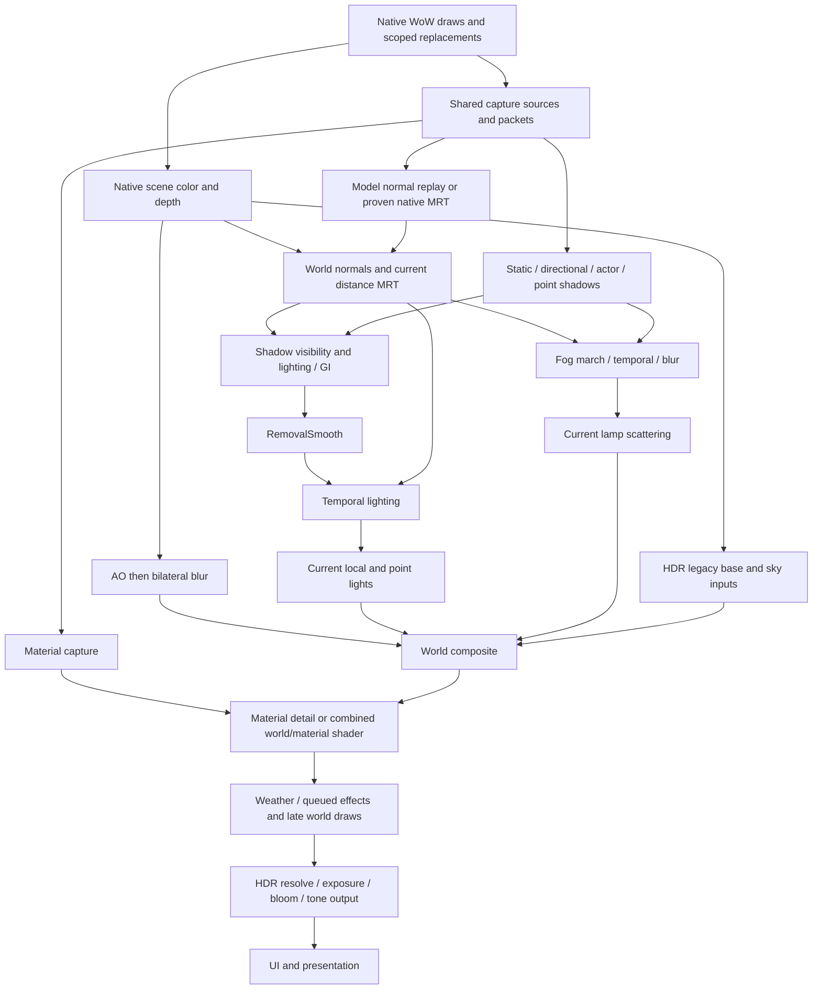

# Native work, capture and composition audit — 2026-11-14

Audited runtime: `06fbc8b31c385c541c737f7030c1b12089d342dc`.
This investigation does not change production shaders, the DLL, client settings
or installed data. It identifies where Northlight replaces work, where it still
adds work, and which proposed fusions need experiments. No new game FPS gain is
claimed. Read this with [the architecture contracts](architecture.md) and
[the preceding performance experiments](performance-20261114.md).

## Evidence and its limits

- Latest client log is still the run ending 2026-11-14 02:20:51, before the
  installed unused-constant normal-merge patch. No later gameplay run is present.
- Preserved log: `.local/out/test-output/performance-20261114/profile-before.log`;
  SHA-256 `e7d7a4d0b209a2bff31db6ec65a7cff64a2cfae6a0e68ba30e0a6b230b512737`.
  `profile-before-analysis.json` contains the sampled distributions below.
- Configuration: 3840Г—2160, MSAA 2, installed DXVK 3.1.1, HDR,
  legacy expansion 0.50, automatic exposure and wide bloom. Diagnostics and
  RenderProfile are on. Their CPU instrumentation is part of these samples.
- Private scene/depth/material capture: client diagnostics directory
  `session-60800-280247484-0`, `capture-1-*`. Its native trace explicitly has
  `whole_scene_replay=false`; it is not a complete geometry replay or FPS test.
- Historical investigations are evidence about their snapshots, not current
  acceptance. In particular, read
  [HDR glare/composition](../renderer/docs/hdr-glare-performance-20261031.md),
  [the previous pipeline audit](../renderer/docs/pipeline-performance-audit-20261101.md),
  [lighting/GI fusion](../renderer/docs/renderer-throughput-20261110-r80.md), and
  [the recovery audit](integration-audit-20261113.md) before repeating old work.

## What already replaces native work

| Native operation | Current ownership and actual work | Remaining opportunity / constraint |
| --- | --- | --- |
| Dynamic shadow-map generation | `native_shadow_control.h` leases the verified build-12340 runtime quality, setting it to zero before native caster preparation and rendering. Ownership restores the native setting when unavailable. | Already an upstream replacement. Do not disable it again through the saved CVar. At frame 381 and later the log says `runtime=0 configured=5 owned=1`; native maps during warmup do not prove steady-state duplication. |
| Terrain shadow sampling | `planTerrainShadowSwap` / `terrainShadowDraw` use proven shader replacements and scoped constants. | This is a receiver operation, distinct from native map generation. Keep unknown shader fallback. |
| Blob/contact shadows | Native blobs are retained at the configured reduced strength. | Different authored contact cue, not another rendering of the directional shadow map. Dropping them changes the picture. |
| Sun/moon bodies and glare | `celestial_disc_renderer.h` claims supported native bodies and suppresses their original draws/glare; Northlight renders the owned result. HDR omits the separate SDR veil. | Already replaces supported draws. Unsupported skybox/planet cases have separate ownership rules. |
| Selected native local lamps | `WorldRenderer::nativeLocalDraw` uses `ownedBank` to hand off only proven RGB slots, restoring the original bank after the native submit. | Prevents double brightness. It does **not** remove the corresponding vertex instructions: the shader still exists with changed uniform values. An exact specialized shader could remove proven owned arithmetic. |
| Native directional/ambient lighting | Native shading is still in scene RGB. `worldLightingValue` estimates the old direct term, subtracts its owned share and adds replacement lighting. Composition estimates the surface response from the lit color and baseline. | A major architectural additive cost. Raw material/albedo and native-light ownership would be needed to stop reconstructing already-rendered lighting. Merely zeroing native RGB breaks that reconstruction and prelit receivers. |
| Native fog | Ordinary world color already contains native fog; composition and material relighting account for its transmittance/color. Spell fog has its own integration into recorded fog constants. | No universal native-fog producer disable. PS3 fog can be explicit shader arithmetic, independent of `FOGENABLE`. A global render-state toggle cannot implement safe replacement. |
| Weather | Proven rain mist draws are skipped. Native rain drawing is adapted; supplemental precipitation, shelter and lens effects have independent roles. Sand uses its lens path without the extra precipitation pass. | Partial replacement, not a single redundant second weather system. Retain native texture identity, coverage and shelter proofs before removing a native draw. |
| Native glow and Northlight HDR bloom | The copy boundary explicitly flushes preceding spell draws so native glow sees them. HDR adds its own linear bloom. | Potential overlap, but no proof that their inputs/transfer/functions match. Native glow can carry other visual behavior; no blanket `ffxGlow` change is justified by this audit. |
| Native geometry and normal/material capture | The native scene is drawn, with separate capture/replay consumers. Source meshes, declarations and poses are shared where proven. | Real repeated GPU work remains even when source upload bytes are zero. This is a higher-priority target than deleting existing source caches. |

Relevant entry points: `src/proxy/renderer.cpp` (`drawHook`,
`captureGameDraw`, `materialNativeDraw`, `renderEffects`, `hdrBegin`,
`spellCopy`), `src/world/world_renderer.h`,
`src/proxy/native_shadow_control_windows.h`,
`src/core/native_shadow_control.h`, `src/lights/native_direct_ownership.h`.

The local-light log at frame 2921 reports 247 handoff draws, 541 owned slots,
75 observed matched slots and zero terrain handoff draws. This is positive
evidence for selected-source handoff, not evidence that every native lamp or
receiver is owned.

## Current dependency graph

This is the active full-quality path, with optional branches shown separately.
Order matters: native surface/texture mutations can drain capture queues early.

| Work | Grid / important dependency | Existing elimination or sharing |
| --- | --- | --- |
| Model normals | Full-resolution FP16 capture with depth/coverage contracts | Resident shared source, pose/constant caches, compact shaders, merge rules, native MRT only where eligible |
| Material capture | Native target dimensions; height/detail and optional occlusion | Deferred batching, range/visibility rejection, shared pose/source, capture output MRT; this is not automatically a merge with native color or model normals |
| AO в†’ blur | Half resolution; blur consumes neighboring AO results | AO application is folded into world composition. Neutral AO can use a 1Г—1 texture instead of a clear |
| WorldNormals | Half resolution, reconstructed geometry plus captured model normals | Writes the current dry-distance target in the same draw |
| Actor visibility / shadow filtering | Different hierarchy/filter grids and shadow inputs | Actor tiles and static shadow caches are already present; different light views are not interchangeable draws |
| Lighting / GI | Half resolution; visibility and probe inputs | Unshadowed lighting can merge GI for the eligible final source; other variants preserve their caps/performance guards |
| RemovalSmooth в†’ TemporalLight | Half resolution; spatial neighborhood followed by history validation | The temporal pass reuses current distance; its removed duplicate distance output must not be restored |
| Current local lights | Current light selection and normals | Reuses the dead raw-light target; batched direct and point work remain separate where shadow/input semantics differ |
| Fog and lamp scattering | Reduced grids, selected volume variant, current distance, history, height/shadows | Fog history/blur remain distinct from current lamp scattering; scattering lacks the receiver depth needed for surface reprojection |
| World composite / materials | Full resolution; world effects first, high-frequency detail afterward | Combined HDR shader exists; legacy expansion currently prevents its use. Name/prelit/unlit masks require the correct separate equations |
| HDR output | Full scene resolve, small exposure reduction, bloom chain, full-resolution output | Narrow bloom can reuse dead AO targets; wide bloom has its own small targets; output can also write the legacy mirror through MRT |

One enclosing saved-state scope is already shared across the terminal world
path. Demand planning avoids lighting/model-normal capture for AO-only frames
and uses `WorldDistance` for fog-only frames. Resources remain warm to avoid
camera-turn allocation churn; allocated does not mean rendered every frame.

## Measured costs

20 GPU samples after frame 500; milliseconds. CPU has 10 separately sampled
frames. These are instrumented intervals, not uncontended GPU busy time.
Do not sum independent medians or add CPU time to GPU time.

| Interval | Median | p95 |
| --- | ---: | ---: |
| Whole sampled GPU frame | 11.594 | 16.375 |
| GameScene, including inline capture work | 5.271 | 8.531 |
| ModelNormals after scene boundary | 0.709 | 2.261 |
| Deferred MaterialCapture at that boundary | 0.017 | 0.058 |
| Effects total | 3.671 | 4.468 |
| Tail after Effects | 1.684 | 2.066 |
| AO | 0.349 | 0.370 |
| AO blur | 0.200 | 0.246 |
| WorldNormals | 0.102 | 0.106 |
| ShadowFilter | 0.170 | 0.201 |
| GI | 0.168 | 0.190 |
| RemovalSmooth | 0.658 | 0.694 |
| TemporalLight | 0.057 | 0.062 |
| FogMarch | 0.291 | 0.299 |
| WorldComposite | 0.481 | 0.509 |
| MaterialDetail | 0.126 | 0.161 |
| CPU capture | 2.445 | 4.752 |
| CPU effects | 2.142 | 3.184 |

`MaterialCapture=0.017` is only the deferred boundary interval. It excludes
material work embedded in GameScene and is not the total capture cost.
Likewise GameScene is not a clean unmodified-WoW baseline.

The 1.684 ms tail is a measurement gap: `gpuEffectsEnd` marks the end of effects,
but HDR `Frame::finish`, late native draws/UI and the final frame timestamp are
not separately attributed. It must not be reported as 1.684 ms of HDR alone.
Useful next timestamps are pre-HDR late work, HDR scene resolve, exposure,
bloom, tone output and post-HDR/UI, preserving sampled nonblocking queries.

## Priorities for actual architectural savings

1. **Avoid model-normal replay at MSAA 2 without changing coverage.**
   `model_normal_native.h` rejects multisampled native targets with
   `target-msaa`; that is the recorded live fallback. The scene therefore
   repeats transforms/rasterization for normals. Frame 2921 had 301 queued
   packets and 191 submitted draws, despite resident sources. The next prototype
   should produce normals during a proven native draw, using a compatible MSAA
   attachment and an explicitly validated resolve. Averaging normal/depth
   samples is not automatically equivalent to the existing single-sample image.
   Preserve alpha-tested edges, late occluders, depth bias, state restoration,
   reset and whole-queue fallback. Removing the guard or lowering MSAA is not a
   quality-preserving optimization. This can only remove eligible replay work,
   not the whole measured interval in every frame.

2. **Stop reconstructing old lighting where the native surface is provable.**
   A receiver route with raw surface color and explicit native-light ownership
   could apply Northlight lighting directly and avoid its share of subtraction
   smoothing. Start with one exact opaque shader family, not every WMO/M2.
   Preserve native vertex color, prelit/baked components, texture layers,
   coverage and fog/HDR transfer. Unknown receivers retain the current route.
   A normal attachment alone does not provide raw albedo. This is the route
   toward replacing native work; deleting RemovalSmooth globally would revive
   lighting artifacts and does not implement it.

3. **Attribute and reduce full-resolution HDR traffic.**
   Expansion 0.50 currently requires the prepared HDR base; the inline-base
   route is gated off. `Frame::finish` also resolves/copies the composed target
   into its sampleable linear texture. A direct-to-texture/ping-pong design may
   remove a copy, but must preserve MSAA resolve, late world draws, native
   copy/readback boundaries, sky contributions and UI transfer. One texture
   cannot be sampled while it is simultaneously the output. First separate the
   tail costs so the proposed ownership change attacks measured traffic.

4. **Specialize proven native lamp arithmetic, not only its constants.**
   The existing source match is a useful prerequisite. A bounded shader-variant
   cache keyed by proven ownership mask could remove owned RGB computations
   while retaining alpha/fog/position and all unowned lights. Require exact
   native image/state tests for partial masks and shader families. Expected
   benefit remains unmeasured; draw-bank matching CPU cost must also be counted.

5. **Revisit expanded-HDR world/material fusion by backend and workload.**
   Existing combined code avoids an FP16 intermediate store/read and one draw.
   This is a bounded candidate, not the dominant cost. See the probe below.
   Use total graph timing, not the disappearance of the MaterialDetail label,
   because its work moves into WorldComposite.

6. **Separate CPU scene availability from GPU mesh demand.**
   `frame_requirements.h` sets `geometry` for fog/local lights and even
   `effects.gi` when GI strength is zero. `WorldRenderer::render` can therefore
   stage mesh/jobs before narrower geometry groups are needed. This deserves a
   configuration matrix, including local point-shadow demand, shelter, height
   data, probe publication and geometry transition history. It is not yet a
   proven removable cost and does not explain the current all-effects-on case.

Source sharing, static shadow caching, replay batching and capture preflight
optimizations already exist. The next CPU investigation should split the
2.445 ms capture interval into admission, pose/constants, material preparation,
native submit and replay scheduling before replacing those mechanisms.

## Fusions that should not be made blindly

- AO and its bilateral blur have a neighborhood dependency. A naive merged
  pixel shader repeats the AO kernel at each blur tap instead of sharing it.
- Horizontal/vertical bloom has the same problem; lower draw count can mean
  more texture work.
- Soft-shadow lighting plus GI was already prototyped and rejected for
  register pressure; the ordinary PCF/GI candidate exceeded the SM3 slot
  budget. The accepted unshadowed route is still present.
- RemovalSmooth plus TemporalLight is worth a separate experiment, but the
  old separation documents the 512-slot limit. Samplers alias current normals/
  distance versus history; the FP16 intermediate also affects rounding. Both
  image checks and GPU timing are required, not just successful compilation.
- Sun/moon cascades, actor maps and point-light faces have different transforms,
  coverage and reuse schedules. Drawing the same mesh does not make those
  results redundant.
- Temporal fog and current local scattering do not have identical reprojection
  data. Moving lamp fog into history would reintroduce a known temporal error.

## Expanded-HDR material probe

`scripts/probe_hdr_material_merge.py` and
`tests/hdr_material_merge_probe.cpp` preserve a manual experiment. Both sides
run the current graph's mode 2; only the combined material shader is toggled.
Comparing mode 1 with mode 2 would also change UI/decode behavior and misattribute
the saving. Warm ABBA blocks report raw CPU/GPU intervals and input hashes.
RGB uses `0.003 + 0.002*abs(reference)` tolerance, alpha is exact, nonfinite
values fail, and removing material detail must visibly change the control.
This is an experimental probe, not a named production acceptance suite.

The initial DXVK 3 run, with authored inputs and narrow bloom, completed three
image controls and their timings before its captured-input assertion failed:

| Completed initial case | Separate, ms | Merged, ms |
| --- | ---: | ---: |
| 1920Г—1080 | 0.1430 | 0.1381 |
| 3840Г—2160 | 0.5175 | 0.4637 |
| 3840Г—2160, MSAA 2 | 0.5317 | 0.4848 |

Those three controls had exact alpha, no nonfinite/out-of-tolerance channels,
maximum absolute scRGB error 0.0078125, a nonzero material control of 0.08203125,
and 62в†’61 draws with two unchanged resolves. They establish a limited candidate,
not captured-scene acceptance, bit equality or game FPS improvement.

The initial captured case used a constant authored material depth unrelated to
the captured projection. The current probe instead loads captured camera,
normals, distance and material height, and enables auto exposure/wide bloom.
That revised fixture compiles, but subsequent DXVK 2/3 attempts failed at
`CreateDevice` with `D3DERR_INVALIDCALL`, before any image/timing checks. They
cannot validate the revised fixture or justify changing the production guard.
No game process was present in the first probe's census; no game was closed.
Raw evidence is under `.local/out/test-output/pipeline-audit-20261114/`.

Re-run the probe when a D3D9 device can be created, with an isolated output
directory below `northlight_paths.output_dir()`. Use `--backend`, optionally
`--capture-prefix .../capture-1-`, and `--output`. If Forever is open, preserve
the user's standing permission with `NORTHLIGHT_TEST_ALLOW_RUNNING_GAME=1` and
record background contention. Before shipping any fusion, additionally run the
actual WorldRenderer mask/caps/failure/diagnostic tests and current source,
architecture and affected GPU acceptance; this small graph does not cover them.

## Follow-up: MSAA capture experiment

The [MSAA-normal investigation](msaa-normal-experiment-20261114.md) contains the
implemented native MRT prototype, GPU image oracles, final timing evidence and
its separate source branch. Hidden DXVK GPU tests now work under RDP with a
process-local physical-adapter override. Both the direct DXVK 2 sample-zero
resolve and the DXVK 3 copy-assisted variant failed performance acceptance on
the ordinary and skinned fixtures. Main therefore retains the existing MSAA
replay path; merely deleting it would not deliver the requested speedup.
