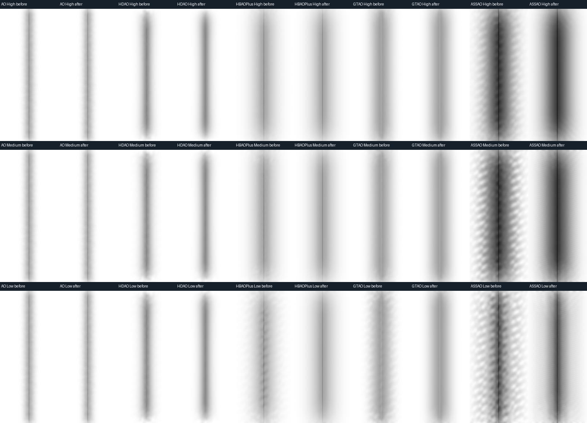

# AO methods for the D3D9 Northlight renderer

Set these keys in `[Quality]` in `northlight-quality.ini`, or use Lighting & AO in the settings menu and Apply:

```ini
ContactAO=1
AOMethod=ASSAO
AOQuality=Medium
AOStrength=100
AORadius=200
```

| AOMethod | Implementation |
| --- | --- |
| SSAO / 0 | Original Northlight 8-tap SSAO. Default; unchanged at strength 100 and radius 200. |
| HDAO / 1 | AMD AOFX-style paired valley detection, 16 pairs. D3D9 adaptation. |
| HBAOPlus / HBAO+ / 2 | D3D9 adaptation of the NVIDIA HBAO+ coarse kernel: 8 directions, 4 radial steps, normal bias, squared-distance falloff. |
| GTAO / 3 | Cosine-weighted horizon integration, 4 slices and 4 paired steps. |
| ASSAO / 4 | Intel ASSAO fixed Q0/Q1/Q2 adapted to D3D9; 12/5/3 paired samples. |

Names are case insensitive. Invalid values retain the default and produce a
QUALITY warning. `AOStrength` is 0..200 percent; 100 preserves the existing
strength scale. `AORadius` is 10..1000 hundredths of a yard; 200 means 2 yards.
`ContactAO=0` disables any selected method and its filter; bloom remains enabled.

All methods use the existing half-resolution targets and the depth/normal-aware
AO filter. Sky and water receivers are excluded. Each method runs in both the
world-GI and fallback paths; the fallback keeps the original simple colour bounce.
GI continues to supply colour bounce when the world renderer is ready.
The advanced methods need one extra alpha-only draw in the fallback path to
retain its original colour bounce within the Shader Model 3 instruction limit.
That draw now uses `*Only` and avoids five discarded Scene/bloom reads.
The startup log records the selected method, strength, radius and enabled state.

These are D3D9 adaptations, not the complete NVIDIA HBAO+ SDK or Intel XeGTAO
pipelines. There is no DX11 deinterleaving, depth-mip hierarchy or extra temporal
AO pass. The kernels have fixed sample counts. Quality and GPU cost still need
comparison in actual gameplay; a synthetic device test is not an in-game FPS test.

VXAO is not implemented: NVIDIA VXAO requires voxelizing scene geometry and
tracing the resulting volume, rather than reading the screen depth buffer.
It cannot be enabled through this screen-space method selector. An unsupported
`AOMethod=VXAO` is rejected instead of silently selecting a different algorithm.

Validation: `python tests/test_ao_methods.py` compiles an independent x86 hidden
D3D9 test device and exercises the production bytecode through DXVK 2. It checks
flat and tilted planes, concave corners, a separated foreground silhouette,
sky, water and strength zero in both composition paths. It also checks named
and numeric INI values, rejection of unsupported values, distinct kernel
outputs, and byte-identical original SSAO/filter/composite payloads.

Algorithm references:

- [AMD AOFX HDAO kernel](https://github.com/shadercoder/AOFX/blob/master/amd_aofx/src/Shaders/AMD_AOFX_Kernel.hlsl)
- [NVIDIA HBAO+ coarse kernel](https://github.com/NVIDIAGameWorks/HBAOPlus/blob/master/src/shaders/src/CoarseAO_PS.hlsl)
- [Jimenez et al., Practical Real-Time Strategies for Accurate Indirect Occlusion](https://www.activision.com/cdn/research/Practical_Real_Time_Strategies_for_Accurate_Indirect_Occlusion_NEW%20VERSION_COLOR.pdf)
- [Intel XeGTAO implementation](https://github.com/GameTechDev/XeGTAO)
- [NVIDIA VXAO requirements](https://developer.nvidia.com/vxao-voxel-ambient-occlusion)

Third-party notices for the adapted kernels are in `licenses/ao-methods.txt`.

## ASSAO and quality validation (2026-11-01)

High/Medium/Low use 12/5/3 ASSAO pairs, 4x4/3x4/2x4 GTAO paired steps,
8x4/6x3/4x4 HBAO+ steps, and 16/8/8 HDAO pairs. SSAO ignores quality;
HDAO Medium and Low have identical bytecode. Defaults remain SSAO/High.
ASSAO Low omits detail/edge/halo terms; Medium/High retain them. Strength and
radius retain their existing ranges. ASSAO may darken contacts more strongly
than other methods at the same strength.

The kernel uses [Intel ASSAO Q0/Q1/Q2](https://github.com/GameTechDev/ASSAO/tree/c21d57a95b43c700ee01a2eb18f5589d7becefb2),
with its progressive pattern, weights, radius limiter, obscurance falloff and
visibility curve. Northlight supplies normals, rotation and bilateral blur.
MIT attribution is in `licenses/ao-methods.txt`. No new targets/passes are added.
Adaptive Q3, deinterleaving and depth mips are not implemented; reproduction of
WoW Forever's integration is not claimed. Zero-offset sample rejection prevents
false shadows from normalizing reconstruction roundoff on distant terrain.

This independent branch preserves its own AO algorithms and blur, and does not import
HDR or actor-thickness implementation. Alpha-only shader output is compared to
ContactBloom as the shared SDR/HDR-input contract; complete HDR runtime and
actor integration remain in #98/#112.

On each packaged DXVK 2/3 backend, `tests/test_ao_quality.py` passes 549 basic
cases across all methods/qualities, 288 GTAO/ASSAO grazing cases, and 3,456 ASSAO
FP16/FP32 grid comparisons with odd sizes, two depth partitions, radii
0.1/2/10 yd and MSAA0/2/4/8. Alpha and fallback RGB comparisons remain exact.
The independent Windows x86 DLL builds. Whole-game FPS is not measured here;
combined microbenchmarks have their own snapshot attribution in #98.

## Visual regression lab



Synthetic corner, WorldComposite visibility, 160-pixel centre crops from
640x360 input. Each pair is before/after, without contrast stretching.
This image records the combined #98 implementation; this branch has separate
GTAO lower-quality and blur payloads, validated by the lab below.

Run the independent Windows GPU lab with NumPy and Pillow installed:

```sh
python tests/test_ao_pipeline_gpu.py --output out/ao-lab
```

Open `out/ao-lab/index.html`. Each sheet compares SSAO, HDAO, HBAO+, GTAO and
ASSAO at one quality. Its four rows are the production raw kernel, FP16 AOBlur,
legacy Composite and WorldComposite. White means fully visible; images have no
contrast stretch. The world pass uses neutral lighting/fog to isolate AO.

The default matrix contains 24 authored D24 scenes (640x360 and 641x361), three
qualities and five methods: 1,440 stage images. It covers flat/tilted surfaces,
vertical/horizontal/diagonal corners, a small camera dolly, grazing contact,
smooth/grooved cylinders, a separated silhouette, sky and water. The test checks
finite visibility, open surfaces, retained contact and residual pattern energy
on both corner orientations. Pattern budgets are expressed in 8-bit visibility
levels and allow more noise at Low. `report.json` records metrics and loaded
bytecode/backend hashes. This is synthetic visual validation, not gameplay or FPS.

Use `--backend PATH` for another standalone D3D9 backend, `--size 1920x1080`
for a native-resolution inspection, and `--compare out/ao-lab-before` for
before/after contact sheets. `--compiled DIRECTORY` replays saved bytecode;
`--observe` records expected failures when investigating an old build.

The November 1 rotation fix replaces two correlated sawtooth values normalized
into a direction with a uniformly distributed angle. The old function produced
diagonal bands that survived the bilateral filter, most visibly in ASSAO.
Symmetric kernels use an angular sweep appropriate to their sample budget;
the actor variants receive the same rotation fix in the combined #98 branch. Sample counts,
strength, radius, targets and the filter are unchanged. The SSAO bytecode is
unchanged. HDAO's paired-valley kernel still responds weakly to fine grooves,
and the sparse Low kernels retain more noise than High. These are method/sample
budget limits, not claims of parity with the full upstream pipelines.

The saved November 1 comparison in the combined #98 branch reduces corner-pattern RMS after AOBlur by
4.53x/4.27x/3.66x for ASSAO High/Medium/Low, and about 6.8x for both HBAO+ Low
and GTAO Low. Mean visibility stays within 0.0005 in that scene. The visual
matrix and the existing quality/grazing/grid tests pass on packaged DXVK 2.7.1
and 3.1.1. Actor AO in #98 passes the independent ray-reference checks on both.

To time a saved before/after pair without requiring pixel equality:

```sh
python tests/benchmark_ao_rotation_gpu.py --before out/ao-lab-baseline/compiled --backend /path/to/d3d9.dll --output out/ao-timing
```

This reuses the footprint stand's ABBA queries. Its default exact-pixel oracle
remains enabled; only the explicit `--measure-changed-output` mode permits the
intentional sampling differences. The benchmark warms 1,024 draws, then retains
12 batches of 64 draws per variant. On RTX 4090, with 1920x1080 inputs and FP16
960x540 AO targets, median paired changes in #98 over nine scenes were:

| Low kernel | DXVK 2.7.1 delta, ms | DXVK 3.1.1 delta, ms |
| --- | ---: | ---: |
| HBAO+ Only | -0.008624 | -0.005208 |
| HBAO+ ContactBloom | -0.009552 | -0.005728 |
| GTAO Only | -0.002192 | -0.000624 |
| GTAO ContactBloom | -0.000800 | -0.001872 |

These are elapsed raw-kernel query intervals, including possible submission
gaps. They show no median kernel regression on this device, not a guarantee
about whole-game FPS, other GPUs, or the complete AO/filter/composite cost.
