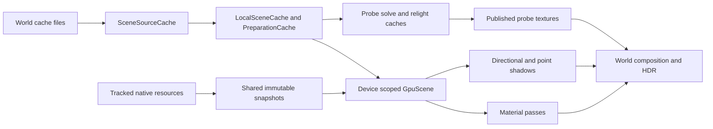

# Northlight cache architecture and reduced render work

Northlight retains data at three different boundaries: immutable source bytes,
prepared CPU geometry, and device resources or completed GPU results. These
boundaries have different keys and lifetimes. `NorthlightGpuScene::Scene` is
already the device owner shared by WorldRenderer and the material renderers;
combining the remaining caches into one generic cache would lose their distinct
invalidation and memory-admission rules.

The changes below remove allocations during bounded GI-cache replacement and
repeat point-shadow terrain draws. They preserve the existing quality settings,
shader payloads, refresh schedule and conservative handling of unknown actors.
Component measurements establish reduced work; they do not establish game FPS.

## Ownership and data flow



The producer owns discovery and copied native observations. The replay/render
thread owns D3D objects. Geometry, fog preparation and probe solving retain
worker-owned CPU state; immutable publications cross those boundaries.
`SceneSourceCache` synchronizes shared sources, while `ProbeCache` belongs to
one worker and `ProbeRelightCache` synchronizes accesses from the solve pool.

## Cache inventory

This inventory groups the runtime caches and retained pools by their actual
reuse contract. Limits are per cache or consumer, rather than a sum of physical
GPU memory: shared allocations must be counted once.

| Layer and implementation | Reused data and key | Lifetime and invalidation |
| --- | --- | --- |
| Proxy `device_mirror.h`, resource mappings and draw-hook lookup tables | Device state, raw/proxy identities, known slots and shader classifications | Device/owner lifetime; unknown state, raw scopes, resource destruction and reset invalidate the relevant proof. |
| `vertex_declaration_cache.h`, shader patch maps in `renderer.cpp`, HDR and material renderers | Held immutable COM shader/declaration identities, decoded layouts, patched variants and rejected variants | References prevent pointer reuse; explicit release/reset clears device resources. Declaration cache has 128 slots. |
| `replay_copies.h`, `tracked_buffers.h`, `particle_uploads.h` | CPU mirrors of native buffer writes, identity/revision and exact byte ranges | Writes maintain mirrors; GPU writes, incomplete data, release and pressure invalidate them. Pins protect readers; refill/backoff bounds expensive fallback reads. |
| `particle_texture_stats.h`, `material_height.h`, `actor_texture.h` | Small uploaded particle mips, material texture bytes and statistics, keyed by lifetime/revision | Partial or failed writes invalidate; managed CPU content can survive reset. Particle pixels have an 8 MiB budget and lazy decode. |
| `draw_snapshot.h` | Shared immutable meshes, exact resource revisions, draw/layout/range keys, replay-content candidates and decoded index/compaction plans | Shared `SourcePool` joins material and shadow captures. Revalidation, LRU pressure and explicit trims release ownership; outstanding immutable owners remain valid. |
| `terrain_capture_bounds.h`, `terrain_indices.h`, `position_bounds.h` | Terrain snapshots, shared compact indices, decoded metadata and tracked vertex bounds | Geometry revision and declared ranges are part of the proof; per-frame bookkeeping is separate from retained source content. |
| `scene_source_cache.h` | Decoded FGS sources and independently retained source-revision tokens | Path plus checked size/time stamp; default 8 MiB. Payload eviction can preserve identities so prepared geometry remains reusable. Live leases stay accounted. |
| `world_gi.h/.cpp` `LocalSceneCache` | Transformed placement pieces, BLAS/chunks, assembled geometry and TLAS/fallback BVH | Map, asset revision, placement, crop and build mode; default retained-piece budget 32 MiB. Published immutable geometry can outlive eviction. |
| `world_mesh_plan.h/.cpp` `PreparationCache` | Prepared triangles, materials and upload pages | Weak geometry identity and exact page keys; borrows the geometry cache's unused allowance. |
| `mesh_buffer_store.h`, `mesh_pool_trim.h` | Content-keyed GPU pages and idle buffer capacities | Active pages cannot be overwritten. Staging invalidates a page before writing; commit swaps tables, cancel preserves only unwritten content. |
| `scene_native_store.h` | Canonical native vertex/index uploads shared by material/shadow consumers | Exact immutable source identity; probation proves reuse before upload. Shared batching, frame-protected LRU, 32/64 MiB consumer caps, bounded upload attempts and pressure accounting. |
| `replay_gpu_cache.h`, `replay_gpu_batches.h` | Earlier per-mesh/batched residency implementations | Retained comparison/selection paths; production shared-scene consumers use `NativeStore` through `NativeClient`. |
| `live_terrain_gpu.h`, `uploadLiveTerrain()` | Persistent terrain vertex arena, directional index lists and fenced index-ring slices | Immutable owners/content identity, mesh generation and exact sorted active membership. Query retirement never waits; rollover retains the DISCARD fallback. Unchanged active lists already skip upload. |
| `static_shadow_scene.h/.cpp`, `static_shadow_gpu.h` | Compact static models, shared alpha textures, residency and per-matrix draw plans | Model content revisions, map generation, coverage ownership and cache epoch; bounded staged upload and per-model plan invalidation. |
| `world_renderer.h` shadow keys, `static_cache_slices.h`, shadow transition code | Directional static depth maps, dirty rectangles, cached anchor/offset and transition history | Light direction/frame, scene/static signature and covered content. Partial redraw records the final key only after completion; reset/failure invalidates it. |
| `world_point_rendering.inl` | Per-light static faces, completed cube faces, face digests, content memo and eight retained static slots | Source/light shape/map, exact static content, refresh schedule and face-cycle state. This change also validates committed mesh/live-terrain revisions for actor-free completed faces. |
| `rigid_memory.h`, `static_m2_dedup.h`, actor selection history | Remembered rigid casters, drawn-state proofs and stable actor selection | Exact source/placement and observed motion, range, visibility, teleport and hold policy. They preserve coverage when the game's view omits a previously observed object. |
| `sampled_vertex_cache.h`, `actor_deformation.h`, `replay_envelopes.inl`, `replay_bounds_metadata.h` | Decoded source inputs, rigid/single-bone proofs, skin envelopes, prepared bindings and shader/layout metadata | Immutable mesh/program/declaration keys; current pose and camera are evaluated separately. Envelope cap 8 MiB/4096 entries; exact-result memo 64 slots/256 KiB with profitability backoff. |
| `worker_actor_memo.h`, actor jobs and replay-bound jobs | Worker actor geometry/results and preparation handoff | Weak packet identity and validated immutable inputs; cancellation/quarantine prevents abandoned jobs from lending stale mutable caches to the next frame. |
| `world_probe_cache.h` `ProbeCache` | Solved world-grid probes, including invalid results; LRU export resolves modulo aliases by recency | Caller clears on geometry, map, lighting or solver changes. Capacity follows the configured atlas, with the existing maximum layout preserved. Replacements now recycle nodes. |
| `world_probe_cache.h` `ProbeRelightCache`, dynamic probes, activation/blend history | Light transport responses, moving-geometry corrections and probe publication continuity | Exact transport shape, seed and geometry generation; relighting can reuse responses across colour changes. Relight storage remains bounded at 4 MiB. |
| `auto_normal_cache.h`, `material_map_persistence.h`, `material_disk_cache.h` | Generated normal/height maps and asynchronous disk results | Source revision, material settings/domain, generator and backend identity. Leases protect borrowed maps; memory pressure bounds working sets. Disk jobs are capped at eight/12 MiB and disk storage at 4 GiB. |
| `auto_displacement_renderer.h`, material renderer deferred replay, `shared_pom.h` | Height reads, geometry/displacement entries, source/material fingerprints and optional shared POM results | Exact source, layout/program, texture versions, addressing, UV constants and material domain. Displacement retains 32–128 MiB under the existing pressure policy. Shared POM remains an explicit experimental opt-in. |
| `world_local_lights.h`, `model_light_attachments.h`, `native_scene_lights.h`, selection trackers | Per-map FGL/FGA records, native model assets/curves, current attachment positions and source selection | Map/asset identity and bounded native observation; pose and current light state are evaluated independently of static metadata. |
| `regional_fog.h`, `regional_fog_cache.h`, atmosphere preparation | Regional tile data, rasterized terrain/WMO field and prepared fog parameters | Accepted map/region/field support; fog preparation remains independent of GI/BVH upload. Camera travel triggers the existing refresh policy. |
| `fog_clouds.h`, `dither_noise.h`, sky material/asset renderers | Generated noise/gradient tables, immutable dither ranks, sky assets and prepared composition state | Process/device or parameter lifetime; immutable lookup tables do not need frame invalidation. |
| Celestial terrain masks and `celestial_disc_renderer.h` | Terrain occlusion, halo/ring visibility and celestial shader/assets | Terrain generation/projection and explicit history validity; scene/view changes and reset invalidate the applicable mask/history. |
| World screen resources, `probe_texture_upload.h`, temporal/fog/removal passes | Published probe atlas, previous SH values, light/depth/fog histories, reusable screen targets | Publication serial/full world key, accepted history/view state, dimensions and format. Scratch targets are retained capacity, not proof that the current frame's pixels are reusable. |
| `hdr_frame.h`, `hdr_color.h`, `hdr_sky_foreground.h` | Exposure history, screen scratch, native shader variants and support/rejection proofs | Device shader identity/variant and size/format; exposure responds to scene cuts and invalidation. Reusing scratch allocation does not skip exposure/composition work. |
| `saved_state.h`, `snapshot_store.h`, command/replay pools, retirement queues | Four pooled stateblocks, immutable snapshot storage, command payload capacity and delayed resource destruction | Capture/restore leases, producer/replay epochs, byte caps and GPU completion fences. A pool cannot substitute for resource-content validation. |
| Atlas proof, GPU/profile histories and memory ledgers | Diagnostic hashes, bounded samples and cached accounting summaries | Observation revision/frame and explicit resets; these retain evidence and accounting, rather than image content. |

Generated world-cache variants and material files are persistent content caches.
Zig/Python build caches and DXVK shader/pipeline caches belong to the toolchain
or backend; changing their policies does not replace renderer invalidation.

## Implemented changes

`ProbeCache::putMissing()` now extracts the oldest hash node, changes its key,
and reinserts it while moving the existing list node to the front. The initial
`reserve(capacity)` guarantees room for that reinsertion. Growth still uses the
original exception-safe insertion path. Full-cache replacement allocates no
nodes and keeps the same LRU order, invalid-probe retention and atlas winners.

Point-shadow cubes now record a per-face proof that the completed face contains
only static geometry and terrain. A hit requires no current replay candidate,
unchanged committed mesh generation, unchanged live-terrain revision and no
static-face rebuild. The live revision advances before every non-reused terrain
upload, including deferred/failed and empty uploads. Ordinary immutable-owner
reuse leaves it unchanged. Actor entry removes the proof; actor departure first
restores the geometry-only face. Failed writes and detached cubes clear proofs.
Partial-face scheduling retains its previous logical workload weights.

The new metadata adds two six-element revision arrays and a mask per point slot.
It adds no GPU allocation, sampler, texture or shader variant. CPU culling still
runs on a hit so a newly entering or unbounded actor cannot be missed.

## Controlled measurements

Windows x86, Zig 0.15.2, O2. Paired blocks share one executable and inputs.
Four warmup blocks are discarded. GPU evidence is an authored two-surface
terrain scene at the existing 256-pixel cube resolution, not a gameplay replay.

| Component workload | Before | After |
| --- | ---: | ---: |
| GI cache allocations across 8192 full-cache replacements | 16385 | 0 |
| GI cache CPU time across 131072 replacements and warm reads | 12.9979 ms | 6.1857 ms |
| Terrain-only point refresh draws | 2 | 0 |
| Native D3D9 CPU submission per terrain refresh | 0.111811 ms | 0.092530 ms |
| DXVK 3 CPU submission per terrain refresh | 0.110115 ms | 0.089714 ms |
| Native D3D9 timestamp interval per terrain refresh | 0.034512 ms | No render work submitted |
| DXVK 3 timestamp interval per terrain refresh | 0.045264 ms | No render work submitted |

The GI comparison isolates the old insertion body with every other operation
shared. The GPU control disables only the new complete-face proof. Timestamp
intervals can include submission gaps; a reported zero is not a claim of
unlimited timer precision. Point timings are from `point-after/validation.json`;
later correctness runs are not substituted into this comparison.

## Validation and reproduction

`test_probe_cache_recycling.py` compares exact cache/atlas results over negative
keys, alias collisions, invalid probes, LRU touches/replacements, tiny capacities,
clear/refill and 16/22/42-wide atlases. O0 and O2 builds verify deterministic
allocation counts. `test_point_shadow_stutter_gpu.py` compares all six R32F faces
against forced redraws, including actual live uploads, membership changes,
light/mesh changes, partial cycles, actor entry/departure and failed writes.

O0/O2 and Linux ASan/UBSan checks pass for the new cache. Nine related CPU
scripts pass, as do the production progressive-worker/helper checks in O2 and
ASan/UBSan. Its old helper rejected a 24-wide request despite the existing
40-wide limit; the same assertion fails against the preserved pre-refactor
header. The test now rejects `ProbeGridMaxN+2` instead.

Native D3D9 and DXVK 3 pass the extended point-shadow oracle, point terrain
coverage and pipeline initialization; shared GPU wiring also passes. A separate
baseline/current live-terrain oracle passes 224 comparisons per backend across
MSAA 0/2/4/8, membership/revision changes, empty sets and reset. The full suite
was not run; the concurrently edited suite inventory contains unrelated new
tests, so the final progressive-worker check runs directly.

The production DLL builds through `scripts/build_renderer.py`, retaining the
compiler preflight and shader freshness gates. Its embedded source identity
matches the current generated sources. DLL SHA-256:
`24301186a974605d8b287c10f694ef5d0986f91c45d0cdf6fcd65a1f2ec75d38`.

Run native Windows builds/tests outside the restricted sandbox as required by
`AGENTS.md`:

```powershell
python tests/test_probe_cache_recycling.py
python tests/test_point_shadow_stutter_gpu.py --backend C:/Windows/SysWOW64/d3d9.dll --backend D:/Games/335_engb_mod/renderer-backends/dxvk/dxvk_d3d9.dll --output out/cache-audit-new
python scripts/build_renderer.py
```

Private baseline sources, raw logs and receipts are under
`out/cache-audit-20261112/`; CPU allocation/timing logs also live under
`.local/out/test-output/test_probe_cache_recycling/`. The installed client and
its settings are not modified by these tests.
