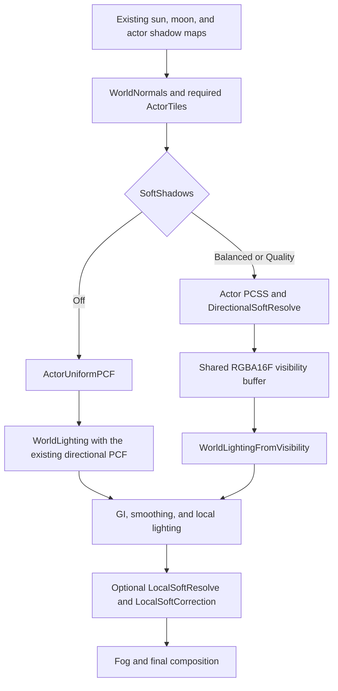

# Contact Hardening Shadows for Northlight

The historical project of 1 November 2026 is described in [PCSS extension](pcss-filter-extension-20261101.md).

The recommended path is to extend the existing PCSS on ready-made shadow maps by highlighting the processing of visibility into an off-line phase. Geometry, number of cubes and schedule for updating them does not change this stage. In the original plan, the first step covered the sun, moon and characters; the second added soft shadows for one or two significant local sources.

At the time of the study, only selected prototypes had been tested.0|1the sun/moon and all available locally selected sources. 0|1|2 and restrictions on the use of 1–2 Local sources do not describe the final implementation below. The game files have not been changed.

## What has already been implemented

| Subsystem | Current mode | Where to look |
| --- | --- | --- |
| Sun and moon, environment | Disruption of near/far Shadow Maps; fixed PCF, 25/16 sample | `shaders/world_effects.hlsl`: `shadowMap`, `directionalShadow`, `WorldLighting` |
| Nearby actors and mounts | Separate 1024² map covering 24×24 world units and a separate half-resolution PCSS pass | `ActorShadow`, `ActorTiles`; `src/shadows/actor_shadow_map.h` |
| Local lights | R32F cubemap with 256² pixels per face and four PCF samples | `shaders/local_light_effects.hlsl`: `localVisibility`; `world_point_rendering.inl` |
| GI | CPU BVH on background worker, including Shadow rays in light transfer calculation | `src/gi/world_gi.cpp`: `BVH::trace`, `BVH::occluded`, `transport` |

So there's actually a path in the project, but it's serving the GI. The finished GPU route ray truced direct Shadows does not exist in the research path. `ActorShadow` already gives the required CHS principle: sharp contact and extension of the half with the removal of blocker from receiver. Now the search contains 41 sample, then a continuous tent filter up to 81 sample. For most pixels covered, four tile minima readings allow the work to be completed earlier.

[AMD ShadowFX](https://github.com/GPUOpen-Effects/ShadowFX) Implements CHS by filtering shadow maps and is designed for DX11/DX12 with SM5 for our D3D9/SM3 own compatible filter on available resources; the individual [AMD Hybrid Shadows](https://github.com/GPUOpen-Effects/Hybrid-Shadows) uses DXR 1.1; this is a different architectural path.

CPU BVH is useful as a reference for test scenes. It is not proposed to use it for each screen pixel in runtime: one beam per pixel half-res 1080p at 60 frame/s requires 31,1 million requests/s per source, without accounting for soft shadows and updating geometry. Screen-space Ray Marching can be considered later for small contact details, but it is limited by visible depth and does not replace off-screen blockers.

## Relationship to the optimization of Stormgrad

Original `qa_report/northlight-renderer.log` found 19 GPU cuts from `ActorShadow` and `PointShadow`, line 547–6871:

| Interval | Median, ms | Number of cuts |
| --- | ---: | ---: |
| ActorTiles | 0,010 | 17 |
| ActorShadow | 0,034 | 19 |
| WorldLighting | 0,081 | 19 |
| PointLight | 0,170 | 19 |
| PointShadow | 24,181 | 19 |

Cuts include footage without work of certain passageways. This is an old problem grab, not the result of a new CHS or measurement after corrections. In the log, the adapter is called RTX 3080; the PCI vendor there differs from the name, so before the new benchmark, you have to rewrite the real device, backend and resolution.

The chat room [Analyze Stormwind FPS bottleneck](thread://01a19774-6639-7923-bcfa-62ee6e6e2dd1?hostId=local) has corrected the bows coating, a general list of terrain, refresh in a dense scene, reuse of fixed edges and total time resources. The architecture review from this chat room is taken into account below: separate actor card and filter readiness, fog tiles retention, checks `slot.ready`, linear depth blocker, and visual packaging in RGBA16F.

CHS consumes the final maps after these optimisms. There is no change `PointShadowLimit`, source selection, refresh, face cycle, coherent signatures, backgrounds and caster admission. You cannot return the old bottleneck additional backplay for soft shadow.

## Individual stage of visibility

Proposed settings `SoftShadows=0|1|2`: Off, Balanced, Quality. This is a new design key that is not yet available in the seizure. It controls precisely the concert hardening. `ActorShadows`, `ActorShadowDetail`, `PointShadows`, and the overall shadow switch retains its function.



CHS is a separate measured step that can contain several draw calls. One big shader enry is not needed here.

For CHS, one half-res `A16B16G16R16F` Target is used:

- R/G is the visibility of an actor map of the sun/ moon;
- B/A is the visibility of the directional map of the sun/ Moon.

Target is cleaned white once. First all the necessary tiles are prepared. Then the compact actor/directional shaders write only their channel with the blanking off, without switching between intermediate margets. Consumer does one reading and `min(value.rg, value.ba)` selects the current source channel and performs the rest of the lighting. It no longer calculates the directional PCF.

This preserves the existing way of combining independent maps. `min` two filtered views are approaching for overlapping sides; physically accurate integration would require a joint check of the stockers prior to filtering. This change is not part of the first step.

FP16 eliminates the additional 8bit Quantum of directional visibility. The logical size of target is 3,96 MB for 1080p and 15,82 MB for 4K. If it replaces the current A8R8G8B8 actor Target, the increase is 1,98/7,91 MB. This is the amount of pixel data without driver overhead. Actor and directional do not receive separate full-screen tags or a separate story.

The owner of the visibiliability-target should be separated from the actor Shadow Maps. For Off, it is only needed by the existing actor resolve and can use the current A8R8G8B8; for a CHS on, it is also necessary without an actor card. The format change should not release cards, drop caster routing or reconstruct static caches. If the new turget is not placed in the current memory dudget, then there remains a normal shadow path.

## Algorithm and value limitation

The PCSS consists of searching for blokers, evaluating the width of the half-wall and filtering depth comparisons. For directional light:

```text
separation = max(receiverPlaneDepthAtTap − blockerDepth, 0) / inverseDepthSpan
penumbraWorld = clamp(tan(lightHalfAngle) × averageSeparation, minWorld, maxWorld)
radiusTexels = penumbraWorld / shadowTexelWorldSize
```

It is important to calculate separation with the receiver plane. Otherwise, the slope of the surface will mistakenly increase the half. Geometric normals and conference are taken from the total `WorldNormals`; matrial normals continue to affect the light without replacing the bis-normal.

The first application saves the existing actor PCSS when CHS is activated: its continuous tent already eliminates animation surges. The initial range of actor half is still 0,05–0,10 world units. A simple replacement for a few noisy samples without an animation check is not acceptable.

For the environment, a CHS is first added to the Near cascade. The Far retains the PCF and the existing transition between cascades. This is the obvious boundary of the first version: remote shadows are still flexible. Radio is set in world units, then translated into texels; the cascade boundary should not change the width suddenly.

Two limited cores are proposed for the prototype of a niear filter: Balanced – 8 blocker + 16 filter samples, Quality – 16 + 32. These initial budgets are for quality comparison and not already tested presets. The Samples are fixed in map coordinates; there is no precipitous rotation and no new temporal denoiser in the first version. The size of the kernel is limited to four sets of near cards; broader softness requires separate testing.

The zero result of the diluted blacker survey does not prove that there is no fine caster. At such a pixel, you need to use the basic PCF; you can only return "fully lit" on conservative evidence of coating. You cannot carry an actor tale minimum to a world map: there's another geometry. A new minimum hierarchy for world is not needed yet; it should be added only for measured benefit.

For Off directional, it remains the same `WorldLighting`, the actor card is read in a fixed continuous PCF with minimum radius. Blocker search and new directional resolve are not launched. The conservative actor tale-out is retained with the area of evidence under a fixed radius. This shuts down CHS by keeping the smoothed normal shadows; `ActorShadowDetail=0` still separates the detailed map.

## Local sources

The local CHS is introduced by a second step. The design of `LocalSoftShadowLimit` limits it to 0–2 sources from already selected and ready `PointSlot`. The value 0 only turns off additional softness. The remaining sources retain current PCF shadows. The CHS choice uses the value in frame and hysteresis for `sourceId`; softness over sorting does not change the main Shadow selection.

`Light` now does not have a physical radius of the radiator. `attenuationEnd` sets the range of light and is not suitable for the width of the half. The first test requires one clearly artistic small emiter radius independent of fallsoff; FGL1 is not required to be modified for this verification; later, the radius can be given for specific types of sources.

The Cube keeps a promising one. `z/w`B. For direction `q`normalized so that its maximum absolute component is equal to 1:

```text
A = far / (far − near)
blockerAxialDistance = A × near / (A − storedDepth)
blockerRayDistance = blockerAxialDistance × length(q)
penumbraWorld ≈ emitterRadius × (receiverDistance − blockerRayDistance) / blockerRayDistance
```

The semi-shadow formula is the local approach of a small source. The empty depth, non-consensual gap and generic denominators need to be excluded. `localCubeTexelRay`, receiver-plane comparison, bias in world units and cross-border processing; directly average `z/w` You can't have different sides.

Separate treatment of one source consists of two compact screen passes:

1. `LocalSoftResolve` Reads only the finished `slot.cube`, dept, water and geometric normals. The RG general transient Target records `V_PCF` and `V_CHS`. After `WorldLighting`, the previous directional visibility is no longer needed, so memory can be reused.
2. `LocalSoftCorrection` Adds strict differences to the existing FP16 Light Target:

   ```text
   deltaRGB = contribution × relevance × selectionGain × (V_CHS − V_PCF)
   ```

Both passes are performed only within the existing Conservative Light scissor. This is a maximum of four additional screen drow calles for two lamps, without new caster draws. `LocalSoftResolve` records neutral `(1,1)` for rejected pixels, does not leave them through discard. Correction only consumes a well-recorded area of the current source. Source ID, framework and current pair of masks should coincide; the previous mask cannot be read.

The main PointLight remains unchanged. `contribution`, attenuation, normal/material responsion, water rejuvenation, day weakening and relevancy are taken from the same common HLSL logic as the main passageway. The difference may be positive or negative; RGB-only addictive blending and signed FP16 Target is needed. Rereading full offset instead of delta will spoil brightness.

These passageways are located after the base pointlight adjustments and until the existing world-constant/sampler restoration. Local CHS does not receive a new story: the current local radiance is already occurring after `TemporalLight`. It is also necessary to restore modified RT, viewport, scissor, blend and color masks.

Before `LocalSoftResolve`, all sampler links of the reused visibility-target are removed and then it is assigned to render target. Before `LocalSoftCorrection` RT returns to `lightSurface`, and only after that, the visibility connects as texture input. It is not possible to read and write one surface at the same time; recovery of states at the end does not replace these transitions.

## Readiness and refusal contracts

`actorMapOn` Now depends on the map, `actorShadowPS`, `actorTilesPS` and `actorVisibility`. This connection must be separated before the switch is added. CHS Off cannot return characters to the nier cascade simply because of the blackout of PCSS entry. The basic actor resolve should be ready before deciding which caster draws would skip into the nier cascade.

Tiles users are accounted for separately: actor resolve and fog. `ActorTilesWide` needs fog, and `actorTilesWideCurrent[source]` confirms the extended area of the current frame. Disablement of CHS does not release the right fog resources and does not set up normal tiles instead of a wide option.

For each celiastal source, the result is considered ready only after successful recording of all required channels. Inactive sources and missing actor cards give neutral visibility. When a new resolve consumer error returns to the normal directional PPF and base actor resolve; partial packed target does not become "manual." The option filtering error should not turn off all lighting.

Local reolve checks `slot.ready`, not just `pointReady`, and reads the final `slot.cube`. Grans may have different ages according to the current schedule. CHS does not require mandatory updating of all six dimensions. `pointScratch` and `pointDepth` general and rewrite; use as published maps is prohibited. Errors of a new effect are treated separately from `pointCheck` to avoid disability of a functional cube cache.

Consumer saves `baseline.a`, control outside the far cascade, sun/ Moon contribution, weather softening, water/sky extensions and HDR rules. When quality changes, lowing history is dropped but not Shadow-map cache. F9, card change, Reset and resise pass through existing life cycle rules. The new key cannot be included in the list of forced off at `ActorShadows=0`: environmental softness is independent of characters.

## Which is verified by the compiler.

Isolated sources are collected by the state-owned Microsoft d3dcompiler_47, IEEE strict, `ps_3_0`. No production headers, manifests or Shader binaires were re-recorded.

| Prototype | Static slots | Temp registers | Result |
| --- | ---: | ---: | --- |
| Current ActorShadow | 332 | 10 | Base point |
| Current WorldLighting | 411 | 16 | Base point |
| Direct integration actor and directional into one entry | 537 | 17 | Exceeds the chosen base limit 512 |
| Select directional resolve with current PCF | 257 | 13 | SM3 gate passes |
| Consumer packed performance with `min(RG, BA)` | 233 | 9 | Passes; does not read Shadow Maps |
| ActorUniformPCF with a safe-early-out | 253 | 10 | Passes; sampler tiles saved |
| Local delta consumer from the finished pair | 246 | 9 | Passes; cube sampling is not available |

This test of the ability to divide work and give filters their own instruction budget. Directed CHS and LocalSoftResolve with new kernels still have to be compiled and GPU checks. The number of static instructions does not take into account the dynamic number of iterations or is not a speed measurement. In particular, removing a data range-out gives 217 slots in uniform actor-prototype but can make the highlighted pixels more expensive; this option is not selected.

Prototypes, hashs and results are in `.local/contact-hardening-design-20261101/`. `check_feasibility.py` reproduced compilations; `feasibility.json` contains statistics and hashs; `evidence.json` -- recovered clippings of the game log and heshes of the files studied. These are local research artifacts, not part of the supply of DLL.

## Budget and acceptance

Initial engineering target for full Balanced Effect at 1920×1080 confirmed GPU from the test bench: **Add to frame not more than 0,5 ms by mid-point and 1,0 ms by P95** including selected local sources. This is a target budget, not a promised result. 4K needs to be measured separately: the number of half-res pixels increases fourfold. KPU filter work should not depend on the number of caster packages.

The sum `ActorTiles + ActorResolve + DirectionalSoftResolve + WorldLighting + LocalSoftResolve + LocalSoftCorrection` is measured, as well as the full frame. The comparison only 411 against 233 slots will hide the work carried out and the additional readings depth/normals. Profiling uses the existing asynchronous ring without flush/wait; `NorthlightGpuProfile` now has 42 markers, capacity needs to be checked for a frame with two celis and all effects.

If the budget is exceeded first, the number of local CHS sources is reduced, then the quality of the new nier filter is reduced. Shadow radios, caster selection and the number of basic shadowed lights are not reduced by this effect. The first version selects the quality clearly; a new automatic controller is not required.

| Verification | Criterion |
| --- | --- |
| Segregation without new algorithm | The individual resolve with the previous PCF/PCSS saves the image within the clearly measured format error |
| Contact and penumbra | Stop is still in contact; a raised object has a single-tond extension of the half; thin fences and wings do not disappear |
| Spatial sustainability | No new jumps at cascade boundaries, actor inset and cubes; low sun and tilt surfaces checked |
| Movement | Camera turn, idle-imulation and character movement checked by human sequences; static screenshot is insufficient |
| Off and Errors | No CHS locker search/directional resolve/local control; maps and shadows remain; inaccessible resource provides the basic route |
| Independent settings | `ActorShadows=0`, `ActorShadowDetail=0`, `PointShadows=0`, CHS Off, fog on/off and twilight with two sources operate independently |
| Cube cache | Same draws, update/reuse accounts and control; checked missing frame, appearance/disappearance actor, change source ID and face cycle |
| Local delta | With the same visibility delta equals zero; no double light; water, daytime interior and intersecting lamps retain rules |
| Lifecycle | Reset, resize, change of map, memory deficit and live-toggle leave no stale visibility or render states. |
| Productivity | Native D3D9 and DXVK: the same scene, settings and camera; warming up, rotating Off/On, median/P95 full frame and sum of passes |

Existing `validate_actor_filter_gpu.py`, `test_model_normals_gpu.py`, `test_point_shadow_visibility_gpu.py`, `test_local_shadow_receiver_gpu.py` and `test_point_shadow_schedule.py` tests should be used; new tests should complement actual GPU scenarios and formulas, rather than simply checking the availability of lines in the source.

## Implementation modalities

1. Record a compatible basic assembly after the current optimism of shadows and record the re-entry of the bridge in Stormgrad.
2. Segregate the actor card readiness from filter re-business, select visibility target and consumer; first save old algorithms and check the image.
3. Add a full Off with uniform actor PCF and saved data year-out; then new directional CHS and profiling. Activate settings through `quality_settings.h`, schema and overlay, update Shader manifests to the regular compiler.
4. After the budget has passed, add limited LocalSoftResolve/Correction. changes here to be agreed with the owner `world_point_rendering.inl`, retaining his cache/refresh contracts.
5. Only after GPU's rebounds and a new game grab will you choose defaults for presets and collect the DLL delivered.

This GPU ray tray trays remains a stand-alone task: GPU acceleration structures, dynamic geometry, alpha-tested any-hit, synchronizing and denoising. The performance contract will connect this product later, but the current implementation of GI does not make this path ready.
