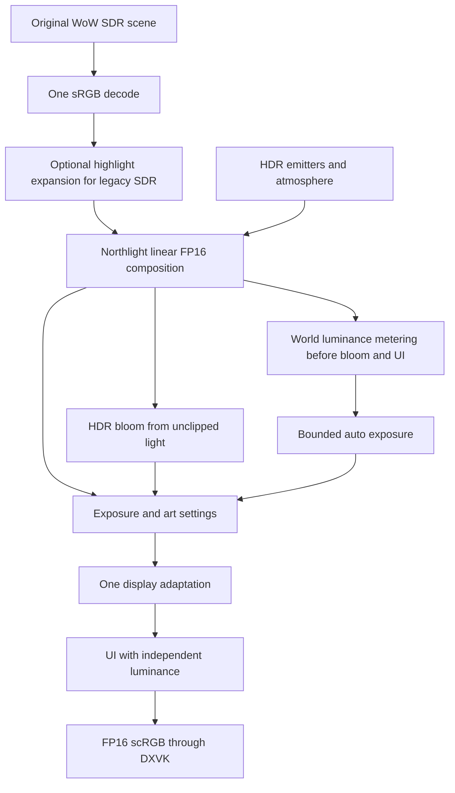

# Northlight HDR pipeline specification

Status: agreed; code of the first phase implemented. Transfer between physical displays is postponed by agreement; visual acceptance of game scenes and full frame budget not yet confirmed. Date: 2026-10-31.

The first phase preserves the brightness of Northlight light in linear FP16-buffers prior to final display, adds auto exposition and calibration, provides a transition between SDR- and HDR-displays without re-starting the game. Normal surfaces retain the usual character of the image; additional luminance and detail are concentrated on light sources, blares and lights.

## Mandatory outcome

The first stage covers its own lighting, Northlight, GI, Sun and Moon, atmosphere, light scattering, and blue. Sources are given a range of brightness above normal white before conversion to display. Disable the bloom saves the HDR brightness of the source itself.

The mandatory platform is Windows with DXVK 2 and DXVK 3. The normal window and frameless full-screen mode are maintained. The existing versions of the MSAA and the logical backbuffer client are maintained. The target increase in GPU time relative to the current frame is no more than 5% including car exposure.

The original WOW scene remains the SDR source for the composition. It is supplemented by an option legacy highlight expansion. The already cut parts are not recovered. The HDR of the original spells and particles requires a separate phase with interception to range loss. Wine/Linux is subject to a separate check; the exclusive fullscreen and the offensive D3D9 HDR extend beyond the first stage.

The SDR saves the current view. The auto exposition and the new HDR-tonemapping work in the HDR. Switching back to SDR returns the existing scene display.

## Causes of current restrictions

The current [HdrWorld](../../shaders/hdr_effects.hlsl) receives a finished 8- bit scene, decodes sRGB, applies contrast/exposure and scales the result through a paper white. Peak only reduces values above the limit. At contrast=1 and EV=0, the original white does not exceed the paper white: pek 7298 at White point 200 it is legitimate to leave the world maximum of 200 thread.

In [HDR presentation](../../src/proxy/hdr_presentation.h) activation is linked to device creation and Reset. The declared GetCurrentOutputDesc is not used. Northlight does not repeat the window transfer check, so the initial SDR failure can be maintained after the transfer to HDR disks.

The intermediate lighting and fog fields in [world renderer](../../src/world/world_renderer.h) already use FP16. However, [world composition](../../shaders/world_effects.hlsl) works with a coded reference stage and returns the result to legacy Target. Bloom contains SDR limits and [The sun and the moon](../../shaders/celestial_disc_effects.hlsl) limit its own emissions to final conversion. The change of format only of the last buffer does not eliminate these losses.

## Personnel processing procedure



### Linear composition

The original SDR color is decoded exactly once. All composite and subtractable light members, surface colour restoration, GI and atmospheric composition receive clearly specified compatible units and linear representation. The existing protection against double lighting is retained. The evaluation of the material from the already illuminated SDR image remains an approach; it cannot be given as a source physically calibrated albedo.

Own sources, including sun/ moon discs and light scattering, do not pass through 8-bit Target before HDR. The values above normal white remain in FP16 until output conversion. Masks restrictions, depths and transparency remain valid regardless of colour range.

Bloom removes the light to the limit for the display and to the overlaying of UI. Its energy is aligned with the world's exposure, and UI does not produce a glow of the world. Adds one general force regulator HDR bloom: 0 turns off the luminance, 1 sets the basic restraint view, range 0–2. This is a multiplier relative to the new base HDR-bloom, not the transfer of the current internal coefficient .08 to the linear domain without verification. The regulator only works in the HDR. The brightness of the sources is determined by the scene, and peak describes the output possibilities and does not force each source to reach maximum display.

### Image and UI

Paper white gives you the brightness of normal white. The output curve is neutral, monotonna, and smoothly compresses the bright details to the effective peak. It saves shades without additional cinematographic colouring. Contrast applies around a support gray in a linear HDR duct and at 1 neutral. Exposure and contrast do not process UI.

At zero exposure and neutral control, the normal white is displayed in the paper white as long as the display allows this value. HDR sources are capable of exceeding paper White. Peak growth expands the available range of bright parts by keeping the normal tone. The necessary neer-peak compression and the behaviour of saturated colours shall be checked by colour gradients; independent cutting of RGB channels shall not cause a change of shade.

The conclusion remains linear FP16/scRGB: neutral RGB 1 corresponds to 80 thread, RGB 12,5 to 1000 thread. Conversion to PQ above scRGB is not performed. These are application signal units; the physical luminance of the panel can be confirmed by a measuring device rather than one software overlay. [Windows Advanced Color](https://learn.microsoft.com/en-us/windows/win32/direct3darticles/high-dynamic-range).

After the world display, a separate conversion of UI is applied, while preserving pre-optimized alpha, existing mixing options and proven boundaries world/UI. The brightness of neutral white UI is determined only by UI brightness. The change of UI breakness does not affect the evaluation of world exposure. Copy processing, reading logical backbuffer, restoring sheders and unchanged client constants are maintained.

### Extension of bright parts of legacy SDR

Legacy Highlight expansion is a controlled inverse tone mastering the original SDR layer. By default, the value 0 turns it off; the controller 0–2 EV limits the maximum reinforcement of bright parts from 1 to 4 times. It operates after decodes the SDR and before adding its own HDR illumination. UI and the already formed HDR energy Northlight are not included in this operator. The SDR stream does not operate.

The operator retains the shade by applying a common multiplier to RGB. A floating threshold of intensity and a limited assessment of the local contrast selects bright details; an even light field should not rise entirely to peak. The method remains heuristic: the same SDR pixels without additional material information do not allow a reliable distinction between the white surface and the light source. The settings do not claim the restoration of lost texture or physical energy from original effects.

The force of expansion is set in the scene space and is not dependent on peak display. The display for the current display is applied once at the end. Restriction, spatial evaluation and transitions are checked on white surfaces, small luminous objects, saturated flowers and camera motion. Cut-off thresholds, nuts at borders, visible blinking and re-enhancement of their own HDR sources are not acceptable.

## Auto exposition

The default is Auto; Manual shuts down the automatic correction. In Auto, the existing EV becomes a user's compensation. In Manual, it directs the display:

```text
Auto:   EV_total = EV_auto + EV_user
Manual: EV_total = EV_user
gain = 2 ^ EV_total
```

EV_auto is limited to a range of -2 to +1 EV relative to the author's basic display. Limits are available in extended settings; manual compensation remains separate. Auto reduces the bright scene by a maximum of four times and increases the dark to a maximum of twice. EV_auto does not depend on the selected peak or monitor.

The assessment uses the luminance of the world before the output curve, bloom and UI. It must be resistant to small bright sources and short flashes. The initial method is to estimate logarithmic luminance on a reduced GPU image with emission suppression and temporary filtering; the final parameters are fixed against reference scenes. Permanent CPU-readback complete frame and waiting for GPU to select exposure is excluded.

The author's basic level takes into account the current time of day, regional lighting and NightBrightness. It is not allowed to constantly bring all scenes to one medium gray. The night is darker than the day, and the dark space is different from the sunny street. The reference scenes record the average tone, the distribution of luminance and the ratio of daylight/night luminance for visual harmonization.

Adaptation is performed over time in the EV regardless of the frequency of the personnel. When exposure is reduced, 90% changes are achieved in about 0,5 seconds; when increased in 2 seconds. For an exponential transition, the renewal factor is `1 - exp(-ln(10) * dt / T90)`. The application of user compensation does not change the internal history of the automatic correction.

The normal turn of the camera and movement maintain a smooth adaptation. A small sun/lighter and a short local flash should not let the rest of the frame out. The change in lightness of most of the world causes adaptation to the specified times.

During loading, the absence of a valid stage and a closed window, the evaluation is suspended. After a downloading screen or confirmed site change, the new estimate is initialized before the first valide frame is shown. If the scene cannot be evaluated, a limited copyright base level is used. For the transition between displays, the EV_auto is retained; when the resources are re-created, its last value is restored.

## Setup and single discharge

The calibration of the display is stored separately for each monitor. The artistic settings of the scenes are common. The profile is linked to the steady identity of the display; the monitor number and the changing ringime handle are not the only key.

| Parameter | Initial value after discharge | Area |
| --- | --- | --- |
| HDR output | HDR request enabled; SDR is not available | Total |
| Paper white | 203 thread | Display |
| UI brightness | 160 thread | Display |
| Peak mode | Auto | Display |
| Hand peak | 1000 filament used in Manual | Display |
| Exposure mode | Auto | Scene |
| Exposure / compensation | 0 EV | Scene |
| Contrast | 1 | Scene |
| HDR bloom strength | 1; 0 Disable, range 0–2 | Scene, only HDR |
| Legacy highlight expansion | 0; range 0–2 EV | Scene, only HDR |
| Automatic amendment limits | -2 / +1 EV | Scene expanded |
| Adaptation to light/darkness | 0,5 / 2 seconds to 90% | Scene expanded |

The first launch of the new HDR-pipline version once drops the entire HDR. Old paper white, UI breakness, peak, contrast and exoure do not migrate to new values or profiles. The previous ExerimentalHDR value is also dropped: the HDR output request becomes active. Exposition and peak after discharge are Auto; the rest are shown in the table. On SDR, it gives the SDR with a saved HDR request for the subsequent transfer of the window. The discharge area is limited to HDR parameters; the rest of the rendezvous settings, including NightBrightness, are retained. The subsequent manual selection of HDR output is retained and not cancelled at the next launches.

For the existing number of counterheads, ranges are retained: Paper White 80–400 thread, UI breakness 40–400 thread, Manual peak 80–10000 thread, Contrast 0,5–2 and user EV from -4 to +4. The extended Auto limits shall be checked for limbs and order min ≤ max; adaptation times shall be positive.

The migration version and the new values are recorded by one transaction via the existing settings service. Restarting, moving the window, updating the display profile and switching the HDR do not repeat the discharge. The recording error is visible to the user; the successful migration marker is not marked before maintaining the values.

All HDR designs, including HDR output, are applied without re-starting at the safe frame boundary. Save/Revert and live preview use the existing menu contract. Switching the monitor selects its profile and does not transfer unsaved draft one display to another.

## Showability and change of output

Auto peak uses the current Windows display's valide data to account for available system redefinitions. Min luminance, peak luminance and Full-frame luminance are different and shown separately if available. Full-screen luminance does not replace a peak of a small bright area. Windows reports these features through [DXGI_OUTPUT_DESC1](https://learn.microsoft.com/en-us/windows/win32/api/dxgi1_6/ns-dxgi1_6-dxgi_output_desc1).

If a reliable peak is not available, 1000 Fallback thread is used. Manual uses the user &apos; s specified value. The source requested and effective values are displayed. The numbers are checked for limb, positive and consistent. If peak is lower than the selected white levels, the active paper white/UI White is limited to the available peak and the saved preferences are shown separately from the restriction.

The main display is considered to be with the largest window crossing area; the switch is stabilized near the display boundary. Trace the transfer and change of window size, HDR toggle Windows, display configuration change, hotplug and return after roll-out. Opportunities are also updated after a change in the system colour profile. When changing configuration, you cannot rely only on an outdated output swapchain. [Windows recommendations for dynamic display capabilities](https://learn.microsoft.com/en-us/windows/win32/direct3darticles/high-dynamic-range).

| Event | Required behaviour |
| --- | --- |
| Start on SDR when HDR is on | Correct SDR; HDR request remains stored |
| SDR carry-over | Rechecking, profile selection, activation of HDR without restarting |
| Transport HDR ♪ SDR | Return to existing SDR |
| Transport HDR ~ other HDR | Profile and display for new display; world exposure retained |
| HDR Windows off / off | SDR Fallback / Automatic HDR Recovery with Saved Request |
| HDR output off/set in Northlight | Live transition without restarting; HDR - SDR and cause |
| Hotpage, Alt-Tab, resize, MSAA shift | Re-established correct resources, state of UI and logical backbuffer |
| Error in checking or allocating resources | Working SDR, cause of failure, saved HDR request; repeat with relevant state change |

Short pauses or blackouts are allowed when reset. The length of the transitions is measured. Resets with command flow and is performed with the correct life time of the resources. Heavy reset, repeated failed configuration attempts and blocking capability testing are not permitted.

The transition mechanism shall be checked first on DXVK 2 and 3: upgrades after transfer, availability FP16/scRGB in the original SDR output, change of priority with the game &apos; s living resources. Security of internal performance Reset cannot be assumed from successful initial activation. The choice of FP16 retention or other re-assembly is determined by this experiment. If a change to backken is required, it is processed by a specific change and follows the same verification matrix. The change-over requirement is maintained without restarting.

## Calibration and diagnostics

A small calibration mode is added to the Render & HDR. It contains neutral sections of a known signal level, settings for normal white and UI, bright gradients for peak evaluation, coloured HDR areas for shade testing. A small bright section and a wide field are provided to see the difference between peak and full-screen luminance.

The calibration areas are generated in units of output and bypass the world &apos; s auto exposition, contrast, bloom and art curve. In the peak test, the range is determined by the candidate being tested: the selected scene pek should not pre-cut the template and create a false point of disappearance for the parts. The UI manual and the normal menu retain the specified UI breakness.

Short diagnostics show the current display, backend, requested/active HDR status, cause fallsback, output format/color space, peak and its source Auto/Manual/Fallback, effective white levels. luminance information is clearly identified as an application signal level rather than a panel measurement. Extended tools can receive GPU statistics on request without full readback frame in the normal game.

## Results check

### Numbers and processing

| Verification | Output expected |
| --- | --- |
| neutral calibration signal 80 / 203 / 1000 filament | scRGB RGB 1 / 2,5375 / 12,5 with FP16 tolerance |
| Paper white 200, Manual EV 0, contrast 1, peak 1000 | Normal white about 200 thread; a bright source of its own can exceed 200 thread |
| Change peak with fixed linear inlet and EV | Steady normal tone; display of bright details changed |
| Shutdown Bloom | HDR source brightness remains; it disappears |
| Change UI breakness with a fixed scene | Only UI changes; world exposure is stable |
| Color gradients and very bright sources | Float compression, absence of NaN/Inf and shift of the shade due to canal clipping |
| Legacy Highlight expansion 0 / greater 0 | At 0 reference SDR location unchanged; local bright parts receive limited reinforcement, even white field retained |
| Change expansion with fixed HDR sources | UI and its own HDR sources are not directly enhanced; peak does not control expansion power |
| Changes in world levels and UI in neighbouring personnel | No Trails, frozen copies, re-conversion or missing UI-draw |

For calibration values an error of up to 0,2% at the level of FP16 is allowed. Checks on the master-output itself are supplemented by observations on a real HDR-display: the correct FP16-buffer does not yet prove the correct desktop output.

The auto exposure is checked separately on limits, compensation for EV, times T90 at multiple frequencies of personnel, local bright sources, short flashes, downloads and continuous motion. If the same scene changes UI, bloom, peak or monitor does not change EV_auto. Day street, night and interior are included in visual benchmarks with NightBrightness.

### Comparability and transitions

The matrix shall be started for DXVK 2 and 3, a conventional and frameless window. It shall include both directions SDR/HDR, HDR/HDR with different profiles, launch on each display type, HDR toggle system, Northlight switch, hotplug, Alt-Tab and resise. Active status shall be confirmed by the actual state of withdrawal.

Existing tests of the logical backbuffer, Device/SwapChain President, several buffers, MSA off/2x/4x/8x, changes of samples at Reset, readback, UI-boundary with effects on/off, shader/state restoration and negative examples of UI classification are being maintained and expanded. The old oracle, which is expected to have the maximum paper white from the SDR source, remains useful for legacy-entry; its own HDR-entry requires new positive tests of headroom.

The SDR is compared to the current branch on the same scenes and settings. Migration is checked as a one-time event: the first launch drops all previous HDR values, the second saves new settings, changes in displays saves separate profiles, recording error does not occur successfully migration.

### Productivity and memory

Prior to the code change, the baseline of the current rendezvous is fixed. The comparison is performed on one GPU/driver, the same scenes, permits, MSAA and settings after warming up the sheaders. The current and new HDR as well as the SDR for regression control are separately measured. Auto, Bloom and conventional UI are included in the new HDR; calibration and extended diagnostics are measured separately.

The day scene, night, interior, source-rich area and atmosphere stage are checked; permits are 1080p, 1440p and 4K when equipment is available. The average time of the GPU frame, p95, the cost of new passageways and launch conditions are fixed. The target 5% is estimated at the average time of each representative scene; p95 is retained to detect further delays. Excess is accompanied by measured review and optimization, without hidden deterioration of quality.

Existing FP16 resources and services are reused. Each new full-size target is included in the memory and time of life, including MSAA and re-created resources. One RGBA16F tagt 3840×2160 without MSAA contains 63,28125 MiB data; this is the size of the Payload, not the evaluation of the whole process. The limitations of x86, repeats and no accumulation of resources are taken into account. The current manifest reports 363/512 ps_3_0 slots for World Composite; the old comment 512/512 in the source is outdated. The new HDRs are actually checked by slots and registers after compilation.

## Implementation sequence

1. Record baseline and repeat underlying problems; prove life cycle SDR/HDR on both DXVKs with living resources and logical client buffers.
2. Identify linear source units and compositions, conduct your own HDR energy through FP16, execute a neutral display, and save a separate UI. Confirm hedroom with fixed Manual EV.
3. Move bloom to uncircumcised HDR entrance, add an option legacy highlight expression and check their own light, atmosphere, sun/ moon and combinations.
4. Add a GPU luminance assessment, Auto/Manual limitation and temporary adaptation; set the base level for day, night and interior standards.
5. Add display profiles, Auto/Manual peak, one full HDR release, live switch menu, calibration and diagnostic.
6. Go through numerical, GPU integration and real display tests, compare SDR, measure the time and memory budget. Update the actual HDR behavior documentation.

The specification sets the agreed result requirements. The output life cycle check is performed before the color-player changes.
